# 柏楚电子证券投资分析报告11.23一版

**撰写与整理**　Codex（实施 Agent）

**稿件状态**　团队审阅稿（11.23 一版）

**研究日**　2026-11-23　　**估值日**　2026-11-12（上交所未复权含权收盘 96.20 元）

**源提交**　[5f485482174392124261b1654ed102d16c19030c](https://github.com/Loyyed/Investment-Studies-Assistance-Project-Yw-DDL-2026.12.2/commit/5f485482174392124261b1654ed102d16c19030c)

[源审阅稿](https://github.com/Loyyed/Investment-Studies-Assistance-Project-Yw-DDL-2026.12.2/blob/5f485482174392124261b1654ed102d16c19030c/docs/cases/688188/deep-research-batch-2/review.md) · [源模型](https://github.com/Loyyed/Investment-Studies-Assistance-Project-Yw-DDL-2026.12.2/blob/5f485482174392124261b1654ed102d16c19030c/docs/cases/688188/deep-research-batch-2/data/model.json) · [复算入口](https://github.com/Loyyed/Investment-Studies-Assistance-Project-Yw-DDL-2026.12.2/blob/5f485482174392124261b1654ed102d16c19030c/docs/cases/688188/deep-research-batch-2/README.md#复算) · [独立复核回执](https://github.com/Loyyed/Investment-Studies-Assistance-Project-Yw-DDL-2026.12.2/blob/5f485482174392124261b1654ed102d16c19030c/docs/cases/688188/deep-research-batch-2/data/independent-audit.json)

**柏楚替谁解决什么问题。** 柏楚电子（688188.SH）首先服务整机厂和集成商。控制系统把工件图纸转成刀路，并联动运动、激光、气体和随动，让整机能按约定的节拍、精度和良率交付。

**整机厂为什么可能续购。** 同机型能复用接口、刀路、工艺参数和已受训人员，保留原系统就可能少做一轮调机、重验和返工。续购优势取决于这些节省能否覆盖替代供货商的净价差。优先对照同一 OEM、机型和功率的净成交价、重选批次及留存。

**配套能留下多少现金。** 每 100 元增量净收入，在硬件毛利率 50%、售后 5 元及其余试算条件固定时，库存 110 天、应收 45 天留下 **10.38 元**首批现金。库存 150 天、应收 65 天时则为 **−0.58 元**。2025 年智能硬件与控制出货比上升，配套净贡献还取决于同订单附着、赔付和到账。基准保留既有硬件业务，弧焊、锂电焊接、超快微加工的可识别增量为零。

**96.20 元已要求什么。** 2026-11-12 含权收盘为 **96.20 元**，同日基准 **81.81 元**，低 **14.96%**，冻结旧基准 **92.75774737785618 元**。其余输入固定，若 2027 年控制量增长 **11.71%**，库存天数较基准少 25 天、增量售后率少 0.6 个百分点，仍需要约 **56.69%** 的稳定核心 EBIT 率；库存多 25 天、售后率多 2 个百分点时，门槛升至 **57.05%**。现价需要量、组内盈利和收款同时兑现。

## 九章目录

1. [摘要与判断](#chapter-01)
2. [商业模式与竞争](#chapter-02)
3. [多年经营阶段](#chapter-03)
4. [收入、成本和费用](#chapter-04)
5. [资本、现金和回报](#chapter-05)
6. [新业务和海外](#chapter-06)
7. [逐年预测和留出](#chapter-07)
8. [估值、权益和反推](#chapter-08)
9. [反方与裁定](#chapter-09)

**关键图表**　[估值点图](#figure-scenarios) · [研究思维导图](#figure-toc) · [产业链](#figure-chain) · [历史分面](#figure-history) · [毛利瀑布](#figure-gross) · [单季四指标](#figure-quarterprofit) · [配套热力图](#figure-bundle) · [项目矩阵](#figure-pipeline) · [预测驱动](#figure-drivers) · [FCFF](#figure-forecast_short) · [新旧价值桥](#figure-valuechange) · [价格等值线](#figure-contour)

[图表文件与数据索引](https://github.com/Loyyed/Investment-Studies-Assistance-Project-Yw-DDL-2026.12.2/blob/5f485482174392124261b1654ed102d16c19030c/docs/cases/688188/deep-research-batch-2/figures/README.md) · [HTML 浏览及打印](https://github.com/Loyyed/Investment-Studies-Assistance-Project-Yw-DDL-2026.12.2/blob/5f485482174392124261b1654ed102d16c19030c/docs/cases/688188/deep-research-batch-2/review.html) · [证据、复算与版本](https://github.com/Loyyed/Investment-Studies-Assistance-Project-Yw-DDL-2026.12.2/blob/5f485482174392124261b1654ed102d16c19030c/docs/cases/688188/deep-research-batch-2/README.md)

## 第 1 章　摘要与判断

### 设备厂付钱买的是可兑现的加工结果

#### 图表 01　每股估值与含权价差

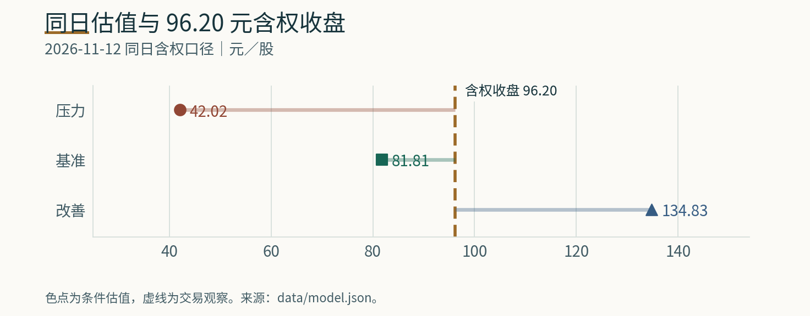

2026-11-12｜元／股｜三情景条件估值，市场点为未复权含权收盘。截至同日可得资料，三情景无概率权重。 [model.json](https://github.com/Loyyed/Investment-Studies-Assistance-Project-Yw-DDL-2026.12.2/blob/5f485482174392124261b1654ed102d16c19030c/docs/cases/688188/deep-research-batch-2/data/model.json)

| 经营情景 | 每股价值·元 | 较96.20元价差 | 收益率差额 | 终值占EV |
| --- | --- | --- | --- | --- |
| 压力 | 42.02 | -54.18 | -56.32% | 60.08% |
| 基准 | 81.81 | -14.39 | -14.96% | 68.44% |
| 改善 | 134.83 | +38.63 | +40.16% | 73.57% |

[研究思维导图](#figure-toc)把客户价值、两次经营检验和现金门槛接到三条估值路径。

[逐年模型](https://github.com/Loyyed/Investment-Studies-Assistance-Project-Yw-DDL-2026.12.2/blob/5f485482174392124261b1654ed102d16c19030c/docs/cases/688188/deep-research-batch-2/data/model.json) · [同日价值桥](https://github.com/Loyyed/Investment-Studies-Assistance-Project-Yw-DDL-2026.12.2/blob/5f485482174392124261b1654ed102d16c19030c/docs/cases/688188/deep-research-batch-2/data/value-bridge.csv) · [证据与版本规则](https://github.com/Loyyed/Investment-Studies-Assistance-Project-Yw-DDL-2026.12.2/blob/5f485482174392124261b1654ed102d16c19030c/docs/cases/688188/deep-research-batch-2/README.md)

### 摘要｜两次检验给了不同的答案

**2022 年，利润下滑与现金释放同时发生。** 营收从 9.13 亿元回落至 8.98 亿元，核心 EBIT 从 4.84 亿元降至 4.34 亿元，CFO−购建从 3.35 亿元升至 5.23 亿元。其中购建少支出约 0.67 亿元。经营现金增量来自哪些订单，要核对到账批次和应收变动。

**2026Q3，卖得更多，毛利率下滑。** 单季收入 6.01 亿元，同比增 16.51%；毛利率降 5.76 个百分点，核心 EBIT 增约 3.34%。扣非归母增 20.83%。核心与报表口径之间的财务、其他收益及减值调整见[单季四指标](#figure-quarterprofit)。单季收现改善和 9 月末贸易占款上升同时出现，接下来要核备货订单的回款及售后成本。

**最强反方。** 高功率换机和硬件配套放大销量与订单额，整机厂也可要求让价、延长质保和付款。若下一期营收、预收继续增长，需用同机型新签和续购净价、两类订单的毛利及对应批次到款和退货，判断新增销售能留下多少现金。

**跟踪顺序。** 先查同机型复购和净价，再核配套订单的售后、库存和回款。量增和利润率能否一起跨过首页门槛，见[价格等值线](#figure-contour)。

#### 图表 02　九章阅读路径

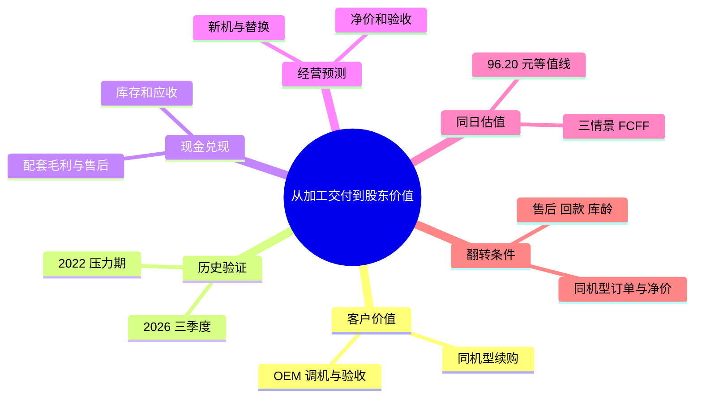

[打开示意图 PNG：从客户价值、历史和现金推到预测、估值与翻转条件的思维导图](./柏楚电子证券投资分析报告11.23一版_图件/02-overview.png)

2016–2026实绩及同日估值窗口｜机制示意｜研究结构与反证路线。正文 40 页；逐年明细和原件索引在同目录证据包。 [README.md](https://github.com/Loyyed/Investment-Studies-Assistance-Project-Yw-DDL-2026.12.2/blob/5f485482174392124261b1654ed102d16c19030c/docs/cases/688188/deep-research-batch-2/README.md) · [claims-and-figures.csv](https://github.com/Loyyed/Investment-Studies-Assistance-Project-Yw-DDL-2026.12.2/blob/5f485482174392124261b1654ed102d16c19030c/docs/cases/688188/deep-research-batch-2/data/claims-and-figures.csv)

- [01 摘要与判断](#chapter-01) · p01
- [02 商业模式与竞争](#chapter-02) · p03
- [03 多年经营阶段](#chapter-03) · p08
- [04 收入、成本和费用](#chapter-04) · p13
- [05 资本、现金和回报](#chapter-05) · p19
- [06 新业务和海外](#chapter-06) · p24
- [07 逐年预测和留出](#chapter-07) · p28
- [08 估值、权益和反推](#chapter-08) · p34
- [09 反方与裁定](#chapter-09) · p39

[三季报原件 p1、p8–11](https://static.cninfo.com.cn/finalpage/2026-10-27/1225622322.PDF) · [价格等值线](https://github.com/Loyyed/Investment-Studies-Assistance-Project-Yw-DDL-2026.12.2/blob/5f485482174392124261b1654ed102d16c19030c/docs/cases/688188/deep-research-batch-2/data/price-contours.csv)

## 第 2 章　商业模式与竞争

整机厂控制采购，终端验收并支付整机价。柏楚能否在下一轮保住客户，要看复用工艺的节省能否抵消替代报价和售后条款。

### 柏楚卡在哪一层｜从光和机到加工结果

激光器出光，光学器件与切割头负责传输和调焦，伺服与机械本体执行运动指令。柏楚的系统居于图纸和设备之间，把轮廓拆成轨迹、速度、气体和穿孔指令。OEM 采购、集成并交工，制造企业在现场验收节拍、精度和安全。柏楚按与 OEM 或项目客户的合同确认部件、系统或服务收入。

系统卖给 OEM 时，终端需求先变成整机订单，再传至控制采购。柏楚直接或经集成商交付整线时，承担的安装、验收、备件和回款责任可能扩大。年报的主营直销描述签约方式，拆分 OEM 和终端制造商需要客户类型与订单。

#### 图表 03　设备、验收与收款的流向

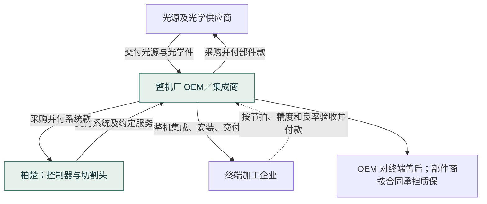

[打开示意图 PNG：光源、柏楚、OEM 和终端之间的采购、交付、验收、付款及售后责任](./柏楚电子证券投资分析报告11.23一版_图件/03-industry.png)

研究截至2026-11-23｜机制示意｜合同职责示意，具体付款、验收及质保逐单核对。流程为产业机制；实际付款和质保依订单。 [mechanisms.md](https://github.com/Loyyed/Investment-Studies-Assistance-Project-Yw-DDL-2026.12.2/blob/5f485482174392124261b1654ed102d16c19030c/docs/cases/688188/deep-research-batch-1/mechanisms.md) · [links.json](https://github.com/Loyyed/Investment-Studies-Assistance-Project-Yw-DDL-2026.12.2/blob/5f485482174392124261b1654ed102d16c19030c/docs/cases/688188/deep-research-batch-2/data/links.json)

**光源／光学**　为工艺提供能量及传输

**控制与头**　图纸、刀路、工艺、随动协调

**OEM／集成**　选型、组装、调试、交工

**终端制造**　按可用产出和合同验收

**现金回流**　终端付整机价；OEM付部件、系统及约定服务

厚板高功率工况的成本常在穿孔、安全与返工，薄板批量则受节拍和排样驱动。管材方案还要处理旋转轴、夹持与干涉，三维方案则处理曲面和姿态。竞争对照固定工件、功率、接口、验收条款及服务地区，比较同工序的速度、合格率和停机时间。

[柏楚 FSCUT4000E 产品资料](https://www.bochu.com/ch/product/fscut4000e/) · [金橙子招股书](https://static.sse.com.cn/stock/disclosure/announcement/c/202209/001048_20220906_D9NX.pdf)

### 控制系统｜旧产品层与新应用层交错

板卡、随动与总线回答控制功能怎样实现。板卡把电脑与设备信号联系起来，随动用于控制切割头与材料表面之间的距离，总线把控制器、伺服与功能单元联接起来。平面、管材、三维回答用户如何加工。一个平面解决方案可以有板卡或总线，也可以将以前单独出售的随动功能集成。2023 年报已说明部分产品集成随动导致原随动销售下降。若只用旧品类的数量求增长，就会把组合调整当成客户流失，或把同一台设备中的多个硬件单元重新计成多套解决方案。

公司各产品的收费以合同里的设备或系统交付计量。软件、控制器及配件若被定价为一组，对外披露的组收入隐含多种功能。2025 年平面、管材、三维收入合计 18.44 亿元，除以 65,064 套是约 2.83 万元的解决方案当量。这个商数提供模型收入起点。它同时含应用、档次、配件和服务影响，无法代表切换前后同一控制器的售价。

#### 图表 04　旧产品分类与主营闭合

2023年报 p24 原本期，质保重列前。 [2023-product-original.csv](https://github.com/Loyyed/Investment-Studies-Assistance-Project-Yw-DDL-2026.12.2/blob/5f485482174392124261b1654ed102d16c19030c/docs/cases/688188/deep-research-batch-2/data/2023-product-original.csv)

| 原产品 | 收入·百万元 | 成本·百万元 | 毛利·百万元 |
| --- | --- | --- | --- |
| 随动 | 170.30 | 22.62 | 147.68 |
| 板卡 | 373.65 | 66.24 | 307.40 |
| 总线 | 327.15 | 44.17 | 282.98 |
| 切割头 | 334.64 | 75.74 | 258.90 |
| 其他 | 190.15 | 60.47 | 129.68 |

条件预测先用归一化规模表示新机，再用适配和份额筛选。存量由历史出货折算。若要把增量归给某个功率段，下一份材料应是同规格整机验收台账，配上供应商重选时的净价、保修期和交付数量。

[2023 年报原产品结构及定位](https://github.com/Loyyed/Investment-Studies-Assistance-Project-Yw-DDL-2026.12.2/blob/5f485482174392124261b1654ed102d16c19030c/docs/cases/688188/deep-research-batch-2/data/2023-product-original.csv) · [2025 出货与库存](https://github.com/Loyyed/Investment-Studies-Assistance-Project-Yw-DDL-2026.12.2/blob/5f485482174392124261b1654ed102d16c19030c/docs/cases/688188/volume-and-stock.csv)

### 为什么同一 OEM 可能续购

首单采购比较硬件报价、工程工时、兼容、供应保障及故障责任。续购时，整机厂还要算换供应商带来的价差，以及重新调机、培训和覆盖质保的成本。原工艺参数越容易复用，沿用系统的节省越大；若平台升级本就要重做开发，优势会收窄。

以试算为例，每台新机更换技术方案要多用两个工程师工作日，假设每天两人的完全工时成本合计 1,600 元、重验导致一天停机损失 2,000 元，换方案须至少节约 5,200 元才抵消首批成本。在 20 台同机型上复用同一次验证时，前述固定成本摊到单台约 260 元，还需另加每台培训及服务。这个例子说明优势和客户规模有关。工时、停机损失及可复用台数是演示条件，证据集没有柏楚客户采购合同据以认定实际金额。

#### 图表 05　续购应分别看到选择、现场成本与价格

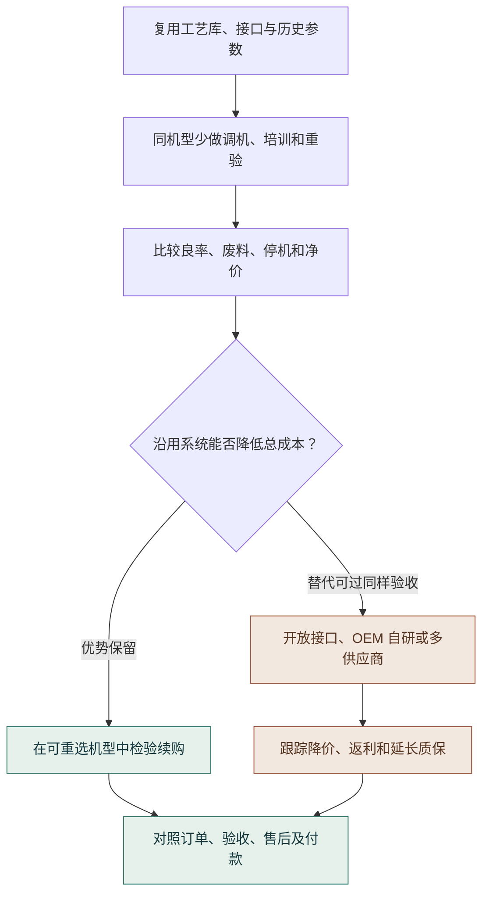

[打开示意图 PNG：同机型复用工艺到续购，以及替代多供与压价的分岔](./柏楚电子证券投资分析报告11.23一版_图件/05-renewal.png)

研究截至2026-11-23｜机制示意｜续购解释与替代路径，未估计客户实际续购率。客户覆盖、实际可重选数和复购数分列。 [mechanisms.md](https://github.com/Loyyed/Investment-Studies-Assistance-Project-Yw-DDL-2026.12.2/blob/5f485482174392124261b1654ed102d16c19030c/docs/cases/688188/deep-research-batch-1/mechanisms.md)

**首选验证**　比较合格工件、兼容和调机工时

**原机留存**　同机型需重新选择的批次作为分母

**单位经济**　净报价＋停机、良率、培训

**竞价风险**　同协议多供或自研且报价更低

扩产时，多家合格供应商都可能增单。区分行业景气和柏楚黏性，要按同一 OEM、同一机型登记在产、重选、替换和留用批次。同机型续购率以具有重选机会的批次为分母；客户覆盖含零采购或停产客户。若更换供应商后良率不变、交付更快且同条件净价下降，黏性解释先失去支持。

[续购机制和补证字段](https://github.com/Loyyed/Investment-Studies-Assistance-Project-Yw-DDL-2026.12.2/blob/5f485482174392124261b1654ed102d16c19030c/docs/cases/688188/deep-research-batch-1/mechanisms.md#1-%E6%8E%A7%E5%88%B6%E7%BB%AD%E8%B4%AD)

### 配套成交与整线验收｜边界越大，承担越多

当 OEM 买控制加切割头，柏楚可减少异构的适配步骤。BCS210E 的产品资料直接标明对 BLT 切割头和若干 FSCUT 系统的适配。另有型号文档包含非波刺头所用放大器，说明方案存在兼容路径。对客户有据的价值是减少对焦、标定、碰撞及现场故障责任拆分，资料不能给出配套后的真实运行良率、终端停机成本或实际付费。报价要以净额读，折扣、返利与退换需要在同订单核对。

当交付从控制扩展到整线，OEM 或集成商依然可能承担机械本体、机器人、工装和现场安全，项目要按验收条款判断收入时点。客户付的预收在验收前形成合同负债，短期提升现金却尚未说明确认收入或改善利润。整线如果需在人机协同、来料公差及现场换产上反复调试，销售增长可能对应更重的资产、应收和现场工时。该差异决定模型中的售后费用、接受率和周转不能只用一个配套比例共同替代。

#### 图表 06　合同边界与现金暴露

典型合同责任分析；具体订单条款待核。 [bundle-cash-thresholds.csv](https://github.com/Loyyed/Investment-Studies-Assistance-Project-Yw-DDL-2026.12.2/blob/5f485482174392124261b1654ed102d16c19030c/docs/cases/688188/deep-research-batch-2/data/bundle-cash-thresholds.csv)

| 交付物 | 付款人及验收 | 增量资金风险 |
| --- | --- | --- |
| 控制 | OEM；约定系统功能及机型调试 | 研发、量产备件、OEM账期 |
| 控制＋头 | OEM；成套匹配及质保 | 部件入库、适配、维修、折扣 |
| 整线及项目 | 集成或工厂；工位与现场验收 | 预收、发出、驻场、尾款和项目购建 |

验收记录应把速度、形位偏差、烧边、停机、联锁和重复加工连到付款节点。发生返工时，从工件或批次追到 OEM、部件商或系统商的实际工时与质保账。缺客户级成本时，图表 23 用每 100 元增量净收入给出配套现金的盈亏条件。

[切割头调高器规格](https://www.bochu.com/ch/product/bcs210e/) · [配套现金条件底表](https://github.com/Loyyed/Investment-Studies-Assistance-Project-Yw-DDL-2026.12.2/blob/5f485482174392124261b1654ed102d16c19030c/docs/cases/688188/deep-research-batch-2/data/bundle-cash-thresholds.csv)

### 竞争要看同一工件、同一控制层和同一批设备

平面中功率的对比对象是同技术路线可替代的切割控制、OEM 自研和多供应商。竞争时可能发生两种相反变化。一种是新工艺越复杂，已积累工艺库的系统越能缩短复制调机时间；另一种是 EtherCAT 等通用接口降低集成成本，设备厂可在第二供应商之间竞价。高功率厚板必须对可运行功率、材料厚度和具体工艺定分母。海外品牌的本地服务和 OEM 自研会改变谁为升级付费；把国内中低功率的供给份额套到海外高功率，会虚增可服务台数与胜率。

金橙子招股书区分振镜和伺服路线，可用于检验精密加工业务边界。在振镜打标和超快微加工，精度、响应和工艺往往由不同部件决定。维宏可比较部分伺服激光数控，德国系统及 OEM 自研可比较同机型形成的替代选项。锐科偏激光源，大族偏整机，分别适合观察价格传导与设备景气。汇川在工业自动化、驱动等多业务的综合估值，无法作为柏楚激光数控业务的直接倍数。任何横向份额都要先拿到时间、地域、功率、设备定义和进货或终端验收分母。

#### 图表 07　同一合同额和设备怎样计一次

分母不足的市场数字留在取证表。 [external-evidence.csv](https://github.com/Loyyed/Investment-Studies-Assistance-Project-Yw-DDL-2026.12.2/blob/5f485482174392124261b1654ed102d16c19030c/docs/cases/688188/deep-research-batch-1/external-evidence.csv)

| 对象 | 条件分母与边界 | 可核对字段 |
| --- | --- | --- |
| 客户覆盖 | 有交易或服务的OEM，不等到期设备 | 客户ID和当期活跃 |
| 新机份额 | 同地域功率、完成采购的设备 | OEM终验台数、采购明细 |
| 续购 | 本期重选且可下单的同机型 | 选择、供应商变更、净价 |
| 附着 | 同一订单有控制和头的验收批次 | 订单头、控制料号与服务 |

研究先观察新增单机净价及服务责任，再估优势持续期。三维收入若来自旧管材机升级，可能改变控制量和售价；预测把每台设备划入新机或存量置换，另外计量独卖硬件和验收后的配套。基准增长的约束依次是可服务新机、可用工艺和取得份额。

[金橙子上交所问询回复](https://static.sse.com.cn/stock/disclosure/announcement/c/202205/001048_20220509_GN1T.pdf) · [可比公司与分母](https://github.com/Loyyed/Investment-Studies-Assistance-Project-Yw-DDL-2026.12.2/blob/5f485482174392124261b1654ed102d16c19030c/docs/cases/688188/peer-screen.csv)

## 第 3 章　多年经营阶段

2016—2021 年的规模扩张建立了历史锚。2022 年检验利润弹性，2023—2025 年的结构变化和 2026 年订单回收检验现金兑现。

### 上市前 2016—2018｜现金随控制业务形成

2016—2018 年招股书合并收入由 1.22 亿元增至 2.45 亿元，营业利润由 0.75 亿元增至 1.51 亿元，经营现金由 0.76 亿元增至 1.39 亿元。控制软件、板卡和支持服务随 OEM 订单扩展。上市前按当时的设备需求和业务分组解释增长，份额、配套和海外规模以各自披露期为准。

2018 年招股书列收入 245,264,062.74 元、成本 46,188,225.97 元、营业利润 151,300,272.74 元、经营现金 139,382,985.49 元，与 2019 年报的 2018 比较列相接。早期软件开发也可能体现为人力及费用化研发，经营门槛要结合费用和购建看。

#### 图表 08　招股书年报原量

招股书 p249、p250；2018与2019年报比较列相勾稽。 [pre-ipo.csv](https://github.com/Loyyed/Investment-Studies-Assistance-Project-Yw-DDL-2026.12.2/blob/5f485482174392124261b1654ed102d16c19030c/docs/cases/688188/deep-research-batch-1/pre-ipo.csv)

| 年度 | 收入·百万元 | 营业利润·百万元 | CFO·百万元 |
| --- | --- | --- | --- |
| 2016 | 122.20 | 74.82 | 75.88 |
| 2017 | 210.38 | 151.15 | 129.14 |
| 2018 | 245.26 | 151.30 | 139.38 |

[招股书 p249–250](https://static.cninfo.com.cn/finalpage/2019-08-02/1206491567.PDF) · [上市前抽取与比较](https://github.com/Loyyed/Investment-Studies-Assistance-Project-Yw-DDL-2026.12.2/blob/5f485482174392124261b1654ed102d16c19030c/docs/cases/688188/deep-research-batch-1/pre-ipo.csv)

### 2019—2021｜扩张把控制收入和购建同时放大

上市年营收 3.76 亿元，2020、2021 年增至 5.71、9.13 亿元，分别约增 51.79%、60.02%；核心 EBIT 从 2.18 亿元升至 4.84 亿元。集团扩张与工艺复用相容，若要判断增长中有多少来自定价与客户黏性，需要同期的设备需求和同机型重选分母。

2019—2021 年现金购建约为 1.13、0.45、1.63 亿元，CFO−购建约为 1.27、3.18、3.35 亿元。2021 年核心利润增加约 1.79 亿元，同口径现金代理只增约 0.18 亿元。购建付款和设备验收跨期开支，预测允许项目先花钱、后确认收入。

#### 图表 09　经营规模与现金的拐点（百万元）

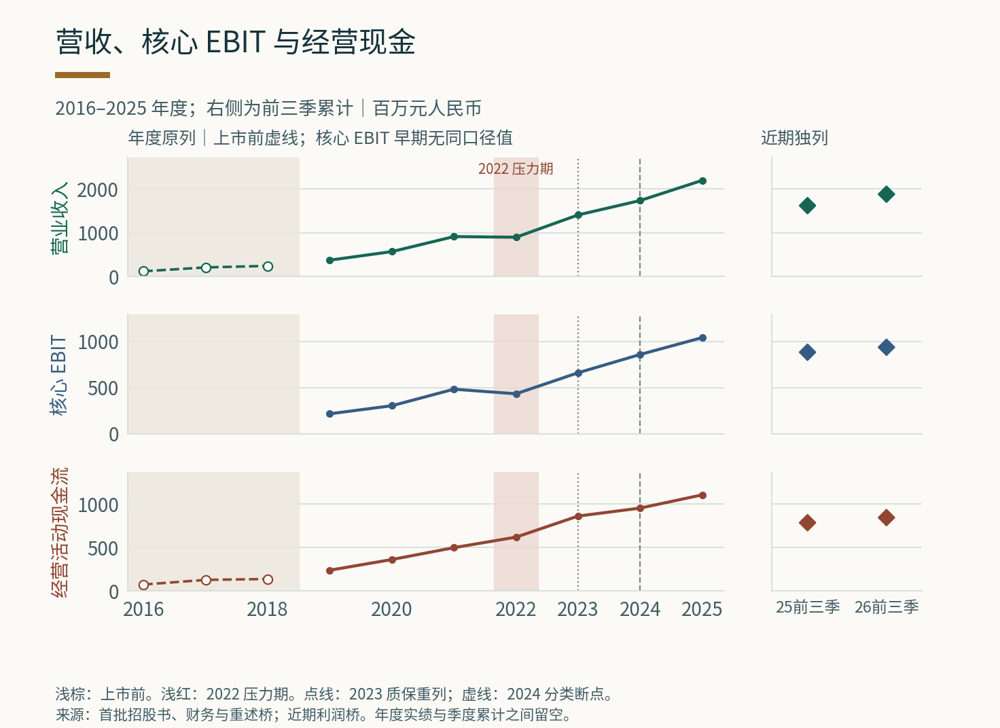

2016–2025年度；2025与2026前三季｜百万元人民币｜年报或招股书实绩与同期累计；核心 EBIT 为同口径重算。集团合并现列；历史成本重分类影响毛利、同额销售费用。 [financial-bridge.csv](https://github.com/Loyyed/Investment-Studies-Assistance-Project-Yw-DDL-2026.12.2/blob/5f485482174392124261b1654ed102d16c19030c/docs/cases/688188/deep-research-batch-1/financial-bridge.csv) · [pre-ipo.csv](https://github.com/Loyyed/Investment-Studies-Assistance-Project-Yw-DDL-2026.12.2/blob/5f485482174392124261b1654ed102d16c19030c/docs/cases/688188/deep-research-batch-1/pre-ipo.csv) · [restatement-bridge.csv](https://github.com/Loyyed/Investment-Studies-Assistance-Project-Yw-DDL-2026.12.2/blob/5f485482174392124261b1654ed102d16c19030c/docs/cases/688188/deep-research-batch-1/restatement-bridge.csv) · [recent-income-bridge.csv](https://github.com/Loyyed/Investment-Studies-Assistance-Project-Yw-DDL-2026.12.2/blob/5f485482174392124261b1654ed102d16c19030c/docs/cases/688188/deep-research-batch-2/data/recent-income-bridge.csv)

展开完整核对表

| 期间 | 合并收入 | 核心EBIT | CFO−购建 |
| --- | --- | --- | --- |
| 2019 | 376 | 218 | 127 |
| 2020 | 571 | 305 | 318 |
| 2021 | 913 | 484 | 335 |
| 2022 | 898 | 434 | 523 |
| 2023 | 1,407 | 662 | 709 |
| 2024 | 1,735 | 860 | 839 |
| 2025 | 2,196 | 1,043 | 1,069 |

右侧两点各为前三季累计。年度与累计之间留空，上市前缺同口径核心 EBIT 的年份也留空。

[2019–2025 年报定位](https://github.com/Loyyed/Investment-Studies-Assistance-Project-Yw-DDL-2026.12.2/blob/5f485482174392124261b1654ed102d16c19030c/docs/cases/688188/deep-research-batch-2/data/annual-evidence.csv) · [跨期利润与现金原额](https://github.com/Loyyed/Investment-Studies-Assistance-Project-Yw-DDL-2026.12.2/blob/5f485482174392124261b1654ed102d16c19030c/docs/cases/688188/deep-research-batch-1/financial-bridge.csv)

### 2022 压力｜利润下降，现金反而释放

2022 年营业收入回落 1.64%，核心 EBIT 同比降 10.29%，核心率从 53.00% 降至 48.33%。成本从 1.80 亿元升至 1.89 亿元，管理和研发费用难随销量同比例下降。该压力期支持在预测中下调毛利，并提高销售管理费率、放慢周转。

CFO 从 4.99 亿元增至 6.19 亿元，约增 1.21 亿元；现金购建从 1.63 亿元降至 0.97 亿元，约少支出 0.67 亿元。CFO−购建改善约 1.87 亿元（各项由原值计算，显示有舍入）。要确认哪批订单收款加快，应把回款、应收和税费分开核到批次。

#### 图表 10　2022年压力的两条线

2022年报p98、p102–103及p107独立抽核。 [independent-audit.json](https://github.com/Loyyed/Investment-Studies-Assistance-Project-Yw-DDL-2026.12.2/blob/5f485482174392124261b1654ed102d16c19030c/docs/cases/688188/deep-research-batch-2/data/independent-audit.json)

| 合并指标 | 2021·百万元 | 2022·百万元 | 变化·百万元 |
| --- | --- | --- | --- |
| 收入 | 913.44 | 898.49 | -14.95 |
| 核心EBIT | 484.08 | 434.25 | -49.83 |
| 报表CFO | 498.73 | 619.28 | 120.55 |
| 现金购建 | 163.45 | 96.76 | -66.70 |
| CFO−购建 | 335.28 | 522.53 | 187.25 |

[2022 独立抽核 p98、p102–103、p107](https://github.com/Loyyed/Investment-Studies-Assistance-Project-Yw-DDL-2026.12.2/blob/5f485482174392124261b1654ed102d16c19030c/docs/cases/688188/deep-research-batch-2/data/independent-audit.json) · [历史现金对照](https://github.com/Loyyed/Investment-Studies-Assistance-Project-Yw-DDL-2026.12.2/blob/5f485482174392124261b1654ed102d16c19030c/docs/cases/688188/deep-research-batch-2/data/cash-history.csv)

### 2023—2025｜增长由分组变化和硬件共同推动

2023 年合并收入回升至 14.07 亿元，年报按板卡、随动、总线、切割头和其他披露。2024 年改按平面、管材、三维及其他解决方案。四组历史收入用 2024 年报的可比同比还原为区间，并以主营合计约束；原披露和可比成本均留在底表。

2025 年合并收入为 21.96 亿元。控制销量增 6.67%，智能硬件增 61.81%，组价与份额明显发生变化。其他主营增长 1.46 亿元，占主营增量约三分之一。管材增长 1.07 亿元，三维增长 0.27 亿元，规模最多的仍是平面增长 1.68 亿元。组合向毛利更薄的组别移动，净效果要看组内价格、原料和履约。这一历史段说明企业可在不显著增加传统控制系统件数的情况下扩大单机方案收入。

#### 图表 11　出货增速分化（套／件当量）

同名范围有随动集成断点，硬件包含配套及单卖。 [volume-and-stock.csv](https://github.com/Loyyed/Investment-Studies-Assistance-Project-Yw-DDL-2026.12.2/blob/5f485482174392124261b1654ed102d16c19030c/docs/cases/688188/volume-and-stock.csv)

| 期间 | 控制系统 | 智能硬件 |
| --- | --- | --- |
| 2024 | 60,993 | 35,118 |
| 2025 | 65,064 | 56,824 |

采用 2024 年报比较列的质保重列把 2023 年营业成本增加 4,426,692.62 元，并将同额从销售费用去掉。毛利变化时使用重列合计，核心 EBIT 保持同值，以免把核算政策变动当成成本效率。2025 年报又把 2024 主营成本性质中的 570.16 万元由制造费用移入原材料，主营成本合计不变。原披露和比较列持续并排。

[2024 年报 p25–27、p153](https://static.cninfo.com.cn/finalpage/2025-04-03/1222993275.PDF) · [两次重列与采用规则](https://github.com/Loyyed/Investment-Studies-Assistance-Project-Yw-DDL-2026.12.2/blob/5f485482174392124261b1654ed102d16c19030c/docs/cases/688188/deep-research-batch-2/data/group-restatement.csv)

### 2026｜将同口径季度接在历史上

2026 年中报和三季报提供累计口径。各年第三季流量分别用前三季减上半年，并以三季报首页的收入核对。营运余额采用报告期末，前三季周转按可比期初期末均值及 273 天计算。

转增节奏也影响比较。原 2025Q3 累计基本每股收益为 3.14 元，2026Q3 列报的 2025 累计比较值为 2.24 元；归母净利润以集团原金额独立对照。本报告对含权冻结日用 10 月登记后的 405,984,426 股。11 月 16 日派息在日期彼岸发生，11 月 10 日公告在冻结日前已知。11 月 20 日路演提供管理层解释，留在期后检验。

#### 图表 12　年内累计与单季闭合

本期和比较均以三季累计减同年上半年。 [recent-income-bridge.csv](https://github.com/Loyyed/Investment-Studies-Assistance-Project-Yw-DDL-2026.12.2/blob/5f485482174392124261b1654ed102d16c19030c/docs/cases/688188/deep-research-batch-2/data/recent-income-bridge.csv)

| 指标 | 2025Q3·百万元 | 2026Q3·百万元 | 2026前三季·百万元 |
| --- | --- | --- | --- |
| 收入 | 516.12 | 601.32 | 1,879.57 |
| 核心EBIT | 260.16 | 268.85 | 938.19 |
| 报告营业利润 | 295.38 | 342.03 | 1,226.03 |
| CFO−购建 | 225.76 | 331.61 | 821.19 |

近期财务证据截至 10 月 27 日公告的三季报。随后披露的说明会和权益实施按各自日期跟踪，便于区分估值日已经知道的事项和后来出现的线索。

[全年度与定期报告证据索引](https://github.com/Loyyed/Investment-Studies-Assistance-Project-Yw-DDL-2026.12.2/blob/5f485482174392124261b1654ed102d16c19030c/docs/cases/688188/deep-research-batch-2/data/annual-evidence.csv) · [季度到物理页复核](https://github.com/Loyyed/Investment-Studies-Assistance-Project-Yw-DDL-2026.12.2/blob/5f485482174392124261b1654ed102d16c19030c/docs/cases/688188/deep-research-batch-2/data/independent-audit.json)

## 第 4 章　收入、成本和费用

2025 年硬件件数增长快于控制系统，主营毛利率下降。先拆组合与组内盈利，再看 2026Q3 的营收、成本和核心利润。

### 收入闭合｜产品、地区、渠道各走各的分母

2024 年主营收入约 17.18 亿元，合并 17.35 亿元；2025 年主营 21.67 亿元、其他业务 0.29 亿元，合并 21.96 亿元。主营按平面、管材、三维和其他闭合，地区、应用和直销是对同一收入的独立拆分。项目增量要与「其他主营」「其他业务」分别核对。

2023 年单列随动、板卡、总线、切割头和其他。次年随动功能可随系统集成，旧产品组与新应用组各自闭合到主营。四组收入区间取自 2024 可比同比，2023 比较成本取重列原数，具体区间与舍入分界见表。

#### 图表 13　按解决方案重组收入（百万元）

2023三列保留到0.001百万元见CSV。采用值与主营精确闭合；比较成本直接取重列表。 [group-restatement.csv](https://github.com/Loyyed/Investment-Studies-Assistance-Project-Yw-DDL-2026.12.2/blob/5f485482174392124261b1654ed102d16c19030c/docs/cases/688188/deep-research-batch-2/data/group-restatement.csv)

| 分组 | 2023桥接下限 | 2023闭合采用 | 2023桥接上限 | 2024 | 2025 |
| --- | --- | --- | --- | --- | --- |
| 平面解决方案 | 1,005.78 | 1,005.82 | 1,005.87 | 1,124.81 | 1,292.91 |
| 管材解决方案 | 275.14 | 275.15 | 275.16 | 380.23 | 487.45 |
| 三维解决方案 | 7.21 | 7.21 | 7.21 | 36.78 | 63.89 |
| 其他主营 | 107.71 | 107.71 | 107.71 | 176.05 | 322.39 |

地区、渠道和主营、其他的 48 项勾稽保留在首批。国内大区和海外直客及间接出口不能用相同分母。2025 华东约 15.52 亿元，相对 2024 的 12.29 亿元增加约 3.23 亿元；华中和华南由 3.89 至 4.59 亿元。其余三地含华北、东北及其他，2025 合计约 1.55 亿元。五区闭合到主营，直销也独立闭合至 21.67 亿元。地区与渠道的成本均可在勾稽表中独立追踪。按同公司披露的收货地计算出口代理，也只用于可比报表口径，不能认定终端设备去向。

[四组收入成本及区间](https://github.com/Loyyed/Investment-Studies-Assistance-Project-Yw-DDL-2026.12.2/blob/5f485482174392124261b1654ed102d16c19030c/docs/cases/688188/deep-research-batch-2/data/group-restatement.csv) · [地区、渠道和两套合计勾稽](https://github.com/Loyyed/Investment-Studies-Assistance-Project-Yw-DDL-2026.12.2/blob/5f485482174392124261b1654ed102d16c19030c/docs/cases/688188/deep-research-batch-1/classification-check.csv)

### 营收驱动｜出货、价与结构各自解释什么

2019—2023 的历史产品数量与 2024—2025 的同名控制系统已发生变化。近两年同名控制出货为 60,993 和 65,064 套，智能硬件出货为 35,118 和 56,824 套。出货比由 57.58% 升至 87.34%。硬件可能单卖、补库存或替换，也可能一台整机需要多件。比值不能成为实际附着率。相应的集团组均金额约由 2.82 万元增至 3.33 万元，组件和整体方案共同变动使该商数不同于同 SKU 净价。

新机及替换决定投标量，适配和 OEM 采购决定实际获单，折扣、返利和退换决定净价。同订单附着按验收量计，独卖留在硬件组。延迟交付或验收可能形成发出商品、应收或预收，收入依据合同节点确认。出货比约束硬件规模，真实附着率要按控制与硬件的同合同配对计算。

#### 图表 14　2024→2025主营量与组价桥

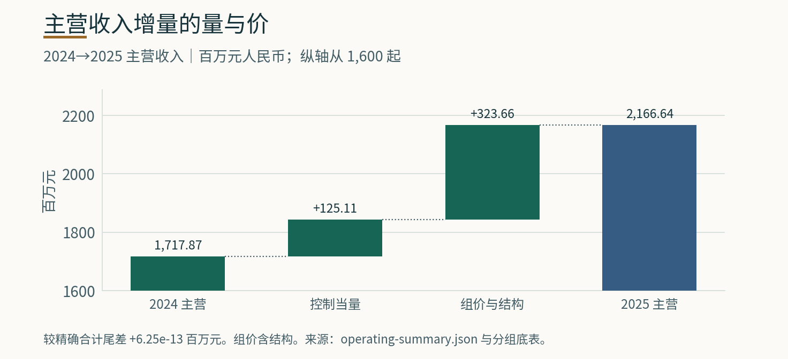

2024→2025主营｜百万元人民币｜原披露合计与量价算术；组均价格含组合。组均额叠加组合影响，保留参数代理边界。 [operating-summary.json](https://github.com/Loyyed/Investment-Studies-Assistance-Project-Yw-DDL-2026.12.2/blob/5f485482174392124261b1654ed102d16c19030c/docs/cases/688188/operating-summary.json) · [group-restatement.csv](https://github.com/Loyyed/Investment-Studies-Assistance-Project-Yw-DDL-2026.12.2/blob/5f485482174392124261b1654ed102d16c19030c/docs/cases/688188/deep-research-batch-2/data/group-restatement.csv)

| 项目 | 增加·百万元 | 下一次核对 |
| --- | --- | --- |
| 主营收入增量 | 448.77 | 四组收入和其他业务 |
| 控制当量所示量 | 125.11 | 同订单设备、控件和替换 |
| 组均实现与结构 | 323.66 | 同机型净价、退返、配套分布 |

2024→2025 以同名控制出货作为规模代理，原模型把主业收入变化中约 1.25 亿元归规模、其余约 3.24 亿元归组均金额和结构。解释后者需要每个机型功率、净价、地域、旧机替换及是否配切割头的明细。把 6.67% 控制量增长和 61.81% 硬件量增长都加到总收入回归，会把同订单多部件算成两次终端需求。

[原出货和库存](https://github.com/Loyyed/Investment-Studies-Assistance-Project-Yw-DDL-2026.12.2/blob/5f485482174392124261b1654ed102d16c19030c/docs/cases/688188/volume-and-stock.csv) · [历史量价区间及组内拆分](https://github.com/Loyyed/Investment-Studies-Assistance-Project-Yw-DDL-2026.12.2/blob/5f485482174392124261b1654ed102d16c19030c/docs/cases/688188/operating-summary.json)

### 毛利桥｜毛利额增长，利润率被组合挤压

毛利桥按四组主营业务拆组合和组内影响。2023 比较收入取自 2024 年报的可比同比区间，2024、2025 使用完整实际列。其他业务对合并毛利率的影响在主营桥之外。

2024→2025 主营毛利率降约 2.61 个百分点，组合权重贡献 −1.38，组内贡献 −1.23。份额上升的其他主营毛利薄于三类方案，平面、管材组内也承压。三维组增长快，绝对毛利约增 0.23 亿元。要区分让价和产能利用率，需取得同机型净价、材料单耗与售后金额。

#### 图表 15　主营毛利率中点贡献（百分点）

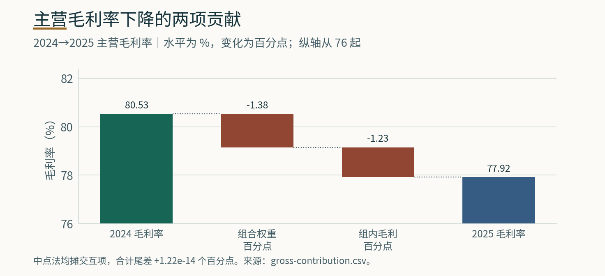

2024→2025主营｜%／百分点｜原披露与中点分解；表另含2023衔接的区间采用值。每段按两期中点，交叉项均摊；含2023则组收入为区间估计。 [gross-contribution.csv](https://github.com/Loyyed/Investment-Studies-Assistance-Project-Yw-DDL-2026.12.2/blob/5f485482174392124261b1654ed102d16c19030c/docs/cases/688188/deep-research-batch-2/data/gross-contribution.csv) · [group-restatement.csv](https://github.com/Loyyed/Investment-Studies-Assistance-Project-Yw-DDL-2026.12.2/blob/5f485482174392124261b1654ed102d16c19030c/docs/cases/688188/deep-research-batch-2/data/group-restatement.csv)

| 分组 | 23→24权重 | 23→24组内 | 24→25权重 | 24→25组内 |
| --- | --- | --- | --- | --- |
| 平面解决方案 | -5.409 | +0.658 | -4.766 | -0.718 |
| 管材解决方案 | +2.133 | -0.209 | +0.313 | -0.701 |
| 三维解决方案 | +1.373 | -0.102 | +0.660 | +0.050 |
| 其他主营 | +1.241 | +0.452 | +2.412 | +0.138 |
| 合计 | -0.662 | +0.799 | -1.381 | -1.231 |

由 2023→2024 的比较看，组合分散先出现，组内改善一度能抵消一部分。下一年两个影响同向，增长模式的边际成本才更明显。预测给压力路径更高硬件占比影响及更低硬件毛利，给改善路径更高技术适配及回收效率。把当前分组权重固定到稳定期只保留在一项敏感性，不用于三条预测线的统一事实。

[收入与毛利贡献底表](https://github.com/Loyyed/Investment-Studies-Assistance-Project-Yw-DDL-2026.12.2/blob/5f485482174392124261b1654ed102d16c19030c/docs/cases/688188/deep-research-batch-2/data/gross-contribution.csv) · [2024、2025 原分组](https://github.com/Loyyed/Investment-Studies-Assistance-Project-Yw-DDL-2026.12.2/blob/5f485482174392124261b1654ed102d16c19030c/docs/cases/688188/product-bridge.csv)

### 成本和费用｜哪些随销量，哪些随能力

2025 主营成本 4.7839 亿元，原材料 3.8270 亿元，人工 0.2748 亿元，制造 0.6433 亿元，运费约 0.0388 亿元。2024 同口径的材料为 2.6557 亿元、制造为 0.4855 亿元，原披露分别为 2.5987 和 0.5425 亿元。采购规模和更多硬件使原材料成为重要的成本驱动。自制部件可能降低材料支出占比却增加制造费和资本占用，不能仅以材料变化判定毛利是否改善。2025 实施行保留发行人空白或比较金额，使用已披露成本总额控制，不把推得的极小尾差作为新增成本。

保证类质保在 2023 比较列重列至营业成本，销售费用同额下调，核心 EBIT 不变。预测中的新增服务率是边际费用条件。按项目判断时，将预计保修、实付维修及额外现场交付分开核单。

#### 图表 16　材料、人工与制造的比较桥

2025余项不按质保分配；2024材料与制造比较列等额变动。 [cost-attribution.csv](https://github.com/Loyyed/Investment-Studies-Assistance-Project-Yw-DDL-2026.12.2/blob/5f485482174392124261b1654ed102d16c19030c/docs/cases/688188/deep-research-batch-2/data/cost-attribution.csv)

| 性质 | 2023重列·百万元 | 2024原列 | 2024次年比较 | 2025 |
| --- | --- | --- | --- | --- |
| 原材料 | 231.38 | 259.87 | 265.57 | 382.70 |
| 人工 | 13.54 | 18.16 | 18.16 | 27.48 |
| 制造 | 26.73 | 54.25 | 48.55 | 64.33 |
| 运输 | 1.81 | 2.16 | 2.16 | 3.88 |
| 实施 | 0.22 | 0.00 | 0.00 | — |
| 2025其余直接成本合计 | — | — | — | 0.00 |

2025 年集团销售、管理、研发分别约 1.37、1.56、3.41 亿元。研发提供控制算法与工艺库，有复用的可能，同时会占用尤其是新应用验证的人时。模型以各费用金额占组后收入或硬件收入计算，调稳定核心利润率时把增量作为独立经营节约。另设一项税金及附加，避免购建或税后模型再次计算同一项。

[成本性质比较列](https://github.com/Loyyed/Investment-Studies-Assistance-Project-Yw-DDL-2026.12.2/blob/5f485482174392124261b1654ed102d16c19030c/docs/cases/688188/deep-research-batch-2/data/cost-attribution.csv) · [2025年报 p27–30、p125–126](https://static.cninfo.com.cn/finalpage/2026-04-10/1225091045.PDF)

### 2026Q3｜为何四个指标给了四个读数

第三季合并营业收入从 5.1612 增至 6.0132 亿元，营业成本从 1.2119 增至 1.7581 亿元，毛利只增加 3,058.18 万元。毛利率从 76.52% 降至 70.76%，下降约 5.76 个百分点。销售费增加约 225.41 万元，管理约 1,061.24 万元，研发约 884.64 万元，税附约 17.59 万元。扣除后核心 EBIT 从 2.6016 增至 2.6885 亿元，增加约 869.30 万元。

报表营业利润单季从 2.9538 升至 3.4203 亿元。核心以外的净增约 3,795.58 万元，其中其他收益增加约 4,294.77 万元。负财务费用的正贡献缩小约 265.23 万元，投资收益减少约 176.61 万元，公允价值变动下降约 285.95 万元，信用减值回转相对同期增加约 228.90 万元。所得税费用单季变动不大，营业外支出下降，得到集团净利约 3.1636 亿元，扣少数损益约 304.67 万元后为归母约 3.1331 亿元。形成了比核心 EBIT 更快的股东利润增长。

#### 图表 17　2026Q3带来的利润变化

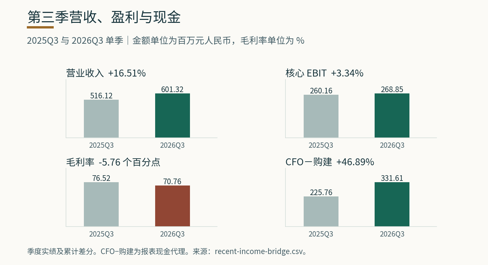

2025Q3、2026Q3单季｜百万元人民币／%｜实际口径及同期累计差分，CFO－购建为现金代理。其他收益来自独立累计差分；扣非归母3.0212亿元是季报首页披露。 [recent-income-bridge.csv](https://github.com/Loyyed/Investment-Studies-Assistance-Project-Yw-DDL-2026.12.2/blob/5f485482174392124261b1654ed102d16c19030c/docs/cases/688188/deep-research-batch-2/data/recent-income-bridge.csv) · [filing-cells.csv](https://github.com/Loyyed/Investment-Studies-Assistance-Project-Yw-DDL-2026.12.2/blob/5f485482174392124261b1654ed102d16c19030c/docs/cases/688188/deep-research-batch-1/filing-cells.csv)

展开完整核对表

| 核心桥（百万元） | 2025Q3 | 2026Q3 | 绝对变动 |
| --- | --- | --- | --- |
| 收入 | 516.12 | 601.32 | 85.20 |
| 成本 | 121.19 | 175.81 | 54.62 |
| 毛利 | 394.92 | 425.51 | 30.58 |
| 核心营业利润 | 260.16 | 268.85 | 8.69 |
| 其他收益 | 2.05 | 45.00 | 42.95 |
| 报告营业利润 | 295.38 | 342.03 | 46.65 |
| 归母 | 264.20 | 313.31 | 49.12 |

四个小图各用自己的纵轴。收入、核心 EBIT 与现金按同比百分比读，毛利率按百分点读。

扣非归母 3.0212 亿元，同比增 20.83%。发行人依非经常性损益规则列报；预测核心 EBIT 则按经营科目重算。要判断其他收益会否持续，应查补贴性质、金额和收现时点。公允变动与理财归入证券价值，避免两次计入。

[三季报 p1、p8–9](https://static.cninfo.com.cn/finalpage/2026-10-27/1225622322.PDF) · [合并利润到归母逐项桥](https://github.com/Loyyed/Investment-Studies-Assistance-Project-Yw-DDL-2026.12.2/blob/5f485482174392124261b1654ed102d16c19030c/docs/cases/688188/deep-research-batch-2/data/recent-income-bridge.csv)

### 净利润、净价与现金预测的分界

2026 前三季报表营业利润约 12.2603 亿元，核心 EBIT 约 9.3819 亿元。利息收入 0.9106 亿元列在财务费用下，随资金规模、利率、期限变化。基准把资金收益归入金融资产。其他收益若有稳定经营来源及回款，可在后续更新经营现金。

归母以合并净利扣少数股东损益，期间 EPS 还受转增、激励和加权股本影响。当前估值用估值日登记股数。要扩展 2026 归母及会计 EPS 预测，需补金融利息、少数股权利润、税率及期间加权股本。

#### 图表 18　从销售到归母的口径链

利息收入是财务费用子项，调整只进一次。 [analysis-ebit-bridge.csv](https://github.com/Loyyed/Investment-Studies-Assistance-Project-Yw-DDL-2026.12.2/blob/5f485482174392124261b1654ed102d16c19030c/docs/cases/688188/analysis-ebit-bridge.csv)

**核心EBIT**　营业收入减成本及四项经营费

**报表营业利润**　扣原符号财务费，加其他收益、投资公允、减值、处置

**合并净利**　计营业外收支，扣报表所得税

**归母**　从合并净利扣少数损益

**扣非归母**　发行人按法定非经常项目调整

2025 解决方案增长既可由更多有效设备带来，也可由配套价格和交付内容扩大带来。未来通过同机型报价复核毛利时，采购返利应减去有效价格，折扣先从单机毛利扣除，非约定售后再从向股东可留下的现金扣除。只有这些字段在同一份订单验收与收款链上匹配，才能说某季度配套提升了单位经济利益。

[正常化核心 EBIT 历史桥](https://github.com/Loyyed/Investment-Studies-Assistance-Project-Yw-DDL-2026.12.2/blob/5f485482174392124261b1654ed102d16c19030c/docs/cases/688188/analysis-ebit-bridge.csv) · [季度原数与口径](https://github.com/Loyyed/Investment-Studies-Assistance-Project-Yw-DDL-2026.12.2/blob/5f485482174392124261b1654ed102d16c19030c/docs/cases/688188/deep-research-batch-2/data/recent-income-bridge.csv)

## 第 5 章　资本、现金和回报

库存与应收决定已确认的收入什么时候变成现金。2022 年和 2026 年的现金证据，再落到每 100 元配套净收入的盈亏条件。

### 三条现金线｜报表流量、估值流量和股东现金

2025 年实际收现、经营估值现金和股东分配对应三项不同决策。销售收款可能来自以前期订单并含税，经营支出还涉及应付结算、研发、税费、押金。股东最终收到多少，要看公司经营留存、债务和分配决策。

2025 CFO 约 11.04 亿元，减购建后约 10.69 亿元。在统一的窄贸易资本、历史折旧和 13% 经营税代理下，历史 FCFF 约 8.20 亿元，差约 2.49 亿元。差额包含经营与金融科目、现金财政收益、非贸易营运项目、收付时点及其他定义。不能用净利或财务利润填平。2025 所得税费用和现金流表支付各项税费应并列。后者包括多类税，不能除以利润总额作为所得税率。

#### 图表 19　历史现金回收的三种尺度

历史代理缺长期租赁及完整其他营运资本，差额保留。 [cash-history.csv](https://github.com/Loyyed/Investment-Studies-Assistance-Project-Yw-DDL-2026.12.2/blob/5f485482174392124261b1654ed102d16c19030c/docs/cases/688188/deep-research-batch-2/data/cash-history.csv)

展开完整核对表

| 年度 | CFO·百万元 | CFO−购建 | 经营FCFF代理 | 差额 |
| --- | --- | --- | --- | --- |
| 2019 | 239.90 | 126.62 | 69.11 | -57.51 |
| 2020 | 362.47 | 317.56 | 201.54 | -116.02 |
| 2021 | 498.73 | 335.28 | 186.38 | -148.91 |
| 2022 | 619.28 | 522.53 | 304.65 | -217.88 |
| 2023 | 860.94 | 709.42 | 373.02 | -336.40 |
| 2024 | 952.44 | 839.23 | 621.75 | -217.48 |
| 2025 | 1,104.32 | 1,069.12 | 819.82 | -249.30 |

经营租赁按净租金代理计入 FCFF，财务性质租赁从权益桥扣债。历史折旧与实付租赁是否重合，要回查租约和账龄。研发已进核心 EBIT；若另算研发资本回报，应按业务寿命和摊销同步重构资本与 NOPAT。

[年度现金与资本底表](https://github.com/Loyyed/Investment-Studies-Assistance-Project-Yw-DDL-2026.12.2/blob/5f485482174392124261b1654ed102d16c19030c/docs/cases/688188/deep-research-batch-2/data/cash-history.csv) · [历史利润、D&A及占款代理](https://github.com/Loyyed/Investment-Studies-Assistance-Project-Yw-DDL-2026.12.2/blob/5f485482174392124261b1654ed102d16c19030c/docs/cases/688188/deep-research-batch-1/capital-and-cash-bridge.csv)

### 2022 和 2026 的现金改善不走同一条路

2022 年 CFO 增约 1.21 亿元、购建少约 0.67 亿元，核心利润少约 0.50 亿元时 CFO−购建仍达 5.23 亿元。2026 年单季 CFO−购建从约 2.26 亿元升至 3.32 亿元，增长约 46.89%；三季累计从 7.61 亿元升至 8.21 亿元，约增 7.88%。单季改善部分抵消了上半年偏弱。

前三季销售商品、提供劳务收到的现金增加约 2.72 亿元，税费返还增加约 0.46 亿元，其他经营收现增加约 1.14 亿元。另一方面，买商品和接受劳务的付款多约 2.22 亿元，职工付现多约 0.98 亿元，税费与其他付款共增加约 0.53 亿元，合计得到经营净现金增量 0.5880 亿元。购建减少约 117.70 万元，构成前三季 CFO−购建增量的其余部分。增长主要来自收现和其他经营流入，购建下降不是这次的主要原因。

#### 图表 20　前三季现金流同比贡献

现金流量正负为净流影响；净增58.8023百万元。 [cfo-change.csv](https://github.com/Loyyed/Investment-Studies-Assistance-Project-Yw-DDL-2026.12.2/blob/5f485482174392124261b1654ed102d16c19030c/docs/cases/688188/deep-research-batch-2/data/cfo-change.csv)

展开完整核对表

| 现金流量单项 | 2025·百万元 | 2026·百万元 | 对CFO变化 |
| --- | --- | --- | --- |
| 销售商品、提供劳务收到的现金 | 1,635.90 | 1,907.68 | 271.78 |
| 收到的税费返还 | 55.67 | 101.67 | 46.00 |
| 收到其他与经营活动有关的现金 | 60.60 | 174.85 | 114.24 |
| 购买商品、接受劳务支付的现金 | 238.70 | 460.95 | -222.24 |
| 支付给职工及为职工支付的现金 | 374.63 | 473.02 | -98.39 |
| 支付的各项税费 | 267.64 | 287.31 | -19.66 |
| 支付其他与经营活动有关的现金 | 86.59 | 119.52 | -32.93 |

销售收现改善与期末备货并存。区分配套收款、以前期应收和其他款项，需要将开票账龄、预收、融资条件和回款批次对到客户。预测保持经营现金税率和分组营运参数，待这些字段明确后再调整配套贡献。

[前三季收付现金变动](https://github.com/Loyyed/Investment-Studies-Assistance-Project-Yw-DDL-2026.12.2/blob/5f485482174392124261b1654ed102d16c19030c/docs/cases/688188/deep-research-batch-2/data/cfo-change.csv) · [季度区间独立抽核](https://github.com/Loyyed/Investment-Studies-Assistance-Project-Yw-DDL-2026.12.2/blob/5f485482174392124261b1654ed102d16c19030c/docs/cases/688188/deep-research-batch-2/data/independent-audit.json)

### 库存怎样改变经济性

以应收账款加存货减应付账款，2025 年 9 月末约 2.9754 亿元，2026 年 6 月末约 4.3697 亿元，9 月末约 4.7116 亿元。较上年 9 月，贸易窄占款增约 1.7362 亿元。6 月到 9 月，应收减少约 0.47 亿元，应付减少约 0.04 亿元，存货增加约 0.77 亿元。即使回款改善，库存在相同窗口依然提高了生产和安全库存的资金承诺。三季报 p7 合同负债约 1.5099 亿元，较 2025 年末 1.3239 亿元增加约 0.1860 亿元。预收能抵消部分占款，但实物验收和应收没有交叉归到同一订单。

2025→2026 前三季库存天数由约 146.58 天升至 175.22 天，应收由 22.56 至 24.85 天，应付由 39.55 至 50.05 天。应付天数暂用成本作为代理，下一步用净采购和存货组成复核；半年和三季度各用匹配的累计天数。

#### 图表 21　贸易营运资本分项

占款仅包含贸易子项；表头为期末，天数用平均余额另算。 [trade-days.csv](https://github.com/Loyyed/Investment-Studies-Assistance-Project-Yw-DDL-2026.12.2/blob/5f485482174392124261b1654ed102d16c19030c/docs/cases/688188/deep-research-batch-2/data/trade-days.csv)

| 期末 | 应收·百万元 | 存货 | 应付 | 净贸易占款 |
| --- | --- | --- | --- | --- |
| 2025-YTD9 | 144.22 | 216.23 | 62.90 | 297.54 |
| 2026-H1 | 222.03 | 326.23 | 111.29 | 436.97 |
| 2026-YTD9 | 174.76 | 403.39 | 107.00 | 471.16 |

库存有价值要满足后续交付速度、订单覆盖和未减值的条件。对原材料、在制、成品、发出商品分别索取金额、库龄和订单可撤销期，明确其中多少已获预付款，多少与潜在换机和试验直接相关。若第一批回款下降，同时库存天数和应付天数升高，账面负债缓冲不能弥补未来坏账或折价。若见管理层所说安全库存释放、原材料降龄，现金桥的稳定营运资本假设才有向好证据。

[营运天数与分母](https://github.com/Loyyed/Investment-Studies-Assistance-Project-Yw-DDL-2026.12.2/blob/5f485482174392124261b1654ed102d16c19030c/docs/cases/688188/deep-research-batch-2/data/trade-days.csv) · [合同负债余额证据](https://github.com/Loyyed/Investment-Studies-Assistance-Project-Yw-DDL-2026.12.2/blob/5f485482174392124261b1654ed102d16c19030c/docs/cases/688188/deep-research-batch-2/data/contract-liabilities.csv)

### 投入资本回报｜高存量回报和负增量可以并存

本稿窄经营资本使用净贸易资本、固定资产以及可提取的在建资产，不把金融资产计进经营，也不将所有研发资本化。因此 2022 平均资本约 3.64 亿元、经营 NOPAT 代理约 3.78 亿元，平均 ROIC 代理超过 100%。同年 NOPAT 较上年减少约 0.43 亿元、资本增加约 0.77 亿元，当期窄增量回报约 −56%。存量历史功能和新项目的回报完全可能方向相反。2025 代理的高值也受窄分母和购建回落影响，不能据此把长期新增 ROIC 设成同样高。

采购可以早于转固、交付和验收。维修、扩产、技改与一次性现场配套按资产卡和付款节点对照，募投资金累计投入还涉及研发及共用能力。估值以 23.5% 稳定增量回报为基准，压力 14%、改善 32%；项目投入延期或共用应同步调整付款和回收时间。

#### 图表 22　窄口径历史资本与回报

研发费用化、小资本分母等限制跨业务比较。 [capital-returns.csv](https://github.com/Loyyed/Investment-Studies-Assistance-Project-Yw-DDL-2026.12.2/blob/5f485482174392124261b1654ed102d16c19030c/docs/cases/688188/deep-research-batch-2/data/capital-returns.csv)

展开完整核对表

| 年度 | 平均经营资本·百万元 | NOPAT代理 | 平均ROIC | 增量ROIC |
| --- | --- | --- | --- | --- |
| 2019 | — | 189.39 | — | — |
| 2020 | 92.67 | 265.26 | 286.24% | 81.59% |
| 2021 | 232.09 | 421.15 | 181.46% | 83.87% |
| 2022 | 363.67 | 377.80 | 103.88% | -56.08% |
| 2023 | 503.27 | 575.80 | 114.41% | 98.08% |
| 2024 | 650.80 | 748.23 | 114.97% | 185.04% |
| 2025 | 740.84 | 907.15 | 122.45% | 182.90% |

稳定期要求再投资 NOPAT 的比例等于长期增速除以新增 ROIC。保持同样长期增速时，增量效率越低，越多现金要留在经营，不宜以 2025 极低购建率外推。2027—2029 项目购建按情景独立提出，2031—2035 净再投资向终值纪律靠拢。只要延期、共用产能或维修性质变化证据出现，就更新付款曲线及回报，不把募投预算全额放入同一年。

[历史平均及增量 ROIC 的可辨认范围](https://github.com/Loyyed/Investment-Studies-Assistance-Project-Yw-DDL-2026.12.2/blob/5f485482174392124261b1654ed102d16c19030c/docs/cases/688188/deep-research-batch-2/data/capital-returns.csv) · [预测资本与稳定期公式](https://github.com/Loyyed/Investment-Studies-Assistance-Project-Yw-DDL-2026.12.2/blob/5f485482174392124261b1654ed102d16c19030c/docs/cases/688188/deep-research-batch-2/forecast.py)

### 配套净现金｜每 100 元多卖出来的条件

配套增量按同 OEM、同机型或同批次比较。折扣、返利、退换及非标安装影响净成交，成本、让利、适配和售后影响税前利润，首批还要建立存货和净应收并支付购建。后续订单按经营资本余额变动进入 FCFF。

**毛利相同，首批现金可以翻负。** 每 100 元增量硬件净收入按 50% 硬件毛利率、安装 4 元、控制组让利 2 元、售后 5 元、现金税率 13%、首批购建 3 元、应付 50 天计算。库存 **110 天**、应收 **45 天**，占款 20.55 元，留下 **10.38 元**；库存 **150 天**、应收 **65 天**，占款 31.51 元，留下 **−0.58 元**。后者要转正，售后支出须低于约 4.34 元。

#### 图表 23　50%硬件毛利时的首批现金敏感性

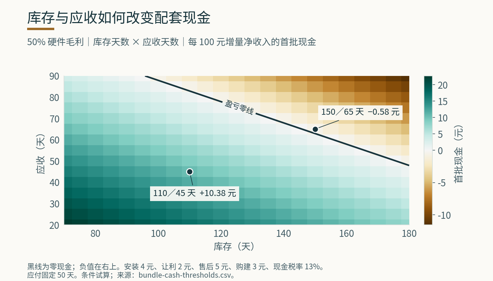

2026-11-12模型窗口的条件试算｜天；元／每100元增量净收入｜50%硬件毛利、原公式逐格计算，黑线为零现金。每100元增量净收入的条件试算；首批建立资本。 [bundle-cash-heatmap.csv](https://github.com/Loyyed/Investment-Studies-Assistance-Project-Yw-DDL-2026.12.2/blob/5f485482174392124261b1654ed102d16c19030c/docs/cases/688188/deep-research-batch-2/data/bundle-cash-heatmap.csv) · [bundle-cash-thresholds.csv](https://github.com/Loyyed/Investment-Studies-Assistance-Project-Yw-DDL-2026.12.2/blob/5f485482174392124261b1654ed102d16c19030c/docs/cases/688188/deep-research-batch-2/data/bundle-cash-thresholds.csv)

| 库存／应收天 | 首批占款·元 | 服务5元后现金 | 售后上限 |
| --- | --- | --- | --- |
| 150／65 | 31.51 | -0.58 | 4.34 |
| 110／45 | 20.55 | 10.38 | 16.93 |
| 85／29 | 12.74 | 18.19 | 25.91 |

下一步用同功率、用途和保修期的净报价、入库记录、终端验收、退货和发票到账天数，核对模型的库存与增量售后。若预付款抵消延长账期，按同一订单净算，避免高估占款。

[首批现金及售后上限全网格](https://github.com/Loyyed/Investment-Studies-Assistance-Project-Yw-DDL-2026.12.2/blob/5f485482174392124261b1654ed102d16c19030c/docs/cases/688188/deep-research-batch-2/data/bundle-cash-thresholds.csv) · [同价阈值](https://github.com/Loyyed/Investment-Studies-Assistance-Project-Yw-DDL-2026.12.2/blob/5f485482174392124261b1654ed102d16c19030c/docs/cases/688188/deep-research-batch-2/data/price-contours.csv)

## 第 6 章　新业务和海外

切割头有批量销售证据，焊接与微加工的可识别增量取决于实际订单、验收和回款。管理层期后答复用于跟踪这些节点。

### 从能加工到能回款｜四项业务共用同一验收规则

切割头已有可证销售，智能硬件总出货是规模代理，附着率需匹配同单。免示教弧焊公开证据走到方案与合作，订单要验证复杂来料、装夹及成批换线。锂电激光焊已有项目规划，后续核电池线良率、在线检测和验收周期。超快精密微加工已有产品规格，需要量产验收及重复回款。

#### 图表 24　项目进入基准要逐层通过

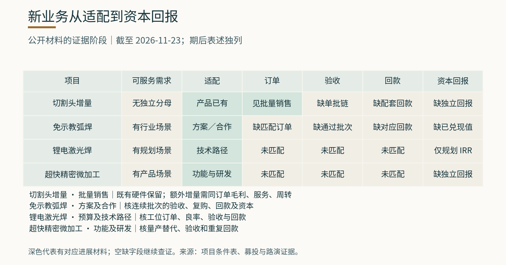

证据截至2026-11-23｜项目 × 证据阶段｜公开材料及期后管理层表述，条件规模另列。设备测试与公司公告是证据层，不是订单已转化。 [commercialization-stages.csv](https://github.com/Loyyed/Investment-Studies-Assistance-Project-Yw-DDL-2026.12.2/blob/5f485482174392124261b1654ed102d16c19030c/docs/cases/688188/deep-research-batch-2/data/commercialization-stages.csv) · [project-conditional-scale.csv](https://github.com/Loyyed/Investment-Studies-Assistance-Project-Yw-DDL-2026.12.2/blob/5f485482174392124261b1654ed102d16c19030c/docs/cases/688188/deep-research-batch-2/data/project-conditional-scale.csv) · [project-stages.csv](https://github.com/Loyyed/Investment-Studies-Assistance-Project-Yw-DDL-2026.12.2/blob/5f485482174392124261b1654ed102d16c19030c/docs/cases/688188/deep-research-batch-1/project-stages.csv) · [post-window.csv](https://github.com/Loyyed/Investment-Studies-Assistance-Project-Yw-DDL-2026.12.2/blob/5f485482174392124261b1654ed102d16c19030c/docs/cases/688188/deep-research-batch-2/data/post-window.csv)

**需求**　可服务工厂、可适配设备数及规格

**适配**　试样合格率、验证周期及成本

**订单**　净价、批次和取消条款

**验收**　交付、工位利用与保修

**收款·回报**　按账期到账，分摊并回收购建

条件规模表按订单数乘净价。以锂电激光焊为例，20～160 个工位、单位净价 11 万元，对应 220 万～1,760 万元收入，用来测试占款及购建后能否留现金。切割头留在硬件组，其余三个项目在三条主路径的可识别增量为零，历史合并收入中的残余仍按原口径保留。

[六层项目与条件规模](https://github.com/Loyyed/Investment-Studies-Assistance-Project-Yw-DDL-2026.12.2/blob/5f485482174392124261b1654ed102d16c19030c/docs/cases/688188/deep-research-batch-2/data/project-conditional-scale.csv) · [精密激光控制产品资料](https://www.bochu.com/ch/product/fscut7000/)

### 切割头募投修正｜不能把首发批次称为全项目

首发批次承诺募集资金 **2.183967 亿元**，累计投入 **0.184063 亿元**。再融资批次承诺 **3.701219 亿元**，累计投入 **1.493854 亿元**。两批汇总募集承诺 **5.885186 亿元**，累计 **1.677917 亿元**。全项目原总投资 **6.183967 亿元**，与募集承诺差 0.298781 亿元。按同一承诺分母累计投入占约 28.51%。不能把首发比例当全项目，更不能用全项目实际资金除智能硬件总销量得到每套资本消耗。

结项公告同时披露原智能焊接机器人及控制系统产业化项目，首发 1.068286 亿元、投入 0.083274 亿元，再融资承诺 2.941366 亿元、投入 0.464497 亿元。截至公告基准日，两原项目合计实际约 2.225688 亿元，公告计划投资调至 2.225689 亿元，差 0.01 万元为汇总尾差。资金结项和设备产能实际兑现是两个计量阶段。需将设备交付能力、良率、订单和回款对接到承诺项目，而不能因资金使用率低就称资本回报高。

#### 图表 25　切割头支出范围（万元）

批次表原项目预算重复列示；聚合承诺和实际，不能把原投资加两次。 [project-stages.csv](https://github.com/Loyyed/Investment-Studies-Assistance-Project-Yw-DDL-2026.12.2/blob/5f485482174392124261b1654ed102d16c19030c/docs/cases/688188/deep-research-batch-1/project-stages.csv)

| 取数范围 | 原项目投资 | 募集承诺 | 已投入募集资金 | 物理页 |
| --- | --- | --- | --- | --- |
| 计划与累计支出 | 61839.67 | 58851.86 | 16779.17 | 6 |
| 首发资金 | 61839.67 | 21839.67 | 1840.63 | 9 |
| 再融资资金 | 61839.67 | 37012.19 | 14938.54 | 10 |

节余转投新建研发中心二期、智能产线机器人和锂电焊接智能方案，使用专户。与本次结项并行的超高精密驱控一体在基本达到研发目标后也有永久补流。2026H1 募资专项说明年内合计永久补充流动资金约 1.640624 亿元，来源包括多项原募集项目，不能都分配给切割头。后续按项目专户、实施协议、共用设备和出入库凭证核各路资金。

[结项公告 p6、p9–14](https://static.cninfo.com.cn/finalpage/2026-01-01/1224913692.PDF) · [中报专项 p24、p33、p39–42](https://static.cninfo.com.cn/finalpage/2026-08-18/1225477139.PDF)

### 焊接和精密加工｜什么证据才能纳入现金预测

新研发中心二期由上海柏楚电子实施，预算约 1.6720 亿元。智能产线机器人及锂电焊接项目涉及柏楚电子和柏楚数控，产业化预算分别为 4.84393 亿元和 2.492646 亿元，建设期均延至 2028 年底。前者管理层测算税后 IRR 26.93%、达产盈亏平衡利用率 41.97%，后者分别为 10.38% 和 60.31%。这三组预算和集团目前的现金购建、财务资产并非同一概念。净回报应在项目主体与共用产能的费用、资金和资本归属明确后计算。

免示教弧焊的可核台账需要给出工件品类、现场调试、订单和重复产线、产线通过率与客户付款节点。锂电激光焊更需识别是工位控制、传感、焊头、设备还是一套整线购买。精密微加工可先用公司产品料号证明规格，再核买的是试样还是标配生产。任一试点退出条件都应最少注明生产良率和重复订单，未过关或服务条款持续加码需要下修挂账业务规模及回款天数。

#### 图表 26　条件规模与首批现金区间

均为明确情景尺度。前三个新项目增量不纳入三条主预测。 [project-conditional-scale.csv](https://github.com/Loyyed/Investment-Studies-Assistance-Project-Yw-DDL-2026.12.2/blob/5f485482174392124261b1654ed102d16c19030c/docs/cases/688188/deep-research-batch-2/data/project-conditional-scale.csv)

| 项目 | 条件台数／工位 | 条件营收·百万元 | 剔专用购建首批现金·百万元 |
| --- | --- | --- | --- |
| 切割头增量 | 3000–10000 | 13.50–45.00 | 0.95–3.16 |
| 免示教弧焊 | 50–400 | 2.50–20.00 | -0.04–-0.29 |
| 锂电激光焊 | 20–160 | 2.20–17.60 | -0.10–-0.82 |
| 超快精密微加工 | 100–700 | 3.50–24.50 | 0.25–1.72 |

一旦取得合同、验收和回款，按工位将净价、可归属数量及未验收情景分别入表，再由实际账龄推经营资金，判断项目回报能否覆盖 WACC。付款按集团对外实际支出归期，共用设备及内部增资按项目主体对账。

[项目实施与阶段原表](https://github.com/Loyyed/Investment-Studies-Assistance-Project-Yw-DDL-2026.12.2/blob/5f485482174392124261b1654ed102d16c19030c/docs/cases/688188/deep-research-batch-1/project-stages.csv) · [独立规模条件](https://github.com/Loyyed/Investment-Studies-Assistance-Project-Yw-DDL-2026.12.2/blob/5f485482174392124261b1654ed102d16c19030c/docs/cases/688188/deep-research-batch-2/data/project-conditional-scale.csv)

### 海外和 11 月 20 日路演｜把线索留给下一次检验

海外业务有两种不同账。直接海外客户由柏楚确认产品收入并承担交付、币种和当地服务；国内 OEM 装配后销往海外时，柏楚的直接客户仍是国内设备厂，产品收入已经在原销售统计。应按订单号、设备序列及终端去向去重。将目的地海外的设备数量按整机终端价格乘一次，再加上国内同单销售，集团两次拿到一份收入。验证分母应是相同汇率、结算条款和销售地点的设备或收入。

11 月 20 日说明会排在估值窗口之后。转录中管理层对高功率表示收入和份额随产品发展提高，也在征集问答称方案份额保持稳定，未给可复算时段和分母。配套回答强调方案与应用扩张，未给附着率上限。船舶焊接及流程回答给出合作和能力方向，未披露设备交付、验收和回款。关于存货，公司解释前置备货可保障连续交付与防范供应链中断。Q&A 中提问人引用的同比、环比和产业归因，不能替代原表。

#### 图表 27　路演期后答复及下一步

2026-11-20会后转录，隔离于含权估值窗。 [post-window.csv](https://github.com/Loyyed/Investment-Studies-Assistance-Project-Yw-DDL-2026.12.2/blob/5f485482174392124261b1654ed102d16c19030c/docs/cases/688188/deep-research-batch-2/data/post-window.csv)

| 议题 | 可回读管理层答复 | 需要的披露 |
| --- | --- | --- |
| 高功率 | 收入和市场地位表述，未给分母 | 按功率段、地区及OEM装机 |
| 配套 | 丰富方案，未给实际附着及上限 | 同订单硬件附着与净价 |
| 船舶焊接 | 设备厂合作、方案方向 | 订单有效期、验收与收款 |
| 备货 | 前置安全库存与供应韧性 | 积压年龄、订单覆盖及扣退货现金 |

备货解释只有在订单覆盖、库存库龄、交付后到账及旧库存售出同时改善时才会支持上修资本周转。若库存继续老化或未能随验收回收，则下调周转及配套现金。转录与三季报披露日的差异见文末「依据与研究边界」。

[上证路演原入口](https://roadshow.sseinfo.com/activityDetails/42275) · [可读会议转录](https://financialfilings.com/filings/shanghai-bochu-electronic-technology-corporation-limited/call-meeting-transcript/2026/76423776/)

## 第 7 章　逐年预测和留出

新机与置换决定订单量，净价、验收及资产占用决定现金。留出误差用于检查这一过程对设备景气和产品分类是否敏感。

### 从可服务设备到控制量｜每台只进一个池

新机订单由可服务整机量、适配比例和取得份额决定；换机订单由历史出货折算存量、置换周期与同机型续购概率决定。海外是销售地标签。2025 年历史控制销量 65,064 套用于约束归一化规模；两个池分别需要客户新机、替换和验收台账。

模型将可服务池归一为 10 万、适配 80%、取得 61%，将既有出货折作年流量的 3.2 倍存量，再按 8 年置换及续购条件计算。可更新归一化参数的证据是新增型号、认证批次、替换周期和维护故障；设备景气走弱时，即使保持份额，也需重估新机量。

#### 图表 28　每台设备只经过一个控制订单池

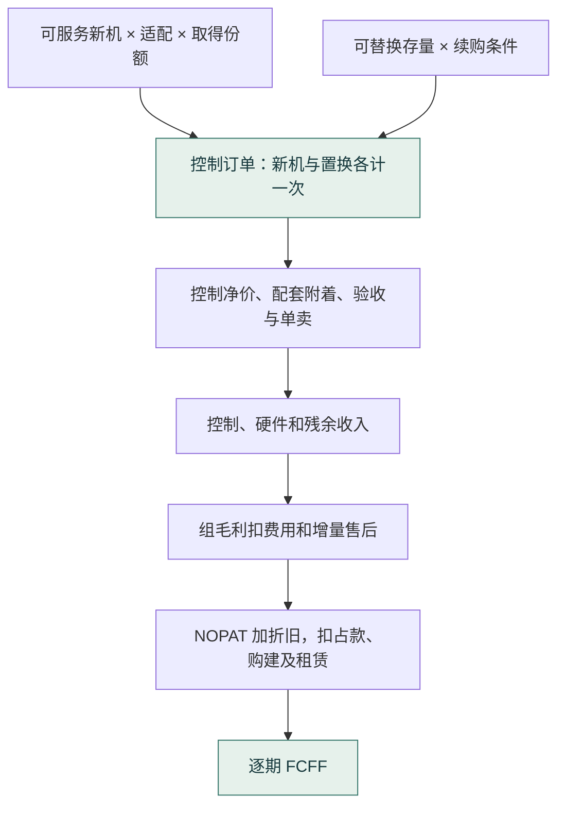

[打开示意图 PNG：新机和置换、控制订单、配套验收、利润与 FCFF 的预测驱动图](./柏楚电子证券投资分析报告11.23一版_图件/28-drivers.png)

2026全年估计至2036稳定期｜机制示意｜预测计算次序；各输入条件及未披露字段保留在模型。系统销量锚可核，池规模和客户转化为条件。 [assumptions.json](https://github.com/Loyyed/Investment-Studies-Assistance-Project-Yw-DDL-2026.12.2/blob/5f485482174392124261b1654ed102d16c19030c/docs/cases/688188/deep-research-batch-2/assumptions.json) · [forecast.csv](https://github.com/Loyyed/Investment-Studies-Assistance-Project-Yw-DDL-2026.12.2/blob/5f485482174392124261b1654ed102d16c19030c/docs/cases/688188/deep-research-batch-2/data/forecast.csv)

**新机**　候选量 × 技术适配 × 赢单份额

**存量**　过往控制曝险 ÷ 周期 × 同机型留存

**收入**　控制量×组价＋硬件和残余，配套以验收为门

**现金**　组毛利、费用、税，再扣周转及购建

基准假设再可服务候选新机年增 6.4%，可适配比例和取得份额小幅拓宽，存量续购条件取 63.4%。压力把候选增长放慢至 2.8%，取得变化转弱且续购 56%；改善则为 9.4% 与 69%。这些值由历史主要在 2022 下行、2025 同名系统只增 6.67% 和 2026 组合扩张共同约束，不外推早年合并营收同比。

[场景假设及口径](https://github.com/Loyyed/Investment-Studies-Assistance-Project-Yw-DDL-2026.12.2/blob/5f485482174392124261b1654ed102d16c19030c/docs/cases/688188/deep-research-batch-2/assumptions.json) · [逐年驱动输出](https://github.com/Loyyed/Investment-Studies-Assistance-Project-Yw-DDL-2026.12.2/blob/5f485482174392124261b1654ed102d16c19030c/docs/cases/688188/deep-research-batch-2/data/forecast.csv)

### 从控制量到验收净额｜价和硬件各算一次

单机控制量先乘组均净价。当量的历史收入来自平面、管材、三维三组，可观察到同名系统数量但组内有混合单。硬件收入只从其他主营估算一块锚，基准占该组 80%，剩余主营及其他业务进入残余。应用方案里可能还有硬件，报告按既有合并收入总额避免重复加入同一组。未来如能拆同一机型的定制硬件，重新归类组价及物料，不直接增加合计。

历史硬件出货 56,824，模型用归一化附着 55% 乘控制量得到配套计划，差额作单卖基数。未来先将当期计划按验收比例转已验收，迟延的一期以后接回，只有验收或合同政策满足才计收入。基准采用 97.5% 当期验收、净售价条件 +1.4%（控制组当量）和 +0.4%（硬件当量）。验收延期与售后费用分开，避免用费率反推客户是否验收。新增研报中潜在项目如已在既有合并收入，仍留在原残余，只有增强的可识别贡献才加新业务。

#### 图表 29　基准前四年控制与硬件量

预测；接受含前期未验收且本期接回的条件数量。 [forecast.csv](https://github.com/Loyyed/Investment-Studies-Assistance-Project-Yw-DDL-2026.12.2/blob/5f485482174392124261b1654ed102d16c19030c/docs/cases/688188/deep-research-batch-2/data/forecast.csv)

| 年度 | 新机当量 | 换机当量 | 配套接受 | 单卖硬件 | 控制组价·元 |
| --- | --- | --- | --- | --- | --- |
| 2027 | 55,900 | 17,643 | 43,023 | 25,134 | 29,461 |
| 2028 | 60,067 | 18,651 | 49,071 | 27,471 | 29,873 |
| 2029 | 64,540 | 19,963 | 54,784 | 30,026 | 30,291 |
| 2030 | 69,343 | 21,430 | 61,113 | 32,819 | 30,715 |

2026 前三季未披露同模型分组量价，利用 YTD 合并实际和模型 Q4 闭合两类代理收入后得到 2026 残余。基准从旧锚向该差额保留 75%，其余暂按旧组价和规模走。压力保留 45%，改善 85%。保留率较高也可能让毛利率较低的残余占比上升。本行先承认观测不到的范围，再将能在年报中核对的变动留作测试项。

[2025 原组收入与数量](https://github.com/Loyyed/Investment-Studies-Assistance-Project-Yw-DDL-2026.12.2/blob/5f485482174392124261b1654ed102d16c19030c/docs/cases/688188/product-bridge.csv) · [验收、价格、残余组逐年列](https://github.com/Loyyed/Investment-Studies-Assistance-Project-Yw-DDL-2026.12.2/blob/5f485482174392124261b1654ed102d16c19030c/docs/cases/688188/deep-research-batch-2/data/forecast.csv)

### 2026Q4｜以季节和最新报表截点组成全年

2025 年合并全年营收 21.9563 亿元，前三季 16.1960 亿元，差得 Q4 5.7604 亿元，约占全年 26.24%。按该季占比为单位的季度基准，基准 Q4 约 1.80 万套控制当量、组价约 2.91 万元，以及约 1.64 万件硬件当量，得到收入 **6.23 亿元**，核心 EBIT **3.00 亿元**。已披露 2026 前三季收入 18.7957 亿元、核心 9.3819 亿元保持原金额，和第四季相加才得全年业务。厚板和配套需求强时改善验收与折扣，弱时允许季度低于上年。Q4 产品数与组价是条件，加总到披露时仍需核物理产品区间。

#### 图表 30　2026Q4预测与前三季保持隔离

Q4量价为条件；桩段现金折现使用11月12日至12月31日。 [model.json](https://github.com/Loyyed/Investment-Studies-Assistance-Project-Yw-DDL-2026.12.2/blob/5f485482174392124261b1654ed102d16c19030c/docs/cases/688188/deep-research-batch-2/data/model.json)

| 路径 | Q4控制量 | 组价·元 | Q4收入·百万元 | Q4核心EBIT | 估值桩段折现 |
| --- | --- | --- | --- | --- | --- |
| 压力 | 16,819 | 27,353 | 553.44 | 228.41 | 99.47 |
| 基准 | 17,977 | 29,054 | 623.42 | 300.44 | 155.01 |
| 改善 | 19,012 | 30,613 | 689.33 | 366.22 | 202.03 |

估值纳入 11 月 12 日收盘后现金。第四季 NOPAT 加折旧代理，扣购建、租赁及相对 9 月末的营运余额变化，再按 49/92 取桩段，距估值基准 49/365 年折现。若项目现金集中结算，优先用合同支付日期替换均匀收现条件。全年 FCFF 用于经营分析。

基准预计 2026 年末贸易资金占用部分回落，2027 继续释放；2028 虽然利润增长，较高经营起点会限制同比现金增量。下一份年报若显示安全库存未释放，应下修现金路径，重点核年末库龄、预收和应付匹配。

[四季度输入和桩段逐项](https://github.com/Loyyed/Investment-Studies-Assistance-Project-Yw-DDL-2026.12.2/blob/5f485482174392124261b1654ed102d16c19030c/docs/cases/688188/deep-research-batch-2/data/model.json) · [估值现金时点](https://github.com/Loyyed/Investment-Studies-Assistance-Project-Yw-DDL-2026.12.2/blob/5f485482174392124261b1654ed102d16c19030c/docs/cases/688188/deep-research-batch-2/data/value-bridge.csv)

### 三条经营路径｜收入先变，现金靠兑现

基准 2027—2030 控制量从约 73,544 套增至 90,773 套。控制组受量价驱动，硬件随附着增长，三组毛利率各自计算。核心 EBIT 扣销售、管理、研发、税附和增量服务。2027 的现金改善还含库存和付款节奏回归，稳定期增长仍受可用购建及新增资本回报约束。

#### 图表 31　三情景逐年现金（百万元）

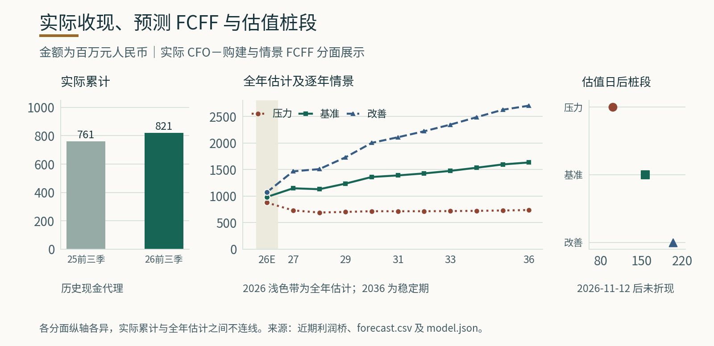

2025/26前三季；2026–2036情景及截点桩段｜百万元人民币｜左实绩现金代理，中间全年估计及预测，右估值日后未折现现金。2026展示全年，估值只折现桩段。2036取稳定期。中间年及各费用在CSV。 [recent-income-bridge.csv](https://github.com/Loyyed/Investment-Studies-Assistance-Project-Yw-DDL-2026.12.2/blob/5f485482174392124261b1654ed102d16c19030c/docs/cases/688188/deep-research-batch-2/data/recent-income-bridge.csv) · [forecast.csv](https://github.com/Loyyed/Investment-Studies-Assistance-Project-Yw-DDL-2026.12.2/blob/5f485482174392124261b1654ed102d16c19030c/docs/cases/688188/deep-research-batch-2/data/forecast.csv) · [model.json](https://github.com/Loyyed/Investment-Studies-Assistance-Project-Yw-DDL-2026.12.2/blob/5f485482174392124261b1654ed102d16c19030c/docs/cases/688188/deep-research-batch-2/data/model.json)

展开完整核对表

| 期间 | 压力收入 | 压力FCFF | 基准收入 | 基准FCFF | 改善收入 | 改善FCFF |
| --- | --- | --- | --- | --- | --- | --- |
| 2026 | 2,433.01 | 877.88 | 2,502.99 | 983.11 | 2,568.90 | 1,072.18 |
| 2027 | 2,237.30 | 730.40 | 2,669.56 | 1,147.34 | 2,970.98 | 1,466.71 |
| 2028 | 2,254.29 | 690.58 | 2,909.88 | 1,129.77 | 3,414.10 | 1,508.95 |
| 2029 | 2,269.36 | 701.52 | 3,174.54 | 1,235.24 | 3,918.48 | 1,731.44 |
| 2030 | 2,286.81 | 715.19 | 3,465.12 | 1,360.56 | 4,495.82 | 2,003.67 |
| 2035 | 2,414.34 | 728.31 | 4,346.06 | 1,597.58 | 6,259.19 | 2,628.89 |
| 2036 | 2,445.72 | 737.77 | 4,446.02 | 1,634.32 | 6,440.70 | 2,705.13 |

压力路径更少的订单适配和替换、更大的折扣、更低硬件毛利、更慢周转和更高维护与项目支出；改善路径具备更高净价、同订单附着及验收和较低现金成本。2026–2035 三条逐年底表包括各项费用、财务前的所得税代理、折旧、贸易资本、现金购建和 FCFF。2035 收入以稳定增速对照，2036 终端资本留存收敛至稳定条件。财务收益、其他收益以及分部少数净利另归桥，EPS 不用估值日股数替代未披露期间加权股本。

只要同机型回款加快且合格率持稳，改善参数可先用于库存与边际服务；单见增销无需同时把续购、售价、收入全上调。反之如果延期验收、库存变老且毛利下降，应先切压力的应收和服务，避免待销售折价完全显现才下修。

[含 2026、2027–35 及稳定期的全部模拟输出](https://github.com/Loyyed/Investment-Studies-Assistance-Project-Yw-DDL-2026.12.2/blob/5f485482174392124261b1654ed102d16c19030c/docs/cases/688188/deep-research-batch-2/data/forecast.csv) · [现金留存与利润路径](https://github.com/Loyyed/Investment-Studies-Assistance-Project-Yw-DDL-2026.12.2/blob/5f485482174392124261b1654ed102d16c19030c/docs/cases/688188/deep-research-batch-2/data/model.json)

### 年报留出｜高增长外推何时失效

按先前最新已发布年报固定历史窗口，每次用相邻两次同比的中位数预测次年，并用“原规模持平”作朴素对照。2022 留出冻结在 2022-04-15，输入 2019—2021 三份首次年报，得到收入预测约 14.24 亿元，实际 8.98 亿元，误差 +58.50%。扩大期两年同比将景气、份额和其他价格共同送入外推，遇 2022 回撤即失效。持平条件误差仅 +1.66%，提供了对压力预测的尺度观察。

2023 从 2020—2022 年开头，训练含一个低谷，预测 11.61 亿元、实际 14.07 亿元，误差 −17.51%。2024 从 2021—2023 的收入恢复，误差 +3.37%，但不能区分 2024 新应用分组和实际获单的贡献。2025 从 2022—2024 训练，误差 +10.64%。另外，以 2024 同名销量同比直接外推 2025 控制系统，旧留出误差 −16.41%，因为随动集成引起了单位断点。模型不使用历史合并增速作为等值控制台数变化。

#### 图表 32　封存原财年后的留出误差

同时保留原规模持平基线，所有目标实际均来自次年公告。 [annual-holdouts.csv](https://github.com/Loyyed/Investment-Studies-Assistance-Project-Yw-DDL-2026.12.2/blob/5f485482174392124261b1654ed102d16c19030c/docs/cases/688188/deep-research-batch-2/data/annual-holdouts.csv)

| 目标年 | 截止日 | 预测百万元 | 实际百万元 | 误差 |
| --- | --- | --- | --- | --- |
| 2022 | 2022-04-15 | 1,424.09 | 898.49 | +58.50% |
| 2023 | 2023-04-11 | 1,160.78 | 1,407.11 | -17.51% |
| 2024 | 2024-03-20 | 1,793.87 | 1,735.46 | +3.37% |
| 2025 | 2025-04-03 | 2,429.14 | 2,195.63 | +10.64% |

四次留出按当年可获资料计算，具体披露日及来源 ID 见底表。历史误差支持把适配、验收及周转分开估计，季度新数可分别更新各项参数。

[年报留出样本、发布时间与误差](https://github.com/Loyyed/Investment-Studies-Assistance-Project-Yw-DDL-2026.12.2/blob/5f485482174392124261b1654ed102d16c19030c/docs/cases/688188/deep-research-batch-2/data/annual-holdouts.csv) · [历史控制量留出](https://github.com/Loyyed/Investment-Studies-Assistance-Project-Yw-DDL-2026.12.2/blob/5f485482174392124261b1654ed102d16c19030c/docs/cases/688188/inputs.json)

### 券商反例｜集团预测接近，分项仍会错得很远

浙商 2023-10 的财务表给 2025 收入 23.14 亿元，正文写 23.10 亿元，对最终 21.9563231292 亿元分别高估约 5.391052% 和 5.208872%。原报告用随动、板卡、总线和其他分类，不能无误映射为 2025 应用解决方案，只回测集团和有明确定义的归母。华创 2025-04-08 给 21.45 亿元，低估 2.306047%，三维收入却预报 1.40 亿元，对实际 0.6389 亿元高估 119.12%。平面低估约 0.64 亿元，管材高约 0.24 亿元。总偏差不大说明组内方向可以互相抵销，模型需单列延迟和终端应用。

华创图 49 页注亿元，三维 2025E 成本原印 **2795.03**。按印值亿元毛利失真。仅将该格按万元折算，成本 **0.279503 亿元**、毛利率约 **80.04%**，与印列 80% 接近。平面 2.21、管材 0.66、其他 1.27、条件三维 0.279503，合计 4.419503 亿元，距表列集团 4.43 亿元尚差 **0.010497 亿元**。该差可能来自舍入和范围，保留原值，待券商底表，严禁用换算后的单位当公司实际原数。

#### 图表 33　同年集团与分业务外部留出

华创三维成本原印及单位诊断见同源补表。 [forecast-holdout.csv](https://github.com/Loyyed/Investment-Studies-Assistance-Project-Yw-DDL-2026.12.2/blob/5f485482174392124261b1654ed102d16c19030c/docs/cases/688188/deep-research-batch-1/forecast-holdout.csv)

| 预测口径 | 预计·百万元 | 实际·百万元 | 误差 |
| --- | --- | --- | --- |
| 浙商 集团营业收入 | 2,314.00 | 2,195.63 | +5.39% |
| 浙商 集团营业收入 | 2,310.00 | 2,195.63 | +5.21% |
| 华创 集团营业收入 | 2,145.00 | 2,195.63 | -2.31% |
| 华创 三维解决方案 | 140.00 | 63.89 | +119.12% |

十篇材料与控制量、净价、产品毛利、项目兑现及终值分别关联。S8 可识别的方法为远期 DCF 和末年利润倍数。详细参数尚缺原文，正文的 15/25/35 倍由本稿自设，配合稳定增长测试做边界对比。

[十篇材料逐条主张](https://github.com/Loyyed/Investment-Studies-Assistance-Project-Yw-DDL-2026.12.2/blob/5f485482174392124261b1654ed102d16c19030c/docs/cases/688188/deep-research-batch-1/external-evidence.csv) · [券商留出](https://github.com/Loyyed/Investment-Studies-Assistance-Project-Yw-DDL-2026.12.2/blob/5f485482174392124261b1654ed102d16c19030c/docs/cases/688188/deep-research-batch-1/forecast-holdout.csv) · [华创单位诊断](https://github.com/Loyyed/Investment-Studies-Assistance-Project-Yw-DDL-2026.12.2/blob/5f485482174392124261b1654ed102d16c19030c/docs/cases/688188/deep-research-batch-2/data/analyst-unit-test.csv)

## 第 8 章　估值、权益和反推

同日新基准低于含权收盘。价值桥说明差额从哪里来，等值线再把缺口还原成控制增速、稳定利润率和履约条件。

### 同日新旧价值｜沿用价格，重算兑现节奏

估值日为 2026-11-12 上交所 15:00 收盘，未复权含权价 **96.20 元**，经济股数 **405,984,426 股**。冻结基准 **92.75774737785618 元**、原 WACC **6.9274187472%**。冻结价回代 2027 控制量增速 7.5334057567% 或稳定核心 EBIT 率 49.8011297326%，均回到 96.20。它们是旧费用、周转和终值假设下的两条单变量根。本稿用不同的经营分组、资本现金机制，因此要重解联合条件。

#### 图表 34　从冻结估值到新稿（元/股）

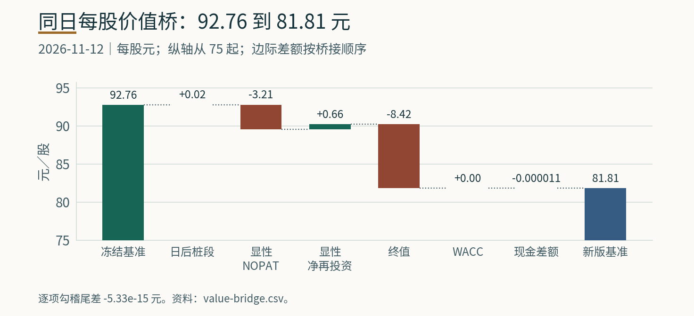

2026-11-12｜元／股｜冻结值到新版条件估值的桥接。沿用同日的WACC、合并证券权利及权益桥；完整精度留在CSV。 [value-bridge.csv](https://github.com/Loyyed/Investment-Studies-Assistance-Project-Yw-DDL-2026.12.2/blob/5f485482174392124261b1654ed102d16c19030c/docs/cases/688188/deep-research-batch-2/data/value-bridge.csv)

展开完整核对表

| 桥项 | 边际价差 | 过桥价 |
| --- | --- | --- |
| 冻结基准 | 起点 | 92.758 |
| 估值日后桩段 | +0.018 | 92.776 |
| 显性期经营NOPAT | -3.208 | 89.568 |
| 显性期净再投资 | +0.662 | 90.230 |
| 终值路径 | -8.418 | 81.812 |
| 同日WACC | +0.000 | 81.812 |
| 货币资金与现金等价物差额 | -0.000 | 81.812 |

新版基准为 **81.81 元**，较冻结值低 **10.95 元**。估值日后桩段约 +0.02 元，显性期经营 NOPAT 约 −3.21 元，显性期净再投资差约 +0.66 元，终值约 −8.42 元。WACC 相同；另扣 4,600 元非现金等价物，约 −0.00001133 元/股。客户从可服务设备池走到验收、组价和回款的条件越严格，长期兑现现金越少。

[同日价值桥全精度](https://github.com/Loyyed/Investment-Studies-Assistance-Project-Yw-DDL-2026.12.2/blob/5f485482174392124261b1654ed102d16c19030c/docs/cases/688188/deep-research-batch-2/data/value-bridge.csv) · [第一批冻结回执](https://github.com/Loyyed/Investment-Studies-Assistance-Project-Yw-DDL-2026.12.2/blob/5f485482174392124261b1654ed102d16c19030c/docs/cases/688188/deep-research-batch-1/valuation-reproduction.json)

### FCFF、WACC 和终值｜让长期纪律接到当期现金

折现率沿用阶段 14 的人民币口径近似。十年国债参考 1.60%，ERP 估计 5.32%，周度 β 用三分之二样本与三分之一单位回归。极少量金融与融资类租赁债务使用市场权重及税盾。基准 WACC **6.9274%**。每个显性期从估值日期起折现，首段 49 天，后面逐年接上而不是把全年的 2026 现金当新收入。净营运增加、资本开支和经营租赁都已经在 FCFF 扣除。

基准终值占企业价值 **68.44%**。稳定增长 2.30%、新增 ROIC 23.50%，对应约 **9.79%** 留存。稳定 NOPAT 约 **18.12 亿元**，再投入约 **1.77 亿元**，余下 FCFF 约 **16.34 亿元**。保持增长不变时，更低的新增 ROIC 会增加留存；WACC 与长期增长率越接近，估值对假设越敏感。

#### 图表 35　同一长期增长下的资本纪律对照

联合变化层的完整网格可下载。 [terminal-sensitivity.csv](https://github.com/Loyyed/Investment-Studies-Assistance-Project-Yw-DDL-2026.12.2/blob/5f485482174392124261b1654ed102d16c19030c/docs/cases/688188/deep-research-batch-2/data/terminal-sensitivity.csv)

| WACC | g | 新增ROIC | 价值·元 | 终值占EV |
| --- | --- | --- | --- | --- |
| 5.93% | 2.30% | 23.50% | 101.24 | 74.21% |
| 6.93% | 2.30% | 14.00% | 77.55 | 67.58% |
| 6.93% | 2.30% | 23.50% | 81.81 | 68.44% |
| 6.93% | 2.30% | 32.00% | 83.48 | 68.74% |
| 7.93% | 2.30% | 23.50% | 69.30 | 63.15% |

退出法用末年核心营业利润的 15、25、35 倍分别替换 Gordon 终值，沿用同一折现、股数及现金权益。两种终值下价格跨度大，显示长期盈利和资本留存比当期报表净利更能影响同日价值。

[WACC×g×新增ROIC](https://github.com/Loyyed/Investment-Studies-Assistance-Project-Yw-DDL-2026.12.2/blob/5f485482174392124261b1654ed102d16c19030c/docs/cases/688188/deep-research-batch-2/data/terminal-sensitivity.csv) · [退出倍数条件](https://github.com/Loyyed/Investment-Studies-Assistance-Project-Yw-DDL-2026.12.2/blob/5f485482174392124261b1654ed102d16c19030c/docs/cases/688188/deep-research-batch-2/data/exit-sensitivity.csv)

### 企业价值到每股｜现金、少数权益和摊薄

2026 三季报 p5 列货币资金 **21.3454 亿元**、交易性金融资产 **35.9603 亿元**。同日桥保留经营现金 **4.00 亿元**。三季报 p12 现金及现金等价物较 p5 货币资金少 4,600 元；中报 p137、p154 明示相同差额来自冻结的 ETC 保证金。本稿将差额从可用现金扣除。交易性金融资产仍沿阶段 17 可使用代理，其他专户的调用条件需与募资专项衔接。若另查出 1 亿元不可使用且未已扣，每股减约 0.2463 元。金融资产估值已经给股东加回，理财税后利息不进经营收益资本化。

短期金融债扣 **0.20322 亿元**，流动租赁代理和非流动租赁合扣约 **0.08677 亿元**，保留能够辨认的金融类，不把账面未识别合同硬并。少数股权账面 **0.48346 亿元**，沿冻结按 1.6 倍约 **0.77354 亿元**扣除，集团现金流覆盖的少数单位要从权益端减回。全表净加 **52.2421495225 亿元**。通知回购或额外缓冲沿冻结值并单列，如需变更应以真实权利和现金日为准。

#### 图表 36　企业价值到普通股权益

证券桥读原三季报及阶段17；冻结金融资产使用权为代理。 [equity-bridge.csv](https://github.com/Loyyed/Investment-Studies-Assistance-Project-Yw-DDL-2026.12.2/blob/5f485482174392124261b1654ed102d16c19030c/docs/cases/688188/deep-research-batch-2/data/equity-bridge.csv)

展开完整核对表

| 权益项 | 正负贡献·百万元 | 每股·元 |
| --- | --- | --- |
| 货币资金 | 2,134.54 | 5.26 |
| 交易性金融资产 | 3,596.03 | 8.86 |
| 经营现金保留 | -400.00 | -0.99 |
| 回购通知／额外缓冲 | 0.00 | 0.00 |
| 金融负债 | -20.32 | -0.05 |
| 融资类租赁 | -8.68 | -0.02 |
| 少数归属 | -77.35 | -0.19 |
| 单列项目负债 | 0.00 | 0.00 |
| 非现金等价物差额 | -0.0046 | -0.000011 |
| 净权益桥 | 5,224.21 | 12.87 |

6 月转增及基数变动后股数 405,557,343，10 月归属登记增加 427,083，合计 405,984,426，与三季报股本核同。已登记部分进入分母，归属条件未到期的激励不得先算实际已发行。以基准权益不变、无新增行权现金的条件，每额外 100 万股会稀释约 0.20 元/股。若实际取得行权价现金、股份费用和税收优惠，应按行权及财报时点改变分母和权益。估值与期间会计 EPS 分母不相替代。

[证券权益桥](https://github.com/Loyyed/Investment-Studies-Assistance-Project-Yw-DDL-2026.12.2/blob/5f485482174392124261b1654ed102d16c19030c/docs/cases/688188/deep-research-batch-2/data/equity-bridge.csv) · [三季报 p5、p7](https://static.cninfo.com.cn/finalpage/2026-10-27/1225622322.PDF)

### 价格反推｜控制量与利润率怎样互换

在 96.20 元含权价格下，2027 年控制量增速越低，所需稳定核心 EBIT 率越高。库存和履约较轻会降低门槛。模型以新增订单冲击控制量，从 2031 起逐渐收敛；额外利润率改善从 2030 起融入稳定期。WACC、归属股数、股权桥、税和增长固定，库存及售后按三组条件分别求解。

#### 图表 37　96.20 元等值线｜纵轴稳定核心 EBIT 率，横轴 2027 控制量增速

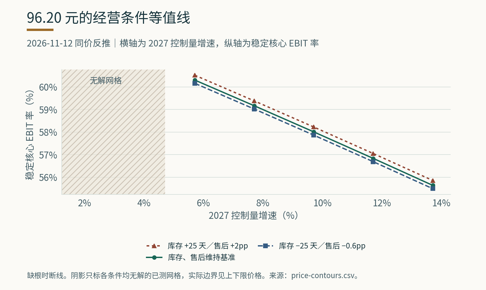

2026-11-12价格，2027量增和稳定核心率｜%／百分点／元｜同价反推；无解点断线，库存与售后条件分列。点为等价根，无解点和两侧界价留在CSV。 [price-contours.csv](https://github.com/Loyyed/Investment-Studies-Assistance-Project-Yw-DDL-2026.12.2/blob/5f485482174392124261b1654ed102d16c19030c/docs/cases/688188/deep-research-batch-2/data/price-contours.csv) · [price-witnesses.json](https://github.com/Loyyed/Investment-Studies-Assistance-Project-Yw-DDL-2026.12.2/blob/5f485482174392124261b1654ed102d16c19030c/docs/cases/688188/deep-research-batch-2/data/price-witnesses.json)

| 资本与履约条件 | 2027控制量增速 | 所需稳定核心率 | 回代元 |
| --- | --- | --- | --- |
| 备货与售后负担高 | 11.71% | 57.05% | 96.20 |
| 基准周转与售后 | 11.71% | 56.83% | 96.20 |
| 周转与售后较轻 | 11.71% | 56.69% | 96.20 |

例如 2027 控制量增长 **11.71%**，库存轻情景要求稳定核心 EBIT 率约 **56.69%**，库存及售后更重时要求约 **57.05%**。逐个网格节点允许调稳定利润率 −12～+14 个百分点，求根后回代。15 个有根节点的最大误差约 4.26e-14 元，6 个节点限于范围无根并保留边界值。在常态量增约 5.71% 且费用改善有限，单靠降低周转不能覆盖要求。与冻结根连续地讨论需要同时记录旧利润、终值和费率条件。

提交两个连续经营周期的 OEM 批次报价、售后现金、库存归属和应收匹配，才能判断控制量超额增长及费用分摊是否足以跨过价格线。让利换来的增量应连同服务和回款一并重算。

[价格网格、回代与无解边界](https://github.com/Loyyed/Investment-Studies-Assistance-Project-Yw-DDL-2026.12.2/blob/5f485482174392124261b1654ed102d16c19030c/docs/cases/688188/deep-research-batch-2/data/price-contours.csv) · [独立估值核验](https://github.com/Loyyed/Investment-Studies-Assistance-Project-Yw-DDL-2026.12.2/blob/5f485482174392124261b1654ed102d16c19030c/docs/cases/688188/deep-research-batch-2/data/independent-audit.json)

### 倍数与权益时间桥｜统一分母再跨期

同日用收盘 × 405,984,426 得市值约 390.56 亿元，减统一净金融桥得到 EV 约 338.31 亿元。滚动归母约 13.0870 亿元、核心 EBIT 约 10.9668 亿元、营业收入约 24.5560 亿元，分别得 P/E 29.84 倍、EV/核心 EBIT 30.85 倍及 EV/收入 13.78 倍。基准情景约对应 EV/滚动核心 EBIT 25.52 倍，显示市场比经营模型要求更高。2025-04-08 华创首发研报列价格 170.87 元、当日股数 205.4551 百万股，使用当时已知 2024 年报归母得到约 39.77 倍。分别以当日原价和股数对当时 LTM 归母，跨转增也不需要人为复权净利。

#### 图表 38　自身不同估值日的同口径 P/E

只用该日可得分母，历史报价采用原研报时点。 [own-relative.csv](https://github.com/Loyyed/Investment-Studies-Assistance-Project-Yw-DDL-2026.12.2/blob/5f485482174392124261b1654ed102d16c19030c/docs/cases/688188/deep-research-batch-2/data/own-relative.csv)

| 市场日 | 原价·元 | 股数·百万 | 滚动归母·百万元 | P/E |
| --- | --- | --- | --- | --- |
| 2025-04-08 | 170.87 | 205.46 | 882.71 | 39.77 |
| 2026-11-12 | 96.20 | 405.98 | 1,308.70 | 29.84 |

可比比较限定工具层。金橙子可检验精密振镜和设备差异，维宏部分伺服切割系统可检验竞争烈度，二者作为整公司也有非相同业务与利润分母。汇川、锐科和大族各有适合的产业位置，但 CNY A 股权利相同也无法使它们的集团估值成为柏楚纯控制系统倍数。没有可靠同口径单独估值时，跨公司仅作范围校验，不引入伪精确中位数。

2026-11-10 公告 11 月 16 日实施每股税前现金 **0.582 元**。固定其他条件，含权 96.20 机械对照 **95.618 元**，新基准 **81.230 元**。这是从含权价值减红利的算术，不是 11 月 16 日实际收盘或滚动股价。若做新窗口，需同时重取未复权收盘、经济股数、真实到账和当时可获的披露，先锁定权益桥，再更新市场观察。

[历史同口径倍数](https://github.com/Loyyed/Investment-Studies-Assistance-Project-Yw-DDL-2026.12.2/blob/5f485482174392124261b1654ed102d16c19030c/docs/cases/688188/deep-research-batch-2/data/own-relative.csv) · [权益公告 2026-046](https://static.cninfo.com.cn/finalpage/2026-11-10/1225663640.PDF)

## 第 9 章　反方与裁定

最强反方能与收入增长同时成立。用相同机型的净价、验收、售后和到账反推续购优势，才知道是否该调整估值。

### 判断怎样翻转｜同一组订单检验正反

**最强反方是销量增加、单位现金变薄。** 行业换机和高功率渗透可以拉动新机与智能硬件，OEM 同时可能压价、延长质保与付款。发货前备货增加占款，2026Q3 毛利下滑与贸易资本增加同这种解释相容。正向证据应同时表现为工艺复用改善一次验收和留存、配套净价覆盖采购及服务、交付后收现金并释放库存。

#### 图表 39　正反两种经营下的重算（元/股）

阈值需要利润率和现金验证，局部上修仍低于市场价。 [model.json](https://github.com/Loyyed/Investment-Studies-Assistance-Project-Yw-DDL-2026.12.2/blob/5f485482174392124261b1654ed102d16c19030c/docs/cases/688188/deep-research-batch-2/data/model.json)

| 方向 | 27控制量增速 | 库存天数变化 | 稳定核心率 | 每股价值 | 较基准 |
| --- | --- | --- | --- | --- | --- |
| 局部上修 | 8.21% | -25 | 48.97% | 85.60 | +3.79 |
| 局部下修 | 3.21% | 25 | 44.52% | 77.84 | -3.97 |

判别的量化方式是锁同一 OEM 某功率机型的新机、已有机型替换及返工计数，做上年与本期倒推；同机型按购价减折扣、返利和退换，按订单匹配验收与最终付款。客户投诉和售后人工若跨季，需要在服务期中按同一制度计入。若有批次出现 2027 控制量增速约 **11.71%**、稳定核心 EBIT 率达 **56.69%**，同时库存少 25 天且售后减 0.6 个百分点，条件值可回 96.20 元。该值对比原始经营数据中相应区间应持续两次经营周期。近端改善但尚未跨阈值时可以上修基准，不能把单个改善当成越过市价。

若控制增速较基准少 2.5 个百分点、稳定利润率少 2 个百分点、库存多 25 天、增量售后率高 2 个百分点，条件值约 **77.84 元**。换成向上的量率变化和较轻资本条件，约 **85.60 元**。两组用于更新基准，仍应与 96.20 元的过价线分别比较。

[场景输出与反证敏感性](https://github.com/Loyyed/Investment-Studies-Assistance-Project-Yw-DDL-2026.12.2/blob/5f485482174392124261b1654ed102d16c19030c/docs/cases/688188/deep-research-batch-2/data/model.json) · [联合价格等值线](https://github.com/Loyyed/Investment-Studies-Assistance-Project-Yw-DDL-2026.12.2/blob/5f485482174392124261b1654ed102d16c19030c/docs/cases/688188/deep-research-batch-2/data/price-contours.csv)

### 审阅裁定卡｜下一次披露怎样改变价值

当前应先核三个会改估值的字段。财务组与产业组用同订单净额、附着、维修和首批占款测配套留存；估值组用同机型及头部客户回款区分市场景气与续购，更新胜率、续购和净价；新业务以预算、样机、验收及对应到账判断能否增加净收益。高功率、海外、精密加工各按实际市场与机型分母核对。

#### 图表 40　团队裁定与参数方向

团队审阅邀请与投资决定另留正式记录。 [claims-and-figures.csv](https://github.com/Loyyed/Investment-Studies-Assistance-Project-Yw-DDL-2026.12.2/blob/5f485482174392124261b1654ed102d16c19030c/docs/cases/688188/deep-research-batch-2/data/claims-and-figures.csv)

| 待字段 | 核对入口／负责人 | 参数及方向 |
| --- | --- | --- |
| 同机型续购、报价与工时 | OEM配对；产业研究 | 净价与取得份额↑／竞价相反 |
| 合格订单附着、库龄及售后 | 订单＋三表；财务复核 | 毛利兑现、应收与库存↓／负面反转 |
| 项目实付、验收及已回款 | 合同／专户／项目经理 | 够门槛方加FCFF与资本 |
| 限制资金及未归属激励 | 募资专项＋登记；估值复核 | 可用资产与证券分母 |
| 路演与券商单位原稿 | 交易所与券商原PDF；证据复核 | 不进冻结窗；修订外部诊断 |

三情景估值保留固定窗口，抽核范围、数值误差和来源差异见[依据与研究边界](#依据与研究边界)。

[独立抽核 JSON](https://github.com/Loyyed/Investment-Studies-Assistance-Project-Yw-DDL-2026.12.2/blob/5f485482174392124261b1654ed102d16c19030c/docs/cases/688188/deep-research-batch-2/data/independent-audit.json) · [图表与主张定位](https://github.com/Loyyed/Investment-Studies-Assistance-Project-Yw-DDL-2026.12.2/blob/5f485482174392124261b1654ed102d16c19030c/docs/cases/688188/deep-research-batch-2/data/claims-and-figures.csv) · [版本及复算入口](https://github.com/Loyyed/Investment-Studies-Assistance-Project-Yw-DDL-2026.12.2/blob/5f485482174392124261b1654ed102d16c19030c/docs/cases/688188/deep-research-batch-2/README.md)

## 依据与研究边界

**资料身份与期间。** 2022、2024/2025 和 2026Q3 的原表抽核共 103 个单元，按 SHA、物理页、合并范围和期间列核对。原件绑定恢复后 ReviewStore 有效 Fact 为 24 条。跨期算术及条件预测保留其原证据身份。2026-11-12 收盘作为估值窗口；后来披露的说明会单列，不能用于回填估值日信息。

**财务与现金口径。** 原披露与重列并列；拆单季使用各年累计差分。CFO−购建是报表现金代理。FCFF 从税后经营利润加适用折旧摊销，扣营运资本增加、现金购建及经营租赁。财务性现金、负债和少数权益由企业价值到股东价值的桥接处理。配套试算以每 100 元净收入及首批资金为单位；重复订单只计余额变化。模型中的量、附着、售价和费用使用条件参数。

**桥接与复核。** 毛利中点法以权重变化乘平均组内毛利率、组内变化乘平均权重，交互项均摊。终值按稳定期 FCFF 除以 WACC−g 折回。估值单独公式复算的三情景最大差为 2.84e-14 元。原股数、估值冻结窗口、模型和全精度桥接见固定源提交。

**待研究复核。** 11 月 20 日说明会转录主持词把三季报披露称为 10 月 30 日。年度证据索引和发行人三季报入口记录为 10 月 27 日，模型沿用发行人披露日，估值输入不变。若要修订说明会来源链，请对照原站活动时间戳和原始录音，再更新期后证据说明。

[三季报原件](https://static.cninfo.com.cn/finalpage/2026-10-27/1225622322.PDF) · [期后证据表](https://github.com/Loyyed/Investment-Studies-Assistance-Project-Yw-DDL-2026.12.2/blob/5f485482174392124261b1654ed102d16c19030c/docs/cases/688188/deep-research-batch-2/data/post-window.csv) · [独立复核回执](https://github.com/Loyyed/Investment-Studies-Assistance-Project-Yw-DDL-2026.12.2/blob/5f485482174392124261b1654ed102d16c19030c/docs/cases/688188/deep-research-batch-2/data/independent-audit.json)
