# 柏楚电子证券投资分析报告11.25新版

署名 刘翔宇

第四轮预测与估值完整定稿 · 2026-11-25

执行记录为 Codex 实施 Agent。第四轮经刘翔宇独立审核通过，四轮研究交付完成。

## 柏楚解决什么加工问题

**一张加工图怎样成为尺寸合格、边缘稳定的工件？** 柏楚的工作连接图纸、工艺安排、控制指令和设备执行。设备制造商把这些功能集成进激光加工设备，加工企业再用设备完成生产。

CAD 负责读取和处理几何图形。年报描述了图纸兼容、路径优化和排样能力。CAM 把几何要求接到加工安排，处理切割顺序、工艺模块和三维实物偏差。数控系统进一步规划运动轨迹和速度，让机械动作满足加工要求。随动控制使用电容或其他传感反馈，测量切割头与工件的间距，并据此调节。工艺效果来自这些环节的配合。设备运动、激光输出、材料和现场设置同样影响最终工件。[E01]

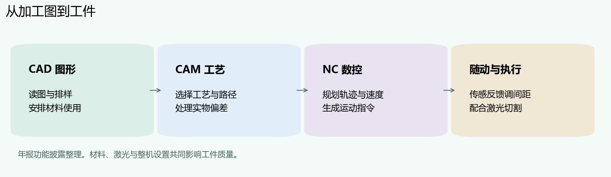

*2025 · 流程示意 · E01，年报定位和计算见来源索引*

柏楚提供以激光切割控制系统为核心的自动化产品。总线控制系统把运动控制器、计算机和调高器集成起来，通过网络与外设通信。切割头、软件和其他配套延伸了控制能力。管材与平面套料软件面对不同几何形状，解决的都是把图形有效转换为加工动作的问题。[E01]

**图中应看图纸到反馈的闭环。** 管理层披露的模块化工艺和传感控制，支持“减少重复工程工作”的研究假说。它们的客户经济价值仍需具体项目的调试工时、良率和停机数据验证。标准产品容易安装，与整机配置、材料工艺验证、操作培训各有不同任务。年报只明确嵌入式软件标准产品一般只需简单安装，后几项的实际工作量和替换成本仍待项目证据。[E02]

设备功能决定产品为什么有用。下一章要接着回答谁为这套能力付款，以及交付、验收和售后怎样把功能变成柏楚的收入。

## 柏楚怎样赚钱

**买设备的人、用设备的人和向柏楚付款的人是什么关系？** 年报把各类激光切割设备制造商列为主要服务对象。制造商采购控制系统、软件及配套，并完成整机集成。加工工厂在设备上运行工艺。客户和合作伙伴名单说明业务接触的范围，匿名主要客户表说明销售集中情况，二者无法逐一配对。OEM 与终端直购的收入拆分仍留缺。[E02]

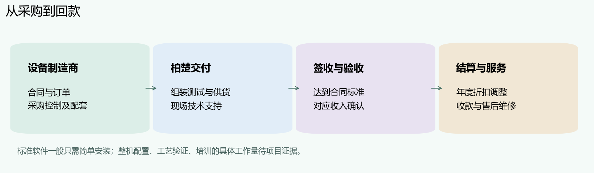

*2025 · 流程示意 · E02、E03，年报定位和计算见来源索引*

柏楚的主要收费路径是商品和软件销售。标准化嵌入式软件、智能切割头及配件以签收为依据，在达到合同验收标准对应的时点确认收入。其他软件通常以交付日确认，带有效期的软件以激活日确认。年度结算协议下的预估折扣先冲减收入，再按年末实际结算调整。这个机制让销售量、产品搭配与最终实现价共同影响收入。[E03]

**图中应跟随订单、商品和现金的不同时间。** 签收验收把交付接到收入，收款还要经历合同约定的结算。柏楚客户服务部负责订单闭环和售后维修，技术服务部提供现场支持，集成检测部承担组装测试。整机终端验收、备件、停机责任和培训费用的逐单归属，年报没有完整合同条款。[E02、E03]

2021 年直销表覆盖合并营业总额。2022–2025 年直销表覆盖主营业务收入和成本，2025 年分别为 21.67 亿元和 4.78 亿元。这个表描述柏楚对合同客户的销售方式。制造商采购后向加工工厂出售整机，也可以形成柏楚的直销。年报没有把上述金额拆成各类买方的收入。[E04]

合同负债能补充说明结算，但先要看它由什么组成。2025 年余额 1.32 亿元中，大部分是预提销售折扣。第六章会把它接到收现和现金转换。下一章先从毛利额出发，找出真正支撑公司利润的方案。

## 利润主要来自哪里

**哪类方案支撑了公司的主要盈利？** 2025 年平面解决方案占主营收入 **59.67%**，占主营毛利额 **62.45%**。它贡献收入 12.93 亿元、毛利额 10.54 亿元，仍是最大的利润来源。同比 14.94% 的收入增长又带来约 1.24 亿元毛利增量。[E05]

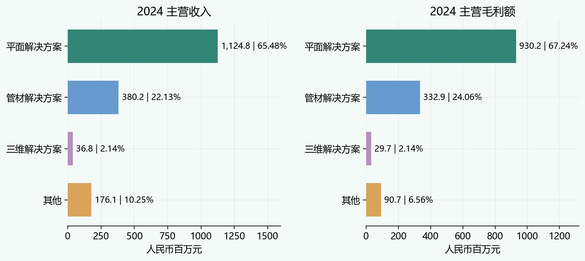

*2024 · 人民币百万元、%  · E05，年报定位和计算见来源索引*

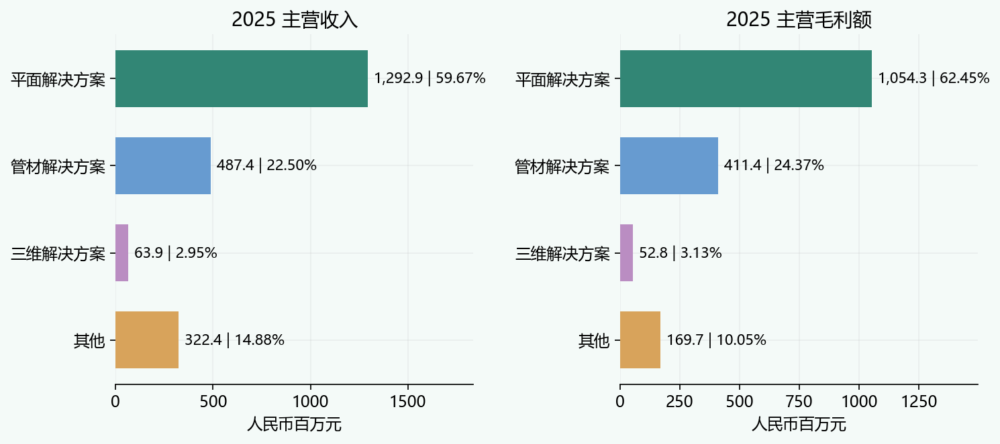

*2025 · 人民币百万元、%  · E05，年报定位和计算见来源索引*

**先看平面在两种结构中的份额，再看其余场景的增量。** 平面的收入权重从 2024 年的 65.48% 降到 59.67%，但它在毛利额结构中的权重更高。其他场景正在分担增长，盈利基础仍然倚重平面。图中毛利额按分组收入减成本计算，分母统一用主营合计。[E05]

金额单位为人民币百万元。2024→2025 增量，主营口径。

| 场景 | 2025收入 | 主营毛利额 | 收入增量 | 毛利增量 |
| --- | --- | --- | --- | --- |
| 平面解决方案 | 1,292.91 | 1,054.32 | 168.10 | 124.16 |
| 管材解决方案 | 487.45 | 411.43 | 107.22 | 78.56 |
| 三维解决方案 | 63.89 | 52.81 | 27.12 | 23.14 |
| 其他 | 322.39 | 169.69 | 146.34 | 78.96 |

管材收入同比增长 28.20%，贡献约 0.79 亿元毛利增量。三维收入同比增长 73.73%，2025 年主营收入权重仍只有 2.95%，它对当年增量的贡献约为 6.04%。其他场景收入增长较快，毛利额也增加，但毛利率只有 52.64%。这里的“其他”沿用管理层场景分类，合并附注中的“其他业务”另有自己的金额。[E05]

地区表给出另一层观察。2025 年华东收入占适用主营合计 71.65%，贡献当年主营收入增量的 72.02%。整机厂采购地集中可能形成这种分布，终端生产地点和下游行业暴露仍无法从地区表直接识别。产品、地区与直销分别描述同一业务的不同切面，各有自己的分母。[E06]

平面提供利润基座，管材、三维和其他场景提供不同强度的增量。要判断这种增长是否可靠，下一章需要把 2025 年放回七年历史，观察公司经历压力后怎样恢复。

## 七年经营怎样走到今天

**柏楚的增长经历过怎样的压力检验？** 2019–2025 年合并营业收入从 3.76 亿元增至 21.96 亿元。各年度经营现金流均为正，收入与利润的路径中仍有清楚的回撤。2022 年最适合检验增长故事对行业和产品变化的敏感性。[E07]

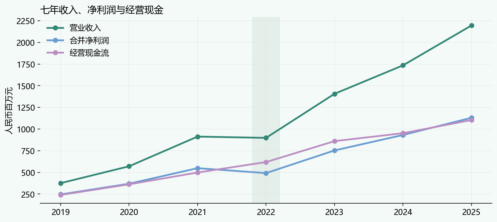

*2019–2025 · 人民币百万元 · E07，年报定位和计算见来源索引*

**图中应关注 2022 年收入、利润和现金方向的分离。** 当年合并收入下降 1.64%，营业成本增长 4.96%，营业利润减少约 5,134 万元。归母净利润减少约 7,068 万元。CFO 却增加约 1.21 亿元。经营压力与现金改善同时出现，需要分别解释销售和付款节奏。[E07、E08]

2022 年随动与板卡的披露收入同比约为 −28.47% 和 −24.31%。总线接近持平，其他产品仍有增量。管理层认为订单受外部环境影响，部分使用场景向高功率转移，客户也转购主站卡。产品升级和旧类别被替代可以同时作用，旧产品销售下降无法单独推导客户流失。该年合并范围新增子公司，固定范围的增速仍待证。[E08]

2024 年扩张恢复，主营收入增加约 3.22 亿元，主营毛利增加约 2.61 亿元。计算成本同比时，采用 2024 年报中已经重列的 2023 年比较列。保证类质保费用 442.67 万元从销售费用转入成本，原列和重列保留在口径桥中。[E09]

2025 年合并收入增加 4.60 亿元，毛利增加 3.18 亿元，营业利润增加约 2.09 亿元。销售、管理、研发费用合计增加约 1.30 亿元。归母净利润增量还包含少数股东损益下降带来的归属变化。新增利润需要同时覆盖研发、服务与销售能力，费用率的变化仍受到收入分母和支出节奏影响。[E07、E10]

历史读到这里，可以确认公司有压力后的恢复和扩张表现。2024 年金额表改按应用场景列示，实物又改成控制系统与智能硬件两组，旧分类没有强行拼接。下一章在可比的 2024–2025 场景范围内，解释扩张为何伴随毛利率下降。

## 毛利额增加时，毛利率为何下降

**多赚了毛利额，为什么每元收入留下的毛利反而减少？** 2025 年主营收入增加约 4.49 亿元，主营毛利额增加约 3.05 亿元。成本增长更快，使主营毛利率从 80.53% 降至 77.92%。盈利规模扩大和收入结构变重同时发生。[E05、E11]

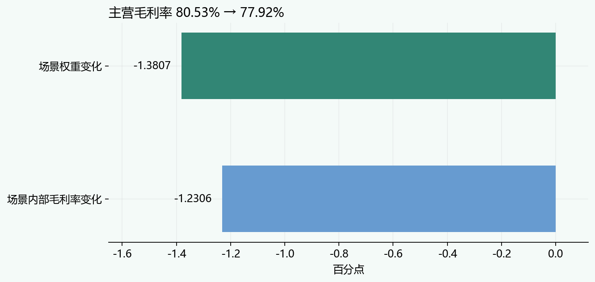

*2024→2025 · 百分点 · E11，年报定位和计算见来源索引*

**先看两项贡献加总，再看它们分别包含什么。** 中点分解将交互项均摊，场景权重变化贡献 −1.38 个百分点，场景内部毛利率变化贡献 −1.23 个百分点，两项合计约 −2.61 个百分点。较低毛利的其他场景升权压低组合。平面和管材的组内毛利率下降，又增加了压力。三维和其他组内毛利率的改善提供了部分抵消。[E11]

管理层主要把毛利率下降归因于软硬一体化推广中智能硬件占比提高。实物表的集团硬件销量与控制系统销量比，从 57.58% 升至 87.34%，与结构变重的方向相容。两类集团销量没有逐台配对，无法据此取得整机配套率。场景收入也缺硬件独立收入成本拆分，硬件对利润率下降的净贡献尚不能定量。[E12]

其他解释仍然重要。规格升级、销售折扣和产品搭配能改变组内实现收入，原材料和制造成本能改变组内毛利。2025 年主营原材料结转成本同比增加约 1.17 亿元。比较这一项时，采用同年报告已调整的 2024 年成本性质列，材料与制造费用之间 570.16 万元的重分另有记录。组内毛利率变化仍包含多种作用。[E11、E12]

软硬件扩张为柏楚提供新的收入，也提高了备料、交付与现场服务的重要性。毛利额能否变成可用现金，取决于收款和投入的时间。下一章用现金桥检验这项扩张。

## 利润怎样变成现金

**账面上多赚的利润，有多少在当年回到公司？** 2025 年经营现金流净额为 11.04 亿元，现金转换率按 CFO÷合并净利润计算，为 97.67%。购建固定资产、无形资产和其他长期资产支付的现金为 0.35 亿元。CFO 减这项购建付现后的简化现金余量为 **10.69 亿元**。[E13]

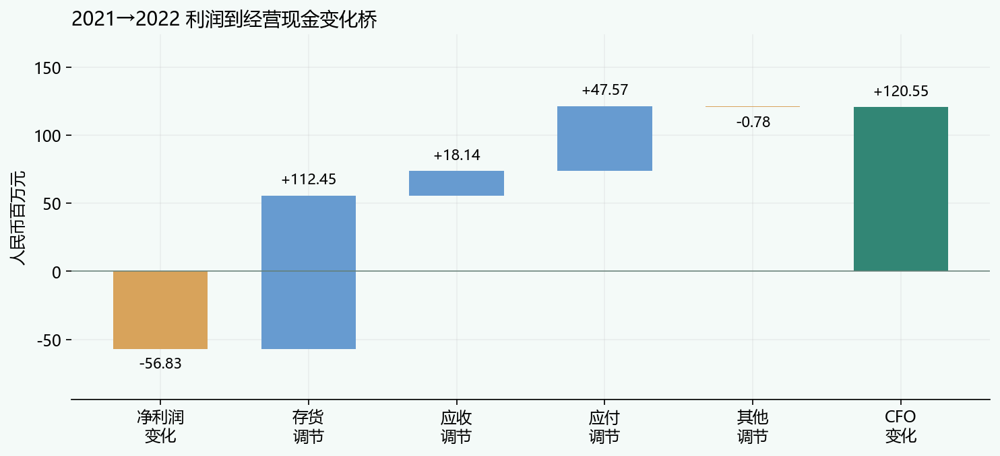

*2021→2022 · 人民币百万元 · E13，年报定位和计算见来源索引*

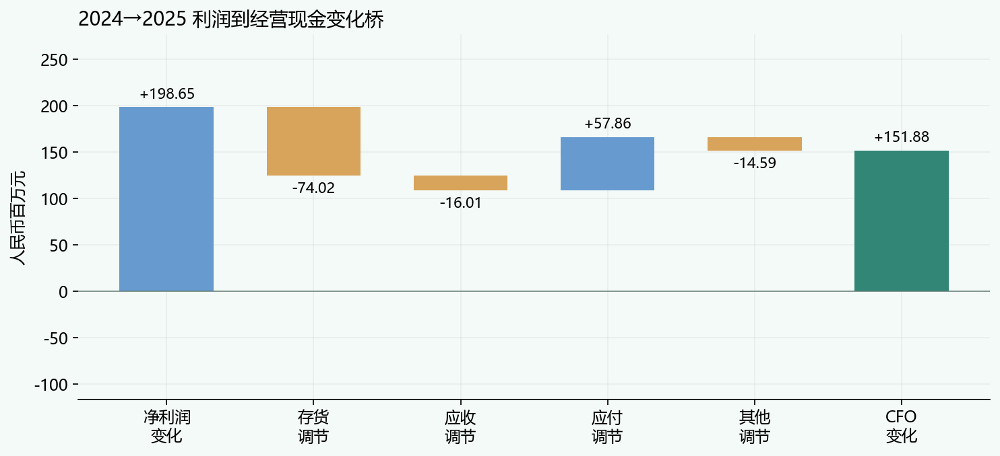

*2024→2025 · 人民币百万元 · E13，年报定位和计算见来源索引*

**切换两期，看现金增加来自哪里。** 2022 年销售收现减少约 5,640 万元，采购和税费付现下降却为 CFO 提供增量。间接法中存货从占用转为释放，对同比贡献约 1.12 亿元。2025 年销售收现增加约 4.55 亿元，采购、职工及税费付现增加抵消了部分流入。间接法中存货调节比上年多占用约 7,402 万元。两年都增加现金，经营含义各有侧重。[E13]

购建付现下降也帮助了 2025 年简化现金余量。2024 年购建付现约 1.13 亿元，2025 年降至 0.35 亿元。固定资产账面规模已在前期扩张，后续维护与扩张投入尚缺拆分，不能用单年购建额代表长期所需投入。[E13、E14]

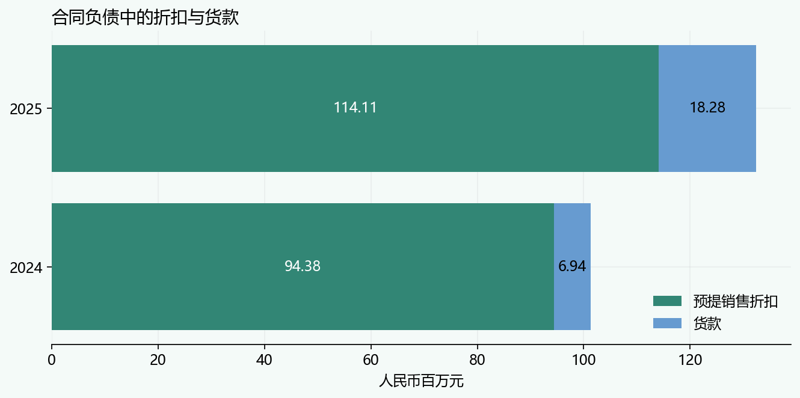

*2024年末、2025年末 · 人民币百万元 · E15，年报定位和计算见来源索引*

| 合同负债项目 | 2024年末（元） | 2025年末（元） | 增加（元） |
| --- | --- | --- | --- |
| 预提销售折扣 | 94,384,129.34 | 114,106,284.20 | 19,722,154.86 |
| 货款 | 6,944,324.40 | 18,281,281.11 | 11,336,956.71 |
| 合计 | 101,328,453.74 | 132,387,565.31 | 31,059,111.57 |

**这张表最应关注折扣和货款的分别变化。** 2025 年合同负债增加 3,105.91 万元，其中折扣增加 1,972.22 万元，贡献增量约 63.50%。折扣占期末余额 86.19%。结合收入确认政策，合同负债增长很大一部分对应年度折扣计量和结算。货款余额增加约 1,133.70 万元提供另一层信息，期间新增预收、消耗和退款的完整流水仍待核。合同负债总额因此难以直接充当订单需求或预收现金增长指标。[E15]

2025 年期末应收占收入约 7.63%，存货占收入约 11.39%，都高于 2024 年。智能硬件期末为 7,963 套，期初加生产减销售推得 5,929 套，差额 −2,034 套仍待调节明细。备货、分类变化、交付等待和回款节奏都可能影响观察。库存增量的原因要在同范围的库龄、验收和现金记录上继续核对。[E14、E16]

现金桥支持柏楚具备较强的历史现金产出，同时指出扩张需要更多营运资源。下一章把利润、现金和技术证据放到一起，判断客户继续采购的理由能支持多强的竞争优势表述。

## 竞争优势能持续多久

**为什么设备制造商可能继续采购柏楚，什么会让这种关系改变？** 我的综合判断是，柏楚的工艺模块、控制接口和现场服务形成了可持续经营优势的研究依据。多年盈利和现金表现为此提供结果层支持。优势的合同持续期和超额收益大小仍需更细证据。[E01、E02、E07]

整机厂沿用工艺参数、控制流程和服务经验，可能减少新机型的重复调试与验证。这个路径给继续采购提供理由。标准化产品简单安装的披露又限制了推断的强度。整机的功能配置、材料工艺验证和操作培训有各自的工作内容，年报没有量化替换供应商时增加的工时与成本。[E01、E02、E03]

自身历史说明公司在 2022 年承压后恢复，在扩张中仍保留较高毛利和现金产出。2025 年毛利率和现金转换率回落，则提示扩张后的保持程度需要继续验证。缺少同业同口径资本回报，优势的相对大小无法仅靠自身毛利率确定。[E07、E11、E13]

最强反方是，行业需求、产品组合、年度折扣和成本变化已经能解释相当部分收入利润结果。场景内毛利率下降并未单独识别同规格降价，增长也没有单独识别定价权。OEM 可以在下一代机型导入第二来源，先发客户资源能否抵挡这种变化，要看真实采购份额。[E03、E08、E11]

| 观察对象 | 会增强判断的证据 | 会收窄或改变判断的证据 |
| --- | --- | --- |
| 复用与继续采购 | 同一批 OEM 的下一代机型继续使用，项目记录显示验证与调试节省 | 主力机型快速导入替代，效果接近且额外验证工作较少 |
| 净价与采购份额 | 同规格、同责任、扣年度折扣后的净价保持，份额和回款同步稳定 | 毛利改善依靠升规格或延长账期，同规格采购份额走弱 |
| 软硬扩张与现金 | 同场景增量毛利覆盖售后，收现和库存周转稳定 | 场景毛利率继续下降，应收存货占用持续上升，现金转换回落 |
| 实物统计 | 同口径出入库与分组重分类能解释库存差额 | 原数据边界发生变化，影响销量比或跨年解释 |

这些条件承接已审第二轮的反方和改判框架。它们把优势判断交给可观察的客户和现金结果。最后一章将据此列出下一轮的预测变量及各变量的历史起点。[E17]

## 历史研究结论与预测入口

**历史材料最终支持怎样的经营判断，下一轮该预测什么？** 平面解决方案是柏楚2025年最大的主营毛利来源。它在 2025 年贡献近六成主营收入和超过六成主营毛利。管材、三维与其他场景让增长来源扩展，软硬组合扩张同时改变成本与现金占用。持续创造价值的判断，后续要把增量盈利与所需资本、客户回款一起检验。[E05、E11、E13]

技术、工艺与接口复用使客户继续采购有合理基础。七年历史也显示盈利和现金的延续。实际续购率、同规格净价和切换成本仍留缺。研究结论可据此认可产品和经营能力，优势寿命与资本回报需要在预测阶段继续接受反方检验。[E01、E07、E17]

| 第四轮变量 | 历史起点和预测所需解释 |
| --- | --- |
| 分场景收入及增长 | 平面为最大基座，管材、三维、其他分别有自己的增量与规模。预测需解释份额、需求、规格与净价，2023 新方案分项绝对收入继续留缺。 |
| 分场景毛利率与销售组合 | 2025 主营毛利率 77.92%，分解已识别权重与组内两项影响。需明确硬件搭配和成本假设如何作用。 |
| 研发、销售和现场服务 | 2025 研发费率下降，销售费率上升。预测要匹配新场景所需能力及售后责任。 |
| 应收、存货和合同结算 | 以已审期末余额与现金调节为历史约束，合同负债拆开折扣及货款。硬件库存滚动原因仍待核。 |
| 购建、维持投入与现金转换 | 2025 购建付现较低。需要交代维护和扩张资本，以及利润到 CFO 的营运条件。 |
| 少数股东与证券价值 | 归母利润和集团现金主体各有范围。下一轮分别接权益归属、融资和估值日期。 |

上述变量的历史数值取自同版图表与第一、二轮底表。第四轮可以据此建立可复算假设，并观察哪些组合会改变现金与价值。此处的阅读稿完成历史经营和商业模式叙事，提交刘翔宇独立审核后接续。[E10、E13–E17]

## 预测怎样从历史走向现金

**未来十年的增长需要哪些盈利与投入条件？** 本轮以2025年末财务状态为条件起点，显性期2026–2035年，2036年起稳定期。2025年报于2026年4月10日可得，报告版本为2026年11月25日。因此数值是使用后来可获完整年报的回顾性条件测算。它不提供2025年末当时可交易的信息集。所有预测与市场价格网格均为研究假设。

先界定利润。核心EBIT保留产品收入、成本、税金及附加、销管研和信用损失。其他收益和金融收益从核心移出。2025年报p167说明软件增值税即征即退政策，p224列出政府补助和其他收益。现金流中税费返还99.29百万元与当期其他收益有确认和时点差异，不能相互替换。核心基准剥离全部其他收益，政策延续另提供可量化敏感性。

| 项目 | 2025百万元 | 采用方式 |
| --- | --- | --- |
| 核心EBIT | 1,038.81 | 收入−成本−销管研−税金及附加＋信用减值原符号 |
| 其他收益 | 124.19 | 政府补助121.90及其他税费项目；核心基准剥离，软件税返在敏感性讨论 |
| 财务费用 | −32.82 | 融资及现金利息、汇兑与手续费混合；整体从核心移出，手续费成本用信用及运营费率覆盖的条件需核 |
| 投资收益／公允价值 | 22.16／44.64 | 从核心剥离，金融资产与长期股权按账面另加；不在FCFF重复预测收益 |
| 资产减值及处置 | 按原表 | 长期股权减值17.26不重复外推；其他处置差额见输入原格 |
| 合并净利润／归母 | 1130.63／1112.55 | p126；完整利润与经营口径不同，预测另加条件金融收益并扣利息和2%少数损益 |

历史桥在2025年将核心EBIT1038.81百万元接到报表营业利润1245.12百万元，再扣非经营净支出和所得税，得到合并净利润1130.63百万元。减少数损益18.08百万元后，归母为1112.55百万元。逐项原格及符号见历史利润桥.csv。

| 参数 | 压力 | 基准 | 改善 | 锚点、推导及反证 |
| --- | --- | --- | --- | --- |
| 2026场景收入增长 | −8/2/8/3/0% | 10/16/25/20/6% | 16/23/35/30/8% | 依次平面、管材、三维、其他主营、其他业务。2024–25分类表p25及p27–28。基准比2025增速回落；订单、同规格净价及回款走弱则下修。 |
| 第五年起场景毛利率 | 77/78/78/45/45% | 80/83/82/51/50% | 83/86/85/55/55% | 从2025原值五年线性过渡。硬件搭配、折扣和材料成本改变则修订。 |
| 销售／管理／研发费率 | 7.5/7.5/18% | 6.3/6.8/15.5% | 6.0/6.3/14.5% | 2025利润表p126，原费率约6.23/7.09/15.55%。规模摊薄是条件，现场服务费用超支则上调。 |
| 现金经营税率 | 17% | 13% | 11% | p167母公司10%及不同子公司税率，仅为综合现金税代理；优惠到期或结构变化需重算。 |
| 应收／库存／应付天数 | 65/220/50 | 48/185/60 | 40/150/65 | 2025约45.48/186.07/59.29天，含应收账款、票据及融资，按收入、成本分别匹配；逾期和库龄恶化则上调。 |
| 折扣／货款余额率 | 4.5/0.6% | 2025余额率不变 | 5.2/1.0% | p213折扣114.11、货款18.28百万元。已净额预测收入，余额变动只进营运资本一次。 |
| 增长净固定资本 | Δ正收入÷2 | Δ正收入÷3 | Δ正收入÷4 | 多年购建及固定资产为锚，比例为研究假设；项目付现高于预算则下调销售资本效率。 |
| 终期ROIC／g／WACC | 12/1/10% | 20/2/8.5% | 28/2.5/7.5% | 全部为条件参数。ROIC超过WACC需持续优势支持；反方为标准化替代、净价或客户份额下滑。 |

税金及附加取净收入1.3%，信用损失取0.2%，按2025税附及信用减值附近规模设置。预付按2025成本比例2.754%保持，D&A按2025收入比例约1.787%保持。其他应付及税费的完整经营属性留缺。

各组收入按净实现收入预测，缺少可比分组量价时直接假设增长率。首年不同场景增长分别体现平面基座、管材与三维扩展、其他主营组合及其他业务。十年增长逐步向稳定增长收敛，避免把2025年的高增长无限延长。毛利率五年过渡，费用按收入计提。2023年新方案金额与实物同比缺口沿用已审处理。

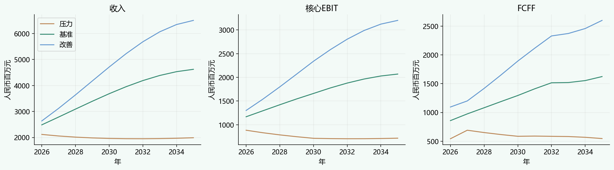

*2026–2035三情景收入、核心EBIT和FCFF；人民币百万元；同版逐年模型*

应看收入与FCFF之间的距离。改善情景依赖较好的组内毛利、回款及资本效率。压力情景首年收入下降，仍按更长回款和更高存货天数准备营运资金。集团控制与硬件量只验证规模及结构，未用于虚构配套率或分组净价。

非现金经营资本定义为应收账款、票据及融资、预付款和存货，减应付账款、折扣与货款余额。预付按成本比例，应收按收入天数，存货和应付按成本天数。2025初始选定NWC为325.12百万元。税费及其他应收应付的经营归属仍不完整，经营现金保留与应收延迟敏感性用于检验遗漏影响，不能当完整历史实体资本核准。

收入已扣年度折扣，模型不再次从收入扣折扣。折扣负债按净收入目标比例变化并进入ΔNWC，模拟净确认与后续结算的时差；这要求折扣计量、净发票应收和结算口径一致。货款余额单列，两项均不是额外确认收入。实际结算与政策变化会改变这条代理路径。

现金税按正核心EBIT乘情景税率。D&A按2025合并折旧摊销占收入比例。前段资本开支等于D&A加正收入增量除销售资本效率，下降期仍保留维护投入。2033–2035逐步过渡到按ΔNOPAT/新增ROIC确定总再投资，再扣ΔNWC反推出净资本开支。租赁按资本化处理，D&A含使用权摊销，未来购建代理包含替换租赁资源所需投入，股权桥扣存量租赁义务。未来股份支付继续包含费用，股数假设固定，新增激励稀释需重算。

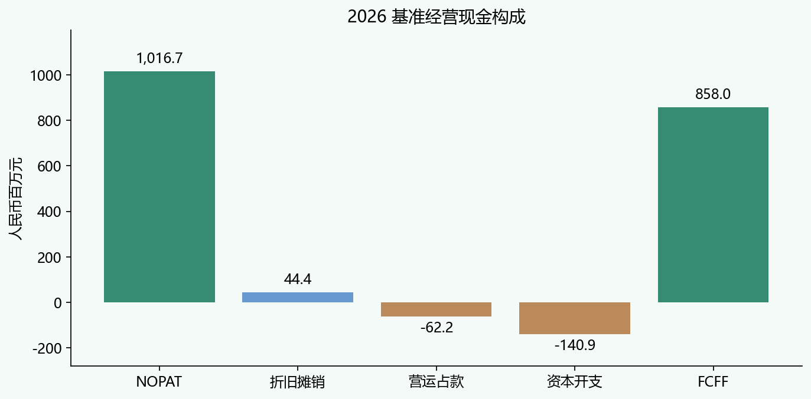

*2026基准FCFF构成；人民币百万元；NOPAT＋D&A−资本开支−ΔNWC*

基准首年收入2485.11百万元，完整归母利润1062.22百万元，低于2025年的1112.55百万元。剥离其他收益的保守路径与收入增长可以同时成立。完整归母预测的金融收益率1.5%、债务成本3.5%、少数损益占比2%均为研究假设。NOPAT1016.71百万元，FCFF858.04百万元。新增占款和购建消耗现金。2025购建35.20百万元没有机械延续到首年，首年基准购建为140.89百万元。购建翻倍与回款延迟检验另附表。

焊接和微加工沿2025年报p15–16、41的方向设独立投入条件。单独试算从其他主营既有收入中重分0、0、2至16百万元，使用25%毛利率替换该部分原组毛利，并额外承担前三年每年8百万元运营费、5百万元资本开支，其后每年3百万元运营费。总收入不追加，避免把新业务在其他主营和独立场景中重复计价。这组规模和成本是试探假设，尚无分业务披露原值。

历史留出使用“只延续上年收入增速”的简单规则，结果见历史留出.csv。它在2022压力期与随后恢复期明显偏离，说明高增速外推会漏掉周期和分类变化。这是原列的描述性检验，未用其误差为三种未来情景分配概率。

| 情景／年 | 收入 | 成本 | 销管研 | 核心EBIT | 税 | NOPAT | 折旧 | ΔNWC | 购建 | FCFF |
| --- | --- | --- | --- | --- | --- | --- | --- | --- | --- | --- |
| 压力/2026 | 2,116.73 | 502.10 | 698.52 | 884.36 | 150.34 | 734.02 | 37.82 | 191.56 | 37.82 | 542.46 |
| 压力/2027 | 2,057.10 | 516.20 | 678.84 | 831.20 | 141.30 | 689.89 | 36.75 | -0.62 | 36.75 | 690.51 |
| 压力/2028 | 2,013.29 | 532.62 | 664.38 | 786.08 | 133.63 | 652.45 | 35.97 | 2.53 | 35.97 | 649.91 |
| 压力/2029 | 1,982.62 | 551.18 | 654.26 | 747.44 | 127.06 | 620.37 | 35.42 | 5.25 | 35.42 | 615.12 |
| 压力/2030 | 1,963.02 | 571.71 | 647.79 | 714.06 | 121.39 | 592.67 | 35.07 | 7.64 | 35.07 | 585.03 |
| 压力/2031 | 1,952.91 | 571.54 | 644.46 | 707.62 | 120.30 | 587.32 | 34.89 | -1.37 | 34.89 | 588.69 |
| 压力/2032 | 1,951.15 | 573.08 | 643.88 | 704.92 | 119.84 | 585.09 | 34.86 | 0.54 | 34.86 | 584.55 |
| 压力/2033 | 1,956.93 | 576.15 | 645.79 | 705.64 | 119.96 | 585.68 | 34.96 | 2.24 | 37.80 | 580.60 |
| 压力/2034 | 1,969.76 | 580.61 | 650.02 | 709.59 | 120.63 | 588.96 | 35.19 | 3.83 | 52.96 | 567.36 |
| 压力/2035 | 1,989.46 | 586.41 | 656.52 | 716.68 | 121.84 | 594.85 | 35.54 | 5.37 | 79.25 | 545.77 |
| 基准/2026 | 2,485.11 | 568.45 | 710.74 | 1,168.64 | 151.92 | 1,016.71 | 44.40 | 62.18 | 140.89 | 858.04 |
| 基准/2027 | 2,785.63 | 651.58 | 796.69 | 1,295.57 | 168.42 | 1,127.15 | 49.77 | 52.16 | 149.94 | 974.81 |
| 基准/2028 | 3,090.77 | 738.32 | 883.96 | 1,422.13 | 184.88 | 1,237.25 | 55.22 | 53.82 | 156.93 | 1,081.71 |
| 基准/2029 | 3,392.77 | 826.59 | 970.33 | 1,544.96 | 200.84 | 1,344.12 | 60.61 | 54.16 | 161.28 | 1,189.29 |
| 基准/2030 | 3,682.73 | 913.84 | 1,053.26 | 1,660.39 | 215.85 | 1,444.54 | 65.79 | 52.93 | 162.45 | 1,294.96 |
| 基准/2031 | 3,951.05 | 984.94 | 1,130.00 | 1,776.84 | 230.99 | 1,545.85 | 70.59 | 45.42 | 160.03 | 1,411.00 |
| 基准/2032 | 4,187.90 | 1,047.68 | 1,197.74 | 1,879.66 | 244.36 | 1,635.31 | 74.82 | 40.08 | 153.77 | 1,516.28 |
| 基准/2033 | 4,383.82 | 1,099.33 | 1,253.77 | 1,964.96 | 255.45 | 1,709.52 | 78.32 | 33.06 | 234.52 | 1,520.25 |
| 基准/2034 | 4,530.44 | 1,137.48 | 1,295.70 | 2,029.29 | 263.81 | 1,765.48 | 80.94 | 24.56 | 267.41 | 1,554.46 |
| 基准/2035 | 4,621.04 | 1,160.23 | 1,321.62 | 2,069.88 | 269.08 | 1,800.79 | 82.56 | 14.87 | 244.24 | 1,624.25 |
| 改善/2026 | 2,636.01 | 588.39 | 706.45 | 1,301.63 | 143.18 | 1,158.45 | 47.09 | -46.45 | 157.19 | 1,094.80 |
| 改善/2027 | 3,120.04 | 695.23 | 836.17 | 1,541.83 | 169.60 | 1,372.23 | 55.74 | 50.86 | 176.75 | 1,200.37 |
| 改善/2028 | 3,637.64 | 808.29 | 974.89 | 1,799.89 | 197.99 | 1,601.90 | 64.99 | 54.07 | 194.39 | 1,418.43 |
| 改善/2029 | 4,173.92 | 923.61 | 1,118.61 | 2,069.09 | 227.60 | 1,841.49 | 74.57 | 55.55 | 208.64 | 1,651.86 |
| 改善/2030 | 4,709.27 | 1,036.13 | 1,262.09 | 2,340.42 | 257.45 | 2,082.97 | 84.13 | 54.78 | 217.97 | 1,894.35 |
| 改善/2031 | 5,220.09 | 1,157.51 | 1,398.98 | 2,585.29 | 284.38 | 2,300.91 | 93.26 | 55.92 | 220.96 | 2,117.29 |
| 改善/2032 | 5,680.18 | 1,267.17 | 1,522.29 | 2,805.52 | 308.61 | 2,496.91 | 101.48 | 50.45 | 216.50 | 2,331.44 |
| 改善/2033 | 6,062.86 | 1,358.17 | 1,624.85 | 2,988.90 | 328.78 | 2,660.12 | 108.32 | 41.91 | 352.42 | 2,374.11 |
| 改善/2034 | 6,343.45 | 1,424.06 | 1,700.04 | 3,124.19 | 343.66 | 2,780.53 | 113.33 | 30.51 | 403.06 | 2,460.29 |
| 改善/2035 | 6,502.03 | 1,459.67 | 1,742.54 | 3,202.29 | 352.25 | 2,850.04 | 116.16 | 16.82 | 347.60 | 2,601.78 |

逐年现金明确后，下一章才能把经营价值、非经营资产和股东归属放在同一个2025年末口径内。

## 条件现金流能支撑怎样的价值

**这套盈利和再投资路径，在怎样的必要回报下成立？** 以下DCF均为2025年末条件价值，使用2026年4月10日可获年报。年末折现，十年FCFF形成显性价值，2036年现金流形成终值。估值单位为人民币百万元，每股值以2025年末288.73百万股计算。

| 情景 | 显性期现值 | 终值现值 | 终值占经营价值 | 股权桥 | 每股条件值 |
| --- | --- | --- | --- | --- | --- |
| 压力 | 3,689.65 | 2,359.22 | 39.0% | 5,155.81 | 38.81 |
| 基准 | 8,162.46 | 11,248.54 | 57.9% | 5,155.81 | 85.09 |
| 改善 | 12,409.34 | 25,816.80 | 67.5% | 5,155.81 | 150.25 |

WACC采用E/(D+E)×(Rf＋β×ERP)＋D/(D+E)×Kd×(1−税率)。缺少年报范围内可核的市场风险溢价、无风险利率、β和市场权重，本轮WACC为研究条件。可供研究的Rf区间2%–3%、β0.9–1.3、ERP5%–7%、Kd3%–5%及债务权重0%–5%均是假设，不是行情观察。三情景7.5%–10%与7%–11%敏感性展示所需回报变化。

终值FCFF=2036 NOPAT×(1−g/新增ROIC)，终值=FCFF/(WACC−g)。g低于WACC，新增ROIC高于g。2035各组增速收敛到g，毛利和费率已稳定，末段再投资与ΔNOPAT/ROIC相接。稳定期不再依赖低购建的现金释放。资本回报敏感性只改变终值新增回报，显性路径保持，其用途是识别终值的独立依赖。

| 项目 | 2025年末百万元 | 口径与来源 |
| --- | --- | --- |
| 现金等价物 | 2,133.20 | p230–231，剔除冻结保证金0.0046 |
| 交易性及其他非流动金融资产、长期股权投资 | 3,277.93 | p121–122，账面值作为条件加回；处置税、折价和非上市投资估值缺项 |
| 经营现金保留 | -175.65 | 收入的8%，假设；不进入非现金营运资本 |
| 短借、租赁和票据融资 | -37.41 | p122–123、216–218，票据14.35百万元按融资负担处理 |
| 少数股东权益 | -42.26 | p123账面值代理，公允价值未知 |
| 年末股份（百万股） | 288.73 | p219股份总数288,729,927；本轮不混用期后股数 |

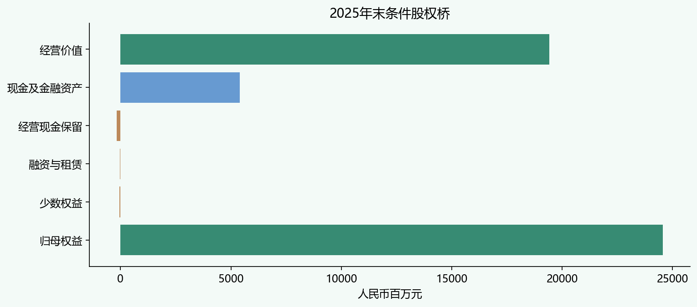

*2025年末基准经营价值到归母权益的条件桥；人民币百万元；原页见输入原格和补充来源*

应看经营资产与金融资产的分开计量。金融资产加回对应核心现金流剥离利息、投资和公允价值收益。长期股权按减值后账面加回，未来估值或处置税可能使其偏离账面。少数权益也用账面代理，公允价值待证。这些条件会影响每股数，仍须在进入买入评估时补证。

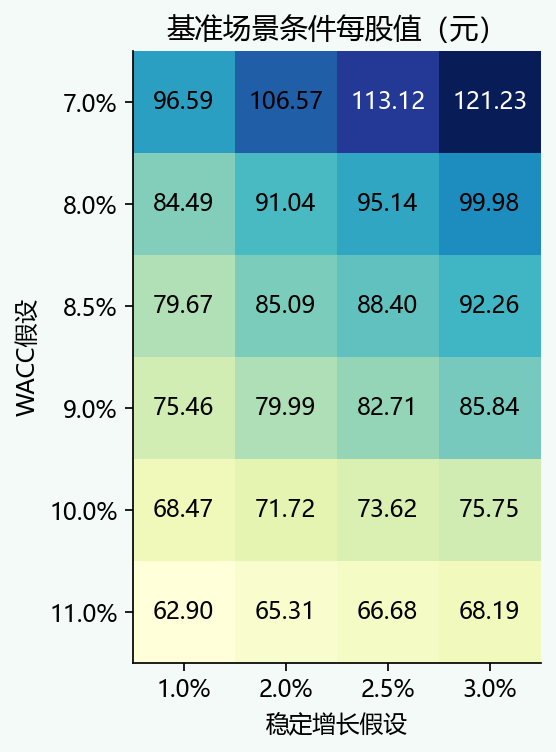

*基准DCF的WACC与g敏感性；假设元／股；折现与增长敏感性.csv*

终值在基准经营价值中占57.9%，因此长期现金假设有很大影响。利润率与回款延迟联合网格另见利润现金联合阈值.csv；购建和经营现金保留网格检验维护投入及现金储备。图册可同时调整WACC、g、组内毛利偏移、应收天数与前段购建倍率，表中会重算FCFF和每股值。最后三年的资本开支仍遵循新增回报约束，倍率用于前段并逐渐退坡。

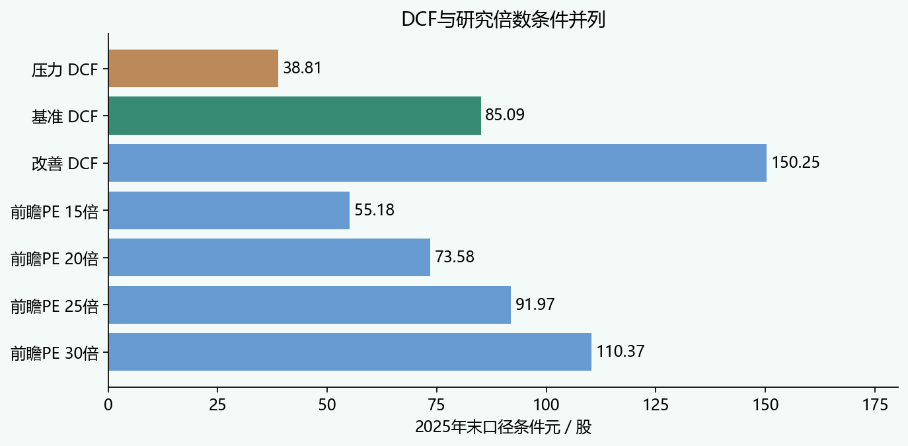

*同一财务起点下DCF与前瞻PE研究条件；元／股；倍数条件不是历史市场带*

| 假设元／股 | FY2025 PE | 2026E PE | PB | PS | PEG | EV/核心EBIT |
| --- | --- | --- | --- | --- | --- | --- |
| 40.00 | 10.38 | 10.87 | 1.90 | 5.26 | 2.29 | 6.15 |
| 60.00 | 15.57 | 16.31 | 2.85 | 7.89 | 3.44 | 11.71 |
| 80.00 | 20.76 | 21.75 | 3.81 | 10.52 | 4.59 | 17.27 |
| 100.00 | 25.95 | 27.18 | 4.76 | 13.15 | 5.74 | 22.83 |
| 120.00 | 31.14 | 32.62 | 5.71 | 15.78 | 6.88 | 28.39 |
| 85.09 | 22.08 | 23.13 | 4.05 | 11.19 | 4.88 | 18.69 |

PE的TTM仅指2025年末向前十二个月，即FY2025归母利润；它不代表2026年11月的最新TTM。前瞻PE用2026同版完整归母利润，包含按年末可投金融资产1.5%收益率、3.5%债务成本和2%少数损益比例的条件。DCF核心利润不含这些金融收益，金融资产已在权益桥加回。PB用年末归母权益，FY2025归母利润除年末权益约18.33%，平均权益ROE另需前期权益口径。PS以合并收入为分母，不能忽略其他主营毛利低于平面的结构。EV/核心EBIT用市值减现金、减金融资产、加经营现金保留和债务及少数权益，匹配剥离金融收益的核心利润。

PEG=2026前瞻PE÷2025–2028固定股数EPS复合增速的百分数。增速非正时留缺，不能给负PEG排序。基准EPS的2025–2028复合增速约4.74%，因此基准DCF隐含2026PE约23.13倍时，PEG约4.88。这个结果提示远期增长与现金回报对估值的重要性，也暴露短窗口盈利增速较慢的反方。研究条件15、20、25、30倍前瞻PE仅是比较网格。20倍在约5%盈利收益率下仍要留出增长投入，持续性和ROIC能否支撑该回报需经营证据。没有可核价格、同行财报和倍数时，不能称它为市场合理区间。

方法分歧先查盈利分母，再查净现金和金融资产、增长、再投资、折现与终值。PE资本化完整利润，可能把暂时金融收益和补助当持续盈利。DCF核心基准剥离全部其他收益，又要求增长投入。它的优势是显式约束现金，弱点是远期参数依赖。两者并列用于检验假设，缺少市场输入时没有形成实际高估低估判断。

旧81.81元属于2026年11月12日信息窗口的冻结模型，原资料含2026三季报、期后权益桥及405,984,426股。旧96.20元是该窗口行情，旧WACC6.9274%来自原研究估计，平台倍数来自旧行情资料，均不进入本轮。新版以2025年末资产、288,729,927股及分场景增长建立十年路径。若只固定新权益总值、把分母换为旧股数，得到60.51元，这只是分母算术隔离，不能当窗口可比价格。实际窗口桥还缺截至旧估值日的分红、资本变动、期中现金流与原市场输入复核。

缺少年末市场收盘、当日经济股数及权利、日度或月度历史价格、同日同行报表与公司行为调整，历史市场估值带及同日价格比较留缺。假设价格网格的倍数可复算，公司长期价值判断仍要回到经营兑现。

## 综合判断与进入买入评估的条件

**柏楚靠什么长期赚钱，当前研究应该采取怎样的立场？** 柏楚把图形处理、工艺、数控和传感执行连接起来，为设备制造商提供控制与配套。标准产品的安装较简单，持续关系仍取决于产品效果、接口适配、整机配置和现场服务。2025年平面是最大的主营毛利来源，其他场景扩大增长来源。长期价值需要增长毛利扣除费用、税、营运占款和资本投入后，仍留下现金。

第四轮经刘翔宇独立审核通过，维持“**有投资前景，值得持续跟踪**”的长期判断。依据是已审历史中的主营毛利贡献、压力后的恢复，以及能够持续产生现金的经营条件。实际续购率、同规格净价、切换成本仍待证。基准条件每股85.09元，压力38.81元，改善150.25元，区间反映假设差异，未赋予概率，也未接入当前行情。

进入买入评估需要同时满足经营、现金和价格条件。首先，同场景毛利、研发及服务投入需与基准路径相容。其次，回款、库存与维护资本不能持续向压力假设恶化，硬件滚动差额要取得解释。最后，在核对同日价格与股东权利后，再比较条件价值。若研究者要求基准值25%的价格缓冲，条件价格门槛约63.81元；这项缓冲为研究假设，并非实际买入指令。压力值较低，仍需判断压力情形的证据和可承受损失。

如果平面和管材同规格净价走弱、客户换用其他方案、场景毛利下降，同时回款天数升到65天以上和库存约220天，增长可能更多消耗现金。若维护及扩张资本显著高于本模型，或稳定期新增ROIC接近必要回报，则应收窄长期前景判断。相反，同一批OEM延续采购、净价和回款保持、软硬增量覆盖售后并提高现金，可增强改善路径的依据。

软件税返持续是上行条件之一。基准已剥离全部其他收益。以净收入4%作为新增经营支持、按13%条件税率纳税，仅作为现金补助代理，条件4%支持对应每股约91.37元，2%对应约88.23元，额外营运占款及政策资格差异仍待核。其显性期及终值都可量化重算。年报收到税费返还与确认其他收益存在差异，政策、资格或退税周期变化可能使该代理失效。新增业务则必须用不重复的收入分配和独立投入核查，其条件试算见压力一致性检查.csv。

正式行情判断需补足当日价格与权利、市场参数和可比公司同口径数据。刘翔宇已完成原格、首年预测及DCF的独立抽核，裁定第四轮通过，四轮研究交付完成。实际审核身份和范围见最终验收记录。

## 依据与来源

数值以第一轮获准底表与第二轮经营桥为主。合同负债构成由2025年报p213单列补充原格。机制判断沿已审第二轮材料，原文自述与研究推断在相邻段说明。

| 索引 | 年报年度和物理页 | 内容及计算 |
| --- | --- | --- |
| E01 | 2025 · 6、12–18 | 加工流程、产品功能、CAM、NC及传感控制 · B04 |
| E02 | 2025 · 14、17、161–162 | 主要经营模式、标准产品安装、现场支持 · B08 |
| E03 | 2025 · 119、160–162 | 合同、签收验收、年度折扣与软件确认政策 · B08 |
| E04 | 2021–2025 · 2021 p25–26；2022 p26；2023 p25；2024 p26；2025 p28 | 直销分母与金额 · B08 |
| E05 | 2024–2025 · 2024 p25、205；2025 p27–28、221 | 平面及其余场景的收入与毛利 · B03、B04 |
| E06 | 2024–2025 · 2024 p25–26；2025 p28 | 地区收入与增量 · B07 |
| E07 | 2019–2025 · 合并三表，逐年页码见单元索引 | 收入、利润和现金历史 · B01、B02 |
| E08 | 2022 · 24–27、102–107、174、182–186 | 压力期、旧产品、现金及范围变化 · B02、B05、B09 |
| E09 | 2024 · 112–113、153、205 | 2023比较成本质保重列 · B02、B03 |
| E10 | 2025 · 125–126、222–224 | 扩张利润、费用、少数股东损益 · B02 |
| E11 | 2024–2025 · 2024 p25–27；2025 p27–30 | 毛利中点分解与成本性质 · B04、B06 |
| E12 | 2024–2025 · 2024 p26–27；2025 p27–30 | 软硬组合、实物结构与成本 · B06、B11 |
| E13 | 2022、2024、2025 · 2022 p106–108、182–183；2024 p116–117、213–214；2025 p129–131、229–230 | 直接与间接现金桥、购建、现金转换 · B01、B09 |
| E14 | 2024–2025 · 2024 p108–109；2025 p121–122、188 | 营运占用与资本 · B10 |
| E15 | 2025 · 161–162、213 | 年度折扣政策及合同负债构成 · L213 |
| E16 | 2024–2025 · 2024 p26；2025 p29 | 硬件库存差额 · B11 |
| E17 | 2025 · 6、14–18、26、41 | 接口复用、竞争、成本与服务，研究反方 · B01、B04、B09 |

[主张来源映射](柏楚电子证券投资图册11.25新版/第三轮/主张来源映射.csv) · [图表取数与公式](柏楚电子证券投资图册11.25新版/第三轮/图表取数.csv) · [第一轮原格索引](柏楚电子证券投资图册11.25新版/第三轮/原格索引.csv) · [合同负债原格](柏楚电子证券投资图册11.25新版/第三轮/合同负债补充原格.csv)

第四轮输入原格、补充来源及逐年模型均见图册第四轮目录。