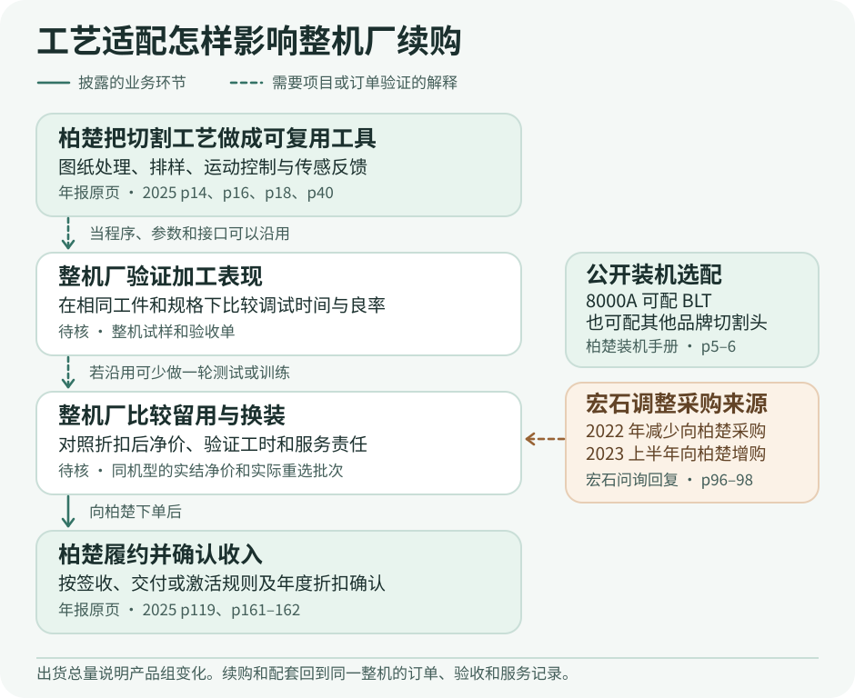

# 商业模式与护城河｜可合并段落

## 图纸怎样变成合格工件

一张板材图纸到达加工厂后，操作人员先导入图形，在板面上安排零件，再确定刀路和切割顺序。柏楚的平面套料软件处理图纸、排样和刀路。控制系统据此规划设备的轨迹和速度。切割时，调高器从电容变化取得间距信号，实时调整切割头与板面的距离。换到管材场景，套料还要处理共边和焊缝补偿。机械、光源和材料的条件一起决定最后的尺寸、边缘质量和节拍。〔M1-01〕

沿着设备看，激光器提供光束，切割头把光束聚焦到工件，机床和驱动机构执行运动。柏楚的切割控制系统把刀路和速度指令接到这些部件，并利用传感反馈调节加工。公司也提供 BLT 切割头。整机厂可以按目标工件选择供应商，再对组合后的设备做验证。比较系统和切割头供应商时，要先确认它们解决的是同一道加工任务，还是在同一台设备上承担不同功能。〔M1-01、M1-10、M1-11〕

买到标准化嵌入式软件后，合同客户通常只需做简单安装。设备厂推出一款整机时，还要按设备原定的用途配好光源、控制器和切割头，并用目标材料与工件验证加工结果。生产现场也要学会设置和维护。年报披露的是标准品的安装方式，以及柏楚设有现场支持和维修职能。验证耗时、换装后的返工及培训成本，要从同一机型实际项目获取。〔M1-01、M1-02〕

## 谁采购、谁使用、柏楚怎样收费

在年报列明的主要业务链中，整机厂采购柏楚的控制系统、软件或切割头，集成为设备。加工厂用整机交付工件。柏楚的集成检测部负责自身产品的组装测试，客户服务部跟进订单和售后维修，技术服务部提供现场支持。涉及整机验收、出保换件或停机损失时，由具体供货和设备合同确定负责方。柏楚披露的直销描述它与合同客户的销售关系。加工厂是否越过整机厂直接采购，要逐单辨认买方。〔M1-02〕

柏楚主要靠交付商品与软件取得对价。标准化嵌入式软件、智能切割头及配件凭客户签收，在达到合同验收标准时确认收入。其他软件按交付日确认，带有效期的软件按激活日确认。年度结算协议约定的预估折扣先冲减收入，年末按实结金额调整。若合同包含可单独提供的服务类质保，对应交易价格按会计政策分摊。要判断同款产品的成交条件，需用年末折扣结算后的净价对照采购份额，并同时看质保责任和账期。实际收款仍以合同结算与到账记录为准。〔M1-03〕

年报把平面、管材和三维解决方案列在同一产品表中。2025 年三项收入合计 18.44 亿元，占主营业务收入的 85.12%。这三行按加工场景归集，具体订单可以同时包括控制系统、软件和配套硬件。核算控制系统单品收入时，要按合同商品和年末实结折扣核对，再用同一品类的行业销售额计算市场份额。〔M1-15〕

## 竞争优势能持续多久

**工艺复用给整机厂一个沿用原系统的理由。** 柏楚将切割工艺做成模块，并披露在研发时复用已封装组件。机型和工件相近时，设备厂可以沿用部分程序、参数、接口和排故经验。重选供应商时，它需要把同规格净报价与重新验证、培训及自身承担的故障成本一并考虑。另一套方案若能通过相同试样，设备厂就有第二个可行选择。〔M1-04〕

**宏石激光的采购记录说明，客户会重新选择。** 宏石外购柏楚 FSCUT，也在维宏平台上开发 AlphaT、AlphaA。它披露，向柏楚和维宏采购的系统主要用于平面切割机。2021 年，柏楚相关供应商占宏石系统控制类采购金额的 45.94%。2022 年，宏石增加向其他供应商采购，这一占比降至 0.44%。2023 年上半年，宏石经评估和商谈后增加向柏楚采购，占比为 29.63%。宏石提到柏楚的工艺参数经验，也考虑其他系统的价格和二次开发条件。宏石把 2023 年上半年向柏楚采购的较高均价部分归因于选用了功能更强的总线系统。具体哪款机型换过系统、调试花了多少工时、同规格结算价如何，仍需用项目和订单验证。〔M1-09〕

*图｜工艺适配怎样影响整机厂续购。左侧展示从加工到采购再到履约的路径。实线连接采购后适用的收入政策，虚线表示待同机型项目和订单检验的经营解释。右侧列出宏石披露的采购调整和柏楚披露的装机选项。原页和取数见 M1-01 至 M1-04、M1-09 与 M1-10。*

**成熟切割的复用基础较清楚。** 2019 年报已经列出面向钣金的板卡以及用于管材和高功率切割的总线产品。2021 年报仍能逐项查到随动、板卡及总线方案，2023 年报还列出现场支持与对接部门。2022 年的旧产品销量下滑提供了压力检验。公司将随动和板卡量下滑归因于订单减少及终端向更高功率转换，也称部分客户转购主站卡。这些变化可以在既有客户升级时出现。要量化优势大小和延续时间，需观察同类设备在真实重选中留下了多少，并与通过同一验收门槛的替代方案比较。〔M1-05〕

**高功率方案要用整机试样检验配套价值。** 总线控制可协调运动、调高和切割头。柏楚的装机手册在同一个 8000A 配置下列出搭配 BLT 和其他品牌切割头的方案，所需配件随之变化。厚板、变形管等工件需要在目标材料和工艺条件下试切。配套能否减少接口验证、故障定位或售后协调，要看整机厂实际选了什么、试样如何通过，以及谁承担维修责任。另一套组合如果在相近工时和服务条件下达到同样结果，配套优势会收窄。〔M1-04、M1-06、M1-10〕

**先看整机厂在同一型号上给了客户哪些选择。** 壹德弘扬的 YD-3015A 技术方案适用 1.5–3 kW，控制系统和套料软件均列柏楚，并注明维宏可选配。在 12 kW 及以上的平面切割范围，维宏另有公开的 LS6000M 产品。宏石还披露在维宏平台上二次开发了 AlphaT、AlphaA。要判断某一方案能否在实际订单中替代柏楚，仍要对照同机型、同功率和同工件的调试工时、良率、节拍与实结价，再核对采购去向。〔M1-04、M1-09、M1-12、M1-17〕

**持续采购的金额还受规格与返利影响。** 嘉泰激光在 2023–2025 年连续向柏楚采购切割头、数控系统等产品，金额从 9,260.25 万元增至 13,487.95 万元，占嘉泰当年采购总额的比重从 16.40% 升至 21.72%。嘉泰在挂牌问询中解释，2024 年其向柏楚采购的超高功率产品占比上升，每套超高功率产品获得的返利优惠也提高。要判断嘉泰某个机型继续使用柏楚的原因，还需要同规格的配置与试切结果，并将次批采购价扣除返利后比较。〔M1-03、M1-18〕

**销量表反映两类产品的出货变化。** 2024 年报说明，部分系列升级后集成了原随动系统功能，相关设备省去了随动系统搭售。智能硬件组与控制系统组的销量之比，2024 年为 57.58%，2025 年为 87.34%，相差 29.76 个百分点。功能集成、硬件单卖、换件或一台设备配置多件硬件都可能改变两组总量。要核实实际配套和收费，应从同一整机型号和订单查初装、替换、备件，再核折扣后净价、整机验收和服务责任。〔M1-06、M1-07、M1-10〕

**焊接先看工序与工位。** 在弧焊工位，柏楚的 FSWeld 用工件模型、离线编程和寻缝来生成路径，由机器人执行焊接动作。在锂电激光焊接，柏楚展示的 IWM 方案组合了振镜焊接和 UltraOCT 在线熔深检测。对同一工件，机械臂的运动能力、焊接工艺控制及质量检测各有验收要求。若另一套工作站在同样的焊缝质量、节拍和维护条件下满足客户要求，又能减少独立控制系统的采购，就会对柏楚在该工位的销售构成替代。〔M1-08、M1-13〕

**复用到新业务，要看到客户验收和续单。** 2025 年报披露柏楚将已有技术模块标准化并共享。公司在 2026 年上海光博会上由精密业务线展示了 UltraMotion 运控平台、锂电焊接、钙钛矿划线和飞行焊接方案。展品给出了在精密工序可检查的功能。下一步要看不同客户能否按相同工艺要求验收，二次交付是否减少工程与售后工时，并最终形成订单和回款。〔M1-08、M1-14〕

**高增速还要与规模和交付进度对照。** 华创机械 2025 年 4 月预计柏楚当年三维解决方案收入 1.40 亿元。年报披露的同名场景收入为 0.6389 亿元，同比增长 73.73%。当年公司合并收入更接近研报预测，分场景的放量节奏仍有明显差异。后续用同工序的首批验收、重复采购及实际结算判断增长。〔M1-15、M1-16〕

现有材料支持两点。柏楚的工艺和服务有可能降低重复验证的成本，整机厂也确实会调整采购来源。下一次核对以同一机型为单位，把调试时间、一次验收和停机，与下一轮采购去向、实结净价和质保责任对起来。若验证省时、订单留用和净价同时保持，技术优势在交易中得到更强支持。若替代方案很快达到同一验收标准，或留用主要由让利和延长质保驱动，续购优势的判断应收窄。〔M1-04、M1-07、M1-09〕

[逐项原页、算法与改判条件](证据与改判.md)
