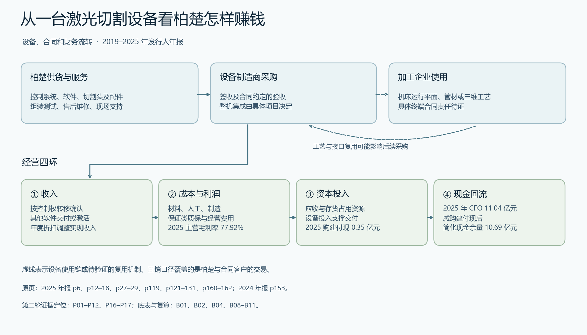
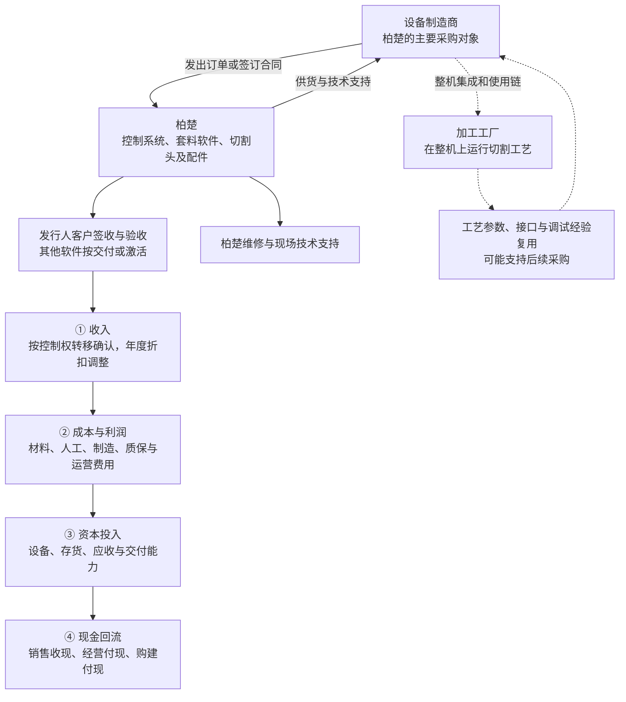

# 柏楚电子商业模式图

从一台设备开始。实线展示年报可定位的业务环节和财务连接。虚线标出终端使用与采购复用的研究路径。

查看可编辑流程

| 四环 | 运行机制和证据 | 替代解释或待观察项 |
| --- | --- | --- |
| 收入来源与驱动 | 柏楚向设备制造商提供控制和配套。嵌入式软件与切割头通常以签收和合同验收标准确认，年度折扣改变实现收入。2025 年平面贡献 59.67% 主营收入、62.45% 主营毛利额。2025 年报 p12–18、p27–29、p119、p160–162，B04、B08、P01–P10。 | 收入可随整机需求、搭配或折扣变化。按买方角色的收入待拆。 |
| 成本结构与驱动 | 部件及产品组合形成营业成本。柏楚还负担研发、销售、维修和现场支持等资源。保证类质保按重述口径进入成本。2024 年报 p153，2025 年报 p14、p26–30、p126，B02、B04、B06、P04、P12、P14。 | 部件结转、现场服务或规格组合均可能改变组内毛利。单机全成本待证。 |
| 资本投入 | 生产前要备料，交付后有应收。购建付现和应收存货账面额可以从合并报表核验。2025 年报 p121–122、p129–131、p188，B09–B11。 | 备货、验收等待或销售节奏都可能推高余额。购建的维持与扩张拆分留缺。 |
| 利润到现金 | 2025 年集团 CFO 11.04 亿元，扣当年购建付现后余量 10.69 亿元。利润到 CFO 的间接法对照应收、存货及应付调节。2025 年报 p125–131、p229–230，B01、B09。 | 现金可能受年度付款和购建时点影响。简化余量是合并现金算术，逐方案现金回收待证。 |

[渠道与交付细节](渠道与交付.md) · [年报原文定位](年报原文定位.csv) · [数值复算与底表](经营桥.md)
