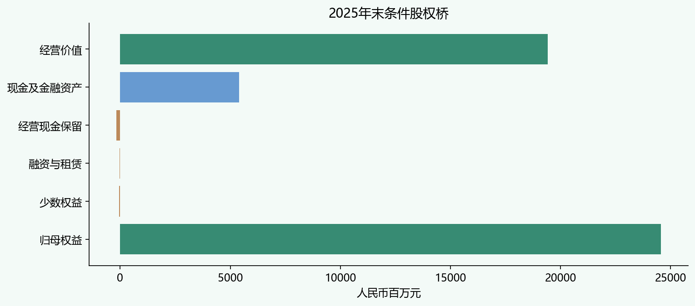
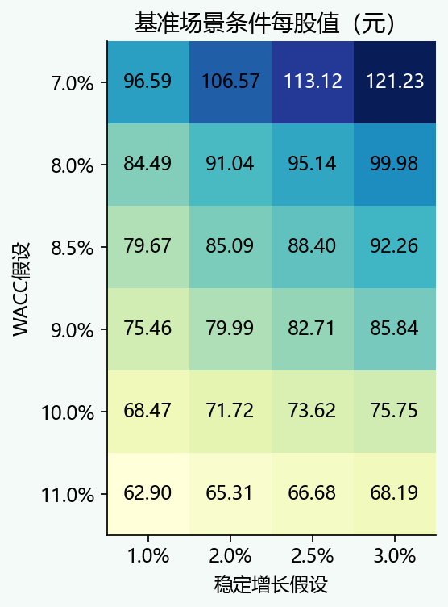
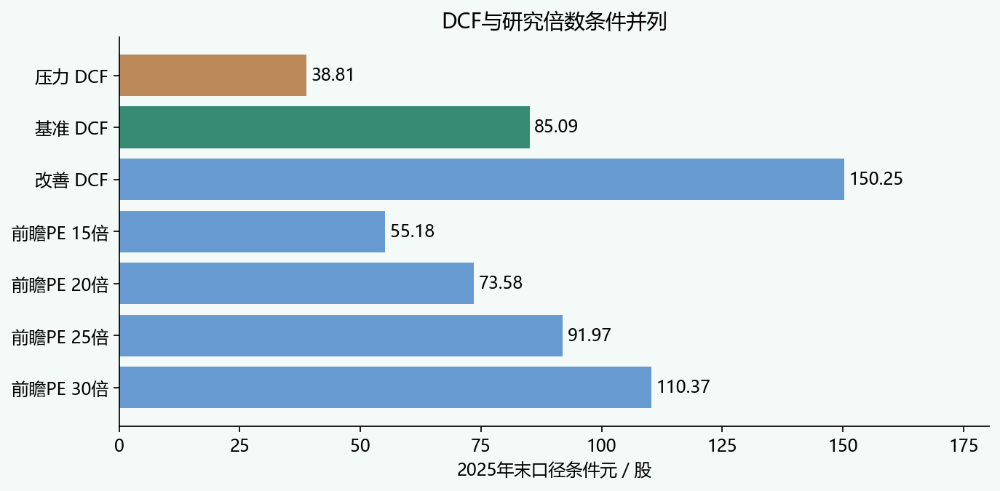

# 条件现金流能支撑怎样的价值

**这套盈利和再投资路径，在怎样的必要回报下成立？** 以下DCF均为2025年末条件价值，使用2026年4月10日可获年报。年末折现，十年FCFF形成显性价值，2036年现金流形成终值。估值单位为人民币百万元，每股值以2025年末288.73百万股计算。

| 情景 | 显性期现值 | 终值现值 | 终值占经营价值 | 股权桥 | 每股条件值 |
| --- | --- | --- | --- | --- | --- |
| 压力 | 3,689.65 | 2,359.22 | 39.0% | 5,155.81 | 38.81 |
| 基准 | 8,162.46 | 11,248.54 | 57.9% | 5,155.81 | 85.09 |
| 改善 | 12,409.34 | 25,816.80 | 67.5% | 5,155.81 | 150.25 |

WACC采用E/(D+E)×(Rf＋β×ERP)＋D/(D+E)×Kd×(1−税率)。缺少年报范围内可核的市场风险溢价、无风险利率、β和市场权重，本轮WACC为研究条件。可供研究的Rf区间2%–3%、β0.9–1.3、ERP5%–7%、Kd3%–5%及债务权重0%–5%均是假设，不是行情观察。三情景7.5%–10%与7%–11%敏感性展示所需回报变化。

终值FCFF=2036 NOPAT×(1−g/新增ROIC)，终值=FCFF/(WACC−g)。g低于WACC，新增ROIC高于g。2035各组增速收敛到g，毛利和费率已稳定，末段再投资与ΔNOPAT/ROIC相接。稳定期不再依赖低购建的现金释放。资本回报敏感性只改变终值新增回报，显性路径保持，其用途是识别终值的独立依赖。

| 项目 | 2025年末百万元 | 口径与来源 |
| --- | --- | --- |
| 现金等价物 | 2,133.20 | p230–231，剔除冻结保证金0.0046 |
| 交易性及其他非流动金融资产、长期股权投资 | 3,277.93 | p121–122，账面值作为条件加回；处置税、折价和非上市投资估值缺项 |
| 经营现金保留 | -175.65 | 收入的8%，假设；不进入非现金营运资本 |
| 短借、租赁和票据融资 | -37.41 | p122–123、216–218，票据14.35百万元按融资负担处理 |
| 少数股东权益 | -42.26 | p123账面值代理，公允价值未知 |
| 年末股份（百万股） | 288.73 | p219股份总数288,729,927；本轮不混用期后股数 |

*2025年末基准经营价值到归母权益的条件桥；人民币百万元；原页见输入原格和补充来源*

应看经营资产与金融资产的分开计量。金融资产加回对应核心现金流剥离利息、投资和公允价值收益。长期股权按减值后账面加回，未来估值或处置税可能使其偏离账面。少数权益也用账面代理，公允价值待证。这些条件会影响每股数，仍须在进入买入评估时补证。

*基准DCF的WACC与g敏感性；假设元／股；折现与增长敏感性.csv*

终值在基准经营价值中占57.9%，因此长期现金假设有很大影响。利润率与回款延迟联合网格另见利润现金联合阈值.csv；购建和经营现金保留网格检验维护投入及现金储备。图册可同时调整WACC、g、组内毛利偏移、应收天数与前段购建倍率，表中会重算FCFF和每股值。最后三年的资本开支仍遵循新增回报约束，倍率用于前段并逐渐退坡。

*同一财务起点下DCF与前瞻PE研究条件；元／股；倍数条件不是历史市场带*

| 假设元／股 | FY2025 PE | 2026E PE | PB | PS | PEG | EV/核心EBIT |
| --- | --- | --- | --- | --- | --- | --- |
| 40.00 | 10.38 | 10.87 | 1.90 | 5.26 | 2.29 | 6.15 |
| 60.00 | 15.57 | 16.31 | 2.85 | 7.89 | 3.44 | 11.71 |
| 80.00 | 20.76 | 21.75 | 3.81 | 10.52 | 4.59 | 17.27 |
| 100.00 | 25.95 | 27.18 | 4.76 | 13.15 | 5.74 | 22.83 |
| 120.00 | 31.14 | 32.62 | 5.71 | 15.78 | 6.88 | 28.39 |
| 85.09 | 22.08 | 23.13 | 4.05 | 11.19 | 4.88 | 18.69 |

PE的TTM仅指2025年末向前十二个月，即FY2025归母利润；它不代表2026年11月的最新TTM。前瞻PE用2026同版完整归母利润，包含按年末可投金融资产1.5%收益率、3.5%债务成本和2%少数损益比例的条件。DCF核心利润不含这些金融收益，金融资产已在权益桥加回。PB用年末归母权益，FY2025归母利润除年末权益约18.33%，平均权益ROE另需前期权益口径。PS以合并收入为分母，不能忽略其他主营毛利低于平面的结构。EV/核心EBIT用市值减现金、减金融资产、加经营现金保留和债务及少数权益，匹配剥离金融收益的核心利润。

PEG=2026前瞻PE÷2025–2028固定股数EPS复合增速的百分数。增速非正时留缺，不能给负PEG排序。基准EPS的2025–2028复合增速约4.74%，因此基准DCF隐含2026PE约23.13倍时，PEG约4.88。这个结果提示远期增长与现金回报对估值的重要性，也暴露短窗口盈利增速较慢的反方。研究条件15、20、25、30倍前瞻PE仅是比较网格。20倍在约5%盈利收益率下仍要留出增长投入，持续性和ROIC能否支撑该回报需经营证据。没有可核价格、同行财报和倍数时，不能称它为市场合理区间。

方法分歧先查盈利分母，再查净现金和金融资产、增长、再投资、折现与终值。PE资本化完整利润，可能把暂时金融收益和补助当持续盈利。DCF核心基准剥离全部其他收益，又要求增长投入。它的优势是显式约束现金，弱点是远期参数依赖。两者并列用于检验假设，缺少市场输入时没有形成实际高估低估判断。

旧81.81元属于2026年11月12日信息窗口的冻结模型，原资料含2026三季报、期后权益桥及405,984,426股。旧96.20元是该窗口行情，旧WACC6.9274%来自原研究估计，平台倍数来自旧行情资料，均不进入本轮。新版以2025年末资产、288,729,927股及分场景增长建立十年路径。若只固定新权益总值、把分母换为旧股数，得到60.51元，这只是分母算术隔离，不能当窗口可比价格。实际窗口桥还缺截至旧估值日的分红、资本变动、期中现金流与原市场输入复核。

缺少年末市场收盘、当日经济股数及权利、日度或月度历史价格、同日同行报表与公司行为调整，历史市场估值带及同日价格比较留缺。假设价格网格的倍数可复算，公司长期价值判断仍要回到经营兑现。
