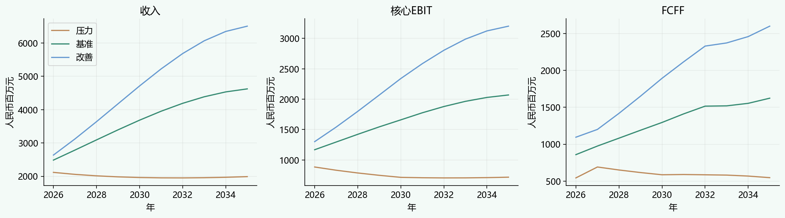
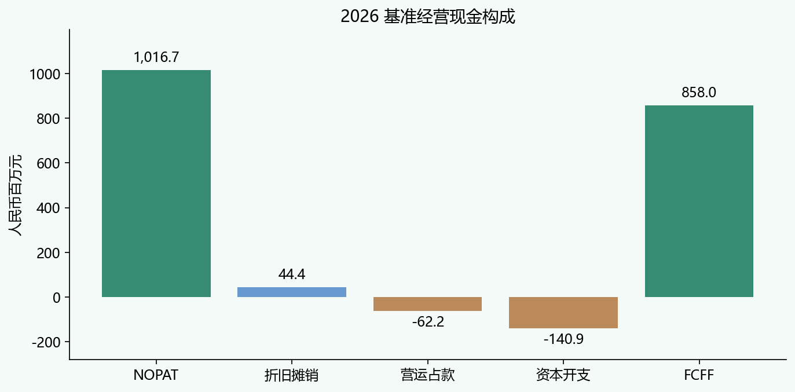

# 预测怎样从历史走向现金

**未来十年的增长需要哪些盈利与投入条件？** 本轮以2025年末财务状态为条件起点，显性期2026–2035年，2036年起稳定期。2025年报于2026年4月10日可得，报告版本为2026年11月26日。因此数值是使用后来可获完整年报的回顾性条件测算。它不提供2025年末当时可交易的信息集。所有预测与市场价格网格均为研究假设。

先界定利润。核心EBIT保留产品收入、成本、税金及附加、销管研和信用损失。其他收益和金融收益从核心移出。2025年报p167说明软件增值税即征即退政策，p224列出政府补助和其他收益。现金流中税费返还99.29百万元与当期其他收益有确认和时点差异，不能相互替换。核心基准剥离全部其他收益，政策延续另提供可量化敏感性。

| 项目 | 2025百万元 | 采用方式 |
| --- | --- | --- |
| 核心EBIT | 1,038.81 | 收入−成本−销管研−税金及附加＋信用减值原符号 |
| 其他收益 | 124.19 | 政府补助121.90及其他税费项目；核心基准剥离，软件税返在敏感性讨论 |
| 财务费用 | −32.82 | 融资及现金利息、汇兑与手续费混合；整体从核心移出，手续费成本用信用及运营费率覆盖的条件需核 |
| 投资收益／公允价值 | 22.16／44.64 | 从核心剥离，金融资产与长期股权按账面另加；不在FCFF重复预测收益 |
| 资产减值及处置 | 按原表 | 长期股权减值17.26不重复外推；其他处置差额见输入原格 |
| 合并净利润／归母 | 1130.63／1112.55 | p126；完整利润与经营口径不同，预测另加条件金融收益并扣利息和2%少数损益 |

历史桥在2025年将核心EBIT1038.81百万元接到报表营业利润1245.12百万元，再扣非经营净支出和所得税，得到合并净利润1130.63百万元。减少数损益18.08百万元后，归母为1112.55百万元。逐项原格及符号见历史利润桥.csv。

| 参数 | 压力 | 基准 | 改善 | 锚点、推导及反证 |
| --- | --- | --- | --- | --- |
| 2026场景收入增长 | −8/2/8/3/0% | 10/16/25/20/6% | 16/23/35/30/8% | 依次平面、管材、三维、其他主营、其他业务。2024–25分类表p25及p27–28。基准比2025增速回落；订单、同规格净价及回款走弱则下修。 |
| 第五年起场景毛利率 | 77/78/78/45/45% | 80/83/82/51/50% | 83/86/85/55/55% | 从2025原值五年线性过渡。硬件搭配、折扣和材料成本改变则修订。 |
| 销售／管理／研发费率 | 7.5/7.5/18% | 6.3/6.8/15.5% | 6.0/6.3/14.5% | 2025利润表p126，原费率约6.23/7.09/15.55%。规模摊薄是条件，现场服务费用超支则上调。 |
| 现金经营税率 | 17% | 13% | 11% | p167母公司10%及不同子公司税率，仅为综合现金税代理；优惠到期或结构变化需重算。 |
| 应收／库存／应付天数 | 65/220/50 | 48/185/60 | 40/150/65 | 2025约45.48/186.07/59.29天，含应收账款、票据及融资，按收入、成本分别匹配；逾期和库龄恶化则上调。 |
| 折扣／货款余额率 | 4.5/0.6% | 2025余额率不变 | 5.2/1.0% | p213折扣114.11、货款18.28百万元。已净额预测收入，余额变动只进营运资本一次。 |
| 增长净固定资本 | Δ正收入÷2 | Δ正收入÷3 | Δ正收入÷4 | 多年购建及固定资产为锚，比例为研究假设；项目付现高于预算则下调销售资本效率。 |
| 终期ROIC／g／WACC | 12/1/10% | 20/2/8.5% | 28/2.5/7.5% | 全部为条件参数。ROIC超过WACC需持续优势支持；反方为标准化替代、净价或客户份额下滑。 |

税金及附加取净收入1.3%，信用损失取0.2%，按2025税附及信用减值附近规模设置。预付按2025成本比例2.754%保持，D&A按2025收入比例约1.787%保持。其他应付及税费的完整经营属性留缺。

宏石和嘉泰使采购条件成为更明确的预测观察点。工艺适配可能帮助留下订单，客户仍会比较候选、规格和折扣。本版分别把同规格净价、实际配套、现场服务、研发、回款和备货接到原有情景变量。只有增量毛利覆盖工程服务与资本占用，才有依据向改善路径移动。若留用更多依赖返利、延保或长账期，应向压力路径移动。新增案例尚未给出直接改变已审参数的定量证据，三情景模型保持原指纹。

各组收入按净实现收入预测，缺少可比分组量价时直接假设增长率。首年不同场景增长分别体现平面基座、管材与三维扩展、其他主营组合及其他业务。十年增长逐步向稳定增长收敛，避免把2025年的高增长无限延长。毛利率五年过渡，费用按收入计提。2023年新方案金额与实物同比缺口沿用已审处理。

*2026–2035三情景收入、核心EBIT和FCFF；人民币百万元；同版逐年模型*

应看收入与FCFF之间的距离。改善情景依赖较好的组内毛利、回款及资本效率。压力情景首年收入下降，仍按更长回款和更高存货天数准备营运资金。集团控制与硬件量只验证规模及结构，未用于虚构配套率或分组净价。

非现金经营资本定义为应收账款、票据及融资、预付款和存货，减应付账款、折扣与货款余额。预付按成本比例，应收按收入天数，存货和应付按成本天数。2025初始选定NWC为325.12百万元。税费及其他应收应付的经营归属仍不完整，经营现金保留与应收延迟敏感性用于检验遗漏影响，不能当完整历史实体资本核准。

收入已扣年度折扣，模型不再次从收入扣折扣。折扣负债按净收入目标比例变化并进入ΔNWC，模拟净确认与后续结算的时差；这要求折扣计量、净发票应收和结算口径一致。货款余额单列，两项均不是额外确认收入。实际结算与政策变化会改变这条代理路径。

现金税按正核心EBIT乘情景税率。D&A按2025合并折旧摊销占收入比例。前段资本开支等于D&A加正收入增量除销售资本效率，下降期仍保留维护投入。2033–2035逐步过渡到按ΔNOPAT/新增ROIC确定总再投资，再扣ΔNWC反推出净资本开支。租赁按资本化处理，D&A含使用权摊销，未来购建代理包含替换租赁资源所需投入，股权桥扣存量租赁义务。未来股份支付继续包含费用，股数假设固定，新增激励稀释需重算。

*2026基准FCFF构成；人民币百万元；NOPAT＋D&A−资本开支−ΔNWC*

基准首年收入2485.11百万元，完整归母利润1062.22百万元，低于2025年的1112.55百万元。剥离其他收益的保守路径与收入增长可以同时成立。完整归母预测的金融收益率1.5%、债务成本3.5%、少数损益占比2%均为研究假设。NOPAT1016.71百万元，FCFF858.04百万元。新增占款和购建消耗现金。2025购建35.20百万元没有机械延续到首年，首年基准购建为140.89百万元。购建翻倍与回款延迟检验另附表。

焊接和微加工沿2025年报p15–16、41的方向设独立投入条件。单独试算从其他主营既有收入中重分0、0、2至16百万元，使用25%毛利率替换该部分原组毛利，并额外承担前三年每年8百万元运营费、5百万元资本开支，其后每年3百万元运营费。总收入不追加，避免把新业务在其他主营和独立场景中重复计价。这组规模和成本是试探假设，尚无分业务披露原值。

历史留出使用“只延续上年收入增速”的简单规则，结果见历史留出.csv。它在2022压力期与随后恢复期明显偏离，说明高增速外推会漏掉周期和分类变化。这是原列的描述性检验，未用其误差为三种未来情景分配概率。

| 情景／年 | 收入 | 成本 | 销管研 | 核心EBIT | 税 | NOPAT | 折旧 | ΔNWC | 购建 | FCFF |
| --- | --- | --- | --- | --- | --- | --- | --- | --- | --- | --- |
| 压力/2026 | 2,116.73 | 502.10 | 698.52 | 884.36 | 150.34 | 734.02 | 37.82 | 191.56 | 37.82 | 542.46 |
| 压力/2027 | 2,057.10 | 516.20 | 678.84 | 831.20 | 141.30 | 689.89 | 36.75 | -0.62 | 36.75 | 690.51 |
| 压力/2028 | 2,013.29 | 532.62 | 664.38 | 786.08 | 133.63 | 652.45 | 35.97 | 2.53 | 35.97 | 649.91 |
| 压力/2029 | 1,982.62 | 551.18 | 654.26 | 747.44 | 127.06 | 620.37 | 35.42 | 5.25 | 35.42 | 615.12 |
| 压力/2030 | 1,963.02 | 571.71 | 647.79 | 714.06 | 121.39 | 592.67 | 35.07 | 7.64 | 35.07 | 585.03 |
| 压力/2031 | 1,952.91 | 571.54 | 644.46 | 707.62 | 120.30 | 587.32 | 34.89 | -1.37 | 34.89 | 588.69 |
| 压力/2032 | 1,951.15 | 573.08 | 643.88 | 704.92 | 119.84 | 585.09 | 34.86 | 0.54 | 34.86 | 584.55 |
| 压力/2033 | 1,956.93 | 576.15 | 645.79 | 705.64 | 119.96 | 585.68 | 34.96 | 2.24 | 37.80 | 580.60 |
| 压力/2034 | 1,969.76 | 580.61 | 650.02 | 709.59 | 120.63 | 588.96 | 35.19 | 3.83 | 52.96 | 567.36 |
| 压力/2035 | 1,989.46 | 586.41 | 656.52 | 716.68 | 121.84 | 594.85 | 35.54 | 5.37 | 79.25 | 545.77 |
| 基准/2026 | 2,485.11 | 568.45 | 710.74 | 1,168.64 | 151.92 | 1,016.71 | 44.40 | 62.18 | 140.89 | 858.04 |
| 基准/2027 | 2,785.63 | 651.58 | 796.69 | 1,295.57 | 168.42 | 1,127.15 | 49.77 | 52.16 | 149.94 | 974.81 |
| 基准/2028 | 3,090.77 | 738.32 | 883.96 | 1,422.13 | 184.88 | 1,237.25 | 55.22 | 53.82 | 156.93 | 1,081.71 |
| 基准/2029 | 3,392.77 | 826.59 | 970.33 | 1,544.96 | 200.84 | 1,344.12 | 60.61 | 54.16 | 161.28 | 1,189.29 |
| 基准/2030 | 3,682.73 | 913.84 | 1,053.26 | 1,660.39 | 215.85 | 1,444.54 | 65.79 | 52.93 | 162.45 | 1,294.96 |
| 基准/2031 | 3,951.05 | 984.94 | 1,130.00 | 1,776.84 | 230.99 | 1,545.85 | 70.59 | 45.42 | 160.03 | 1,411.00 |
| 基准/2032 | 4,187.90 | 1,047.68 | 1,197.74 | 1,879.66 | 244.36 | 1,635.31 | 74.82 | 40.08 | 153.77 | 1,516.28 |
| 基准/2033 | 4,383.82 | 1,099.33 | 1,253.77 | 1,964.96 | 255.45 | 1,709.52 | 78.32 | 33.06 | 234.52 | 1,520.25 |
| 基准/2034 | 4,530.44 | 1,137.48 | 1,295.70 | 2,029.29 | 263.81 | 1,765.48 | 80.94 | 24.56 | 267.41 | 1,554.46 |
| 基准/2035 | 4,621.04 | 1,160.23 | 1,321.62 | 2,069.88 | 269.08 | 1,800.79 | 82.56 | 14.87 | 244.24 | 1,624.25 |
| 改善/2026 | 2,636.01 | 588.39 | 706.45 | 1,301.63 | 143.18 | 1,158.45 | 47.09 | -46.45 | 157.19 | 1,094.80 |
| 改善/2027 | 3,120.04 | 695.23 | 836.17 | 1,541.83 | 169.60 | 1,372.23 | 55.74 | 50.86 | 176.75 | 1,200.37 |
| 改善/2028 | 3,637.64 | 808.29 | 974.89 | 1,799.89 | 197.99 | 1,601.90 | 64.99 | 54.07 | 194.39 | 1,418.43 |
| 改善/2029 | 4,173.92 | 923.61 | 1,118.61 | 2,069.09 | 227.60 | 1,841.49 | 74.57 | 55.55 | 208.64 | 1,651.86 |
| 改善/2030 | 4,709.27 | 1,036.13 | 1,262.09 | 2,340.42 | 257.45 | 2,082.97 | 84.13 | 54.78 | 217.97 | 1,894.35 |
| 改善/2031 | 5,220.09 | 1,157.51 | 1,398.98 | 2,585.29 | 284.38 | 2,300.91 | 93.26 | 55.92 | 220.96 | 2,117.29 |
| 改善/2032 | 5,680.18 | 1,267.17 | 1,522.29 | 2,805.52 | 308.61 | 2,496.91 | 101.48 | 50.45 | 216.50 | 2,331.44 |
| 改善/2033 | 6,062.86 | 1,358.17 | 1,624.85 | 2,988.90 | 328.78 | 2,660.12 | 108.32 | 41.91 | 352.42 | 2,374.11 |
| 改善/2034 | 6,343.45 | 1,424.06 | 1,700.04 | 3,124.19 | 343.66 | 2,780.53 | 113.33 | 30.51 | 403.06 | 2,460.29 |
| 改善/2035 | 6,502.03 | 1,459.67 | 1,742.54 | 3,202.29 | 352.25 | 2,850.04 | 116.16 | 16.82 | 347.60 | 2,601.78 |

逐年现金明确后，下一章才能把经营价值、非经营资产和股东归属放在同一个2025年末口径内。
